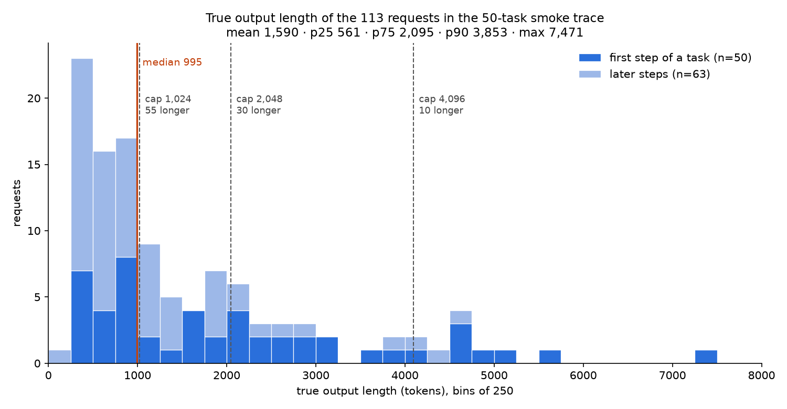
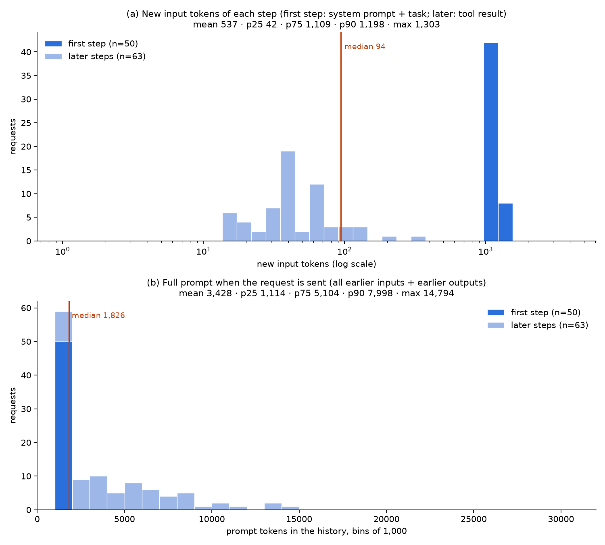

# Phase 2 experiments: lab log

Everything done after Phase 1, in order, with what was planned, what ran, what failed and why each next step was
chosen. Each study has its own README with full method and numbers; this file is the narrative that ties them
together. Nothing here has been run on the 500-task workload yet: every result is from the 50-task smoke trace and
one run per configuration, unless stated.

## Studies and experiments

| ID | Name | Question | Folder | Status |
|---|---|---|---|---|
| A | Solo task latency | How long does each task take alone? (SLO ground truth) | [`solo_SLO/`](solo_SLO/README.md) | done (50 tasks × 3 reps) |
| B | Swap / recompute cost models | What does moving or rebuilding a request's KV cost under FIFO N4? | [`../swap_vs_stay_vs_recompute/`](../swap_vs_stay_vs_recompute/README.md) | done |
| Exp 1 | KV policy, requeue at back | Does a stay / swap / discard choice at each tool call help FIFO N4? | [`kv_policy/`](kv_policy/README.md) | smoke done: no gain |
| Exp 2 | KV policy, returning requests first | Same, with returning steps dispatched ahead once their KV fits | [`kv_policy/`](kv_policy/README.md) | smoke done: 50/50 completed, slower |
| Exp 3 | FastServe-style MLFQ | Does a skip-join multi-level feedback queue beat FIFO N4? | [`mlfq_fastserve/`](mlfq_fastserve/README.md) | smoke done: worse |
| Exp 4 | Memory-aware admission, max-count backfill, no concurrency cap, fixed output caps | Does admitting as many requests as fit beat FIFO N4? | [`mem_admission/`](mem_admission/README.md) | smoke done: oracle-informed runs (section 15) −28 to −58% median latency; **true fixed-cap runs (section 16): 50/50, 0 overflows, but median latency +14 to +42% and throughput −5 to −10% vs FIFO N4** |
| Exp 5 (E5a, E5b) | Exp 4 fixed cap 2,048 + starvation guard (60 s / 120 s) | Does a starvation guard fix Exp 4's tail? | [`mem_admission/`](mem_admission/README.md) | smoke done: longest request wait 580 → 232 / 242 s, but task p95 695 → 732 / 735 s and throughput −3 to −4%; guard fires for 50–65% of requests under overload |
| LTR-0 | Published Learning-to-Rank predictor (OPT-125M, ShareGPT/Llama-3-8B), zero-shot | How well does it predict / rank our 113 requests' output lengths? | [`ltr_ranking/`](ltr_ranking/README.md) | done: τ 0.24–0.27; with any fitted factor MAE 919–955 vs 978 tokens for a constant. With real earlier outputs (replay, section 20): τ ≤ 0.30, best MAE 925 vs 980 |
| Exp 6 (E6) | Exp 4 cap 2,048 + class × step length ranking (τ ≈ 0.33) | Does a weak but real length ranking help? | [`mem_admission/`](mem_admission/README.md) | smoke done: **p50 257 → 181 s (below FIFO N4's 225), 68% within 10× of solo (best realistic)**, but p95 695 → 747 s, −4% throughput; mbpp first steps pay. **500 tasks (section 24): 500/500 vs 480/500, p50 2,874 → 1,277 s, p95 4,768 → 6,111 s, −8% throughput** |
| Online-length | Online output-length estimation (no future data) | How fast does τ improve as history is gathered? | [`online_length/`](online_length/README.md) | done (offline replay): τ 0.31–0.34 after ~150–200 completions, then flat |
| Exp 7 (E7a, E7b) | Exp 4 cap 2,048 + order by an output-length estimator learned online (median / model), 500 tasks | Does a leak-free, self-learned ranking match or beat the offline lookup (E6)? | [`mem_admission/`](mem_admission/README.md) | done: E7a p50 1,773 s, τ 0.26; E7b p50 1,523 s, τ 0.32 (E6: 1,277 s, 0.33) |
| Exp 8 (T = 120 / 240 / 600 s) | E7b + Exp 5 fixed starvation guard, 500 tasks | Does a fixed per-request wait bound fix E7b's tail without losing its median? | [`mem_admission/`](mem_admission/README.md) | done: no at any T; guard collapses to FIFO (77–92% starving), p50 1,523 → ~3,300 s, p95 6,136 → ~5,600–5,750 s, max wait 7,402 → ~2,650 s; T=360 stopped |
| Exp 10 (α = 0.5, FIFO ×2) | Split KV pool: E7b order in partition P, ready-time FIFO (≤ 2 in flight, strict) in partition F; oversized requests fail; 500 tasks | Can a FIFO share bound the tail while the E7b share keeps the median? | [`mem_admission/`](mem_admission/README.md) | stopped by user at 220 / ~1,403 requests (slow, ~5.7 req/min vs E7b ~10.5); no result |
| Exp 10b (α = 0.5, memory-aware FCFS) | As Exp 10 but partition F is memory-aware FCFS with no concurrency limit (strict, ready-time order); oversized requests fail; 500 tasks | Does filling F's half fix Exp 10's idle memory and bound the tail? | [`mem_admission/`](mem_admission/README.md) | done, invalid: 496/500, p50 5,243 s, p95 12,125 s, 2.0 tasks/min; P deadlocked for 164 min because the deadlock breaker was not partition-aware; rerun as E10c pending |
| Exp 10c (α = 0.5, per-partition deadlock breaker) | E10b plus a per-partition deadlock breaker (`--split-breaker partition`); smoke first | Does the split help once P can no longer freeze? | [`mem_admission/`](mem_admission/README.md) | smoke done: 48/50 (2 oversized), p50 198 s, p95 697 s, 2.88 tasks/min; no partition freeze; 500-task done: 496/500, p50 2,242 s, p95 5,814 s, p99 7,190 s, 3.65 tasks/min; between E7b and E8, no p99 gain |
| Exp 11 (slot reuse) | E7b, but finished caches stay in their slot as leftovers; scheduler picks the slot with the longest shared prefix; LRU leftovers erased only when the pool would overflow; smoke + E7b control on the rebuilt binary | Does reusing slot caches (as FIFO N4 does via cache_prompt) cut prefill and latency? | [`mem_admission/`](mem_admission/README.md) | smoke done: 50/50, reuse 57.6% vs 35.8%, p50 219 vs 227 s, p95 713 vs 825 s; slot-choice flaw: only 9 of 32 slots used, 50/63 returning steps lost their own slot to another task (corrected from 54) |
| Exp 11b (own-first slot order) | E11 with slot order own leftover > finished task's leftover > empty > LRU live leftover | Does protecting live tasks' histories raise reuse? | [`mem_admission/`](mem_admission/README.md) | smoke done: 50/50, reuse 57.1% (no gain), p50/p95 233/679 s; own-slot reuse 4→11, but the memory guard erased 52/63 returning steps' histories: cap reservations leave ~3.6K cells for leftovers |
| Exp 11c (finished-first guard) | E11b + memory guard erases finished tasks' leftovers first | Does protecting live histories in the guard raise reuse? | [`mem_admission/`](mem_admission/README.md) | smoke done: 50/50, reuse 45.7%, p50/p95 223/764 s, no gain; only 6/65 erases hit finished leftovers; histories survive only if the task returns within seconds |
| Exp 12 (≤ 4 running) | E11b + at most 4 requests running at once, 500 tasks | Does matching FIFO N4's concurrency recover decode speed? | [`mem_admission/`](mem_admission/README.md) | done: 500/500 but p50/p95/p99 2,750/7,193/7,786 s, 3.47 tasks/min (worse than E11b); prefill 1.09 M (lowest), own-slot hits 386/568; leftovers keep KV at 65%, TPOT 20.7 ms: idle cells slow decode |
| Exp 13 ("beat FIFO N4") | -np 4, memory-aware admission, order by task arrival + K·min(pred, 2,048), own-first slot reuse; K chosen on smokes (K=0) | Can a memory-aware scheduler beat FIFO N4 on every metric? | [`mem_admission/`](mem_admission/README.md) | 500 tasks: wins completion (496 vs 480), p50, p99, max; loses p95 (+1.6%), mean (+3.9%), tasks/min (−6.4%); 4 failures from a guard bug (§33) |
| SLO benchmark, 500 tasks (FIFO N4 vs E11b, 3 runs each) | Same seed ×3 per system, interleaved; solo base 500 tasks × 3 reps, retain mode; slowdown = completion / solo | Per-task SLO attainment and segregations, averaged over runs | [`mem_admission/`](mem_admission/README.md) | E11b wins: SLO 100× 63.1 vs 33.9%, slowdown p50 56 vs 153×, 324/500 tasks better, 500 vs 477 completed; every segment except 1-step tasks. FIFO N4 wins p95/p99 latency (−19%/−18%) and tasks/min (4.1 vs 3.9) (§34) |
| Exp 11b, 500 tasks | E11b on the full 500-task set | Does slot reuse help at scale? | [`mem_admission/`](mem_admission/README.md) | done: 500/500, p50/p95/p99 1,604/5,958/7,003 s (E7b 1,523/6,136/7,134; FIFO N4 2,874/4,768/5,553), 3.85 tasks/min, prefill −18%; only 18/568 histories survived tool calls |
| C | Idle-KV microbenchmark | Do idle cells in the unified pool slow other requests' decoding? | [`idle_kv_microbench/`](idle_kv_microbench/README.md) | done: yes, ~0.45 ms per 1K cells of occupied range |

## Shared setup and assumptions

- **Hardware and runtime:** one NVIDIA T4 (16 GB, PCIe Gen3 ×8 as reported by `nvidia-smi`) on an AWS EC2
  instance; llama.cpp b11780 with the Phase 1 read-only KV-occupancy patch (`runtime/`).
- **Server settings (Phase 1):** Qwen3-0.6B Q8_0, f16 KV, unified pool (`-kvu`) of 32,768 cells, `--cache-ram 0`,
  no mmap, prompt reuse on, default batching (`-b 2048 -ub 512`, continuous batching on). Phase 1 baselines use
  `-np 4`; every Phase 2 scheduler uses `-np 16` so idle tasks can keep a slot while 4 requests run.
- **Workload:** `data/traces/agenttrace_50_seed2.jsonl` (50 tasks, 35 MBPP / 15 NL2Bash, 113 requests, 63 tool
  waits). Load tests use Poisson arrivals with mean 5 s and seed 2, so every scheduler sees the same task order and
  arrival times as the Phase 1 R2-style smoke run. This offers 12 tasks/min against ~3 tasks/min of capacity: it is
  an overloaded setting, so it measures completion and throughput, not SLO attainment.
- **Replay, not execution:** greedy decoding with `ignore_eos`, each request generates exactly its recorded output
  budget, tool waits are sleeps of the recorded duration (150× scaled, ≤ 10 s). Tools are never run.
- **KV size:** 112 KiB per token (measured: 114,688 bytes per token moved by slot save).
- **"Mean KV use" / "occupancy"** in every table = the mean, over 1-second samples for the whole run (from just
  before the first arrival to the end, including the final drain), of the runtime's `kv_cells_used / 32,768`
  (`kv_memory.csv`, `harness/kv_memory.py`). It counts **all occupied cells**: running requests plus idle caches left
  in slots; shared cells count once. It is a count, not the occupied range that Study C shows sets decode speed.
- **Swap path:** llama.cpp slot save/restore into RAM-backed `/dev/shm`, the only GPU↔host path this runtime offers.
- **Tasks recorded from Qwen3-1.7B are kept.** The server always runs Qwen3-0.6B, and the two models share a
  tokenizer, so those trajectories replay identically.

## Chronological log

### 1. Framing (2026-11-13)

- **Dataset review.** Re-derived the Phase 1 dataset statistics from the trace files (task, request and token counts
  match `data/README.md`). Clarified two terms used later: a *step* is one model request in a task's agent loop
  (k steps = k requests and k − 1 tool waits), and a *distinct problem* is one benchmark question; AgentTrace has
  runs from two models per problem, and the 500-task sample keeps one run per problem.
- **Baseline choice.** The Phase 1 report names FIFO N4 (concurrency 4, 32K pool) as the baseline to beat
  (94.4–96.0% completion, 4.21–4.30 tasks/min on 500 tasks) and N1 as the zero-failure reference.
- **SLO proposal and critique.** The proposal was a per-step-count SLO (α × category time), minimizing the average
  difference to it, gated on ≥ 95% completion. Reasoning against parts of it, from data:
  - solo latency varies 2.5–15× within a step-count category, and step count explains only 47% of its variance
    while output tokens plus tool time explain 98.8%, so the SLO should be per task (α × that task's solo latency);
  - a signed average difference lets early finishes cancel misses; use SLO attainment (failed tasks count as
    misses), normalized lateness, slowdown and goodput instead;
  - N4's own completion sits at the 95% threshold, so the gate needs repeated runs or a relative threshold.
- **Overload argument.** The user objected that queueing is the scheduler's fault. The counter-argument, with
  numbers: the 500 tasks need 1,591,939 output tokens; the best sustained rate seen on this T4 is ~230 tokens/s, so
  any schedule needs ≥ 115 min, while Poisson 5 s delivers all tasks in ~42 min. Even shortest-job-first at full
  speed under burst arrival finishes the 250th task at ~24 min. Estimated slowdowns of the Phase 1 runs against a
  fitted solo-latency model were 133–214× at the median. Conclusion: at these rates, latency is mostly backlog;
  SLO comparisons need sub-capacity loads (~2.5–3.8 tasks/min). This shaped every later caveat.
- **Runtime facts checked.** Prompt caching is on everywhere; in Phase 1, first requests reused ~92% of their
  prompt (the shared ~1,048-token system prompt left in a slot) but later steps reused only 25–28%, because under
  load the slot was overwritten during the tool wait. llama.cpp's default batching splits prompts into 2,048-token
  logical batches and 512-token micro-batches; attention over chunked prefill is exact, and decode tokens of other
  requests share each step.

### 2. Study A: solo task latency (2026-11-13)

- **Plan changes.** First request: all 500 tasks × ~10 reps. Estimated from R1 at ~3.3 h per pass, i.e. ~66 h for
  two KV modes, so the user cut it to 3 reps, then to a smoke test on the 50-task set only.
- **Misstep 1:** the user asked to use only Qwen3-0.6B. I read this as dropping tasks recorded from Qwen3-1.7B,
  stopped the first launch, and found the 50-task set has only 28 such tasks; I switched to the first 50 0.6B tasks of
  the 500-task file. The user clarified that the server already runs only 0.6B and both models share a tokenizer, so
  the filter was unnecessary. The filtered launch had been killed by an interrupted tool call before finishing any
  task; I removed its output and restarted on the original 50-task set. The filter remains as `--source-model`
  (default `all`).
- **Result:** 300/300 task-runs completed. Median 15.7 s, p95 116.7 s; per-task variation ~0.2% between reps.
  Evicting KV during tool waits costs a median +2.3% per multi-step task when alone (max +12%).
- **Caveat found later:** every task-run starts from an erased pool, so the shared system prompt is recomputed each
  time; Phase 1 usually reused it. Solo latency is slightly pessimistic (a few hundred ms per task).

### 3. Study B: swap and recompute cost models (2026-11-17)

- **Goal (user):** fit swap time `a·L + b` (GPU→CPU and CPU→GPU) and recompute time `c + d·L + e·L²` for a
  stay / swap / discard scheduler, using the 50-task set.
- **Misstep 2:** I first wrote a measurement of isolated requests (one at a time). The user interrupted: the models
  must be fitted under FIFO N4 load, treating the 113 requests as independent jobs, with no tool waits. The
  interrupted run had already written slot files to `/dev/shm` (one of 918 MB), which confirmed that slot save works;
  I deleted them.
- **Crash:** the first full run died before measuring anything: the warm-up pass used repetition −1, and NumPy
  rejects a negative seed. Fixed (warm-up uses 999) and rerun (~60 min).
- **Clarified definition:** swap L = tokens in the slot (prompt + generated − 1, the last sampled token is never
  cached); recompute L = prompt tokens prefilled.
- **Result (L-only forms):** swap out `0.1856·L + 351.6` ms, swap in `0.1146·L + 230.5` ms, recompute
  `−34.5 + 0.4840·L − 1.054e−5·L²` ms; R² 0.53–0.80, mean error 29–41%. 36 of 339 requests (11%) failed on
  context size and were excluded. 301 of 303 restores were fully reused.
- **Surprises:** recompute under N4 is 4–5× slower per token than alone (0.41 vs 0.09 ms/token) and concave
  (`e < 0`); swap through llama.cpp reaches only 0.6 / 1.0 GB/s against ~7.9 GB/s of PCIe.
- **User: "the mean error is quite large."** Diagnosis: the same request varies 16–25% between repetitions, so
  L alone cannot do better. Testing features showed:
  - splitting prompt (prefilled, contiguous) and generated (scattered) tokens explains swap out: 0.42 vs 0.14 ms
    per token, R² 0.60 → 0.83, mean error 33% → 19%; contention adds nothing for swap;
  - swap in improves less (41% → 35%), probably because free-cell fragmentation at restore time matters (not logged);
  - contention features (requests decoding/prefilling during the prefill, their context) bring recompute from 31%
    to 26%.
  These "split length" and "contention" models are what Exp 1–3 use.

### 4. Exp 1 and Exp 2: KV policy on FIFO N4 (2026-11-17)

- **Design.** At each tool call: stay if a slot is spare, expected idle time ≤ 30 s and the pool keeps room for the
  next queued requests; otherwise swap if predicted cheaper than recompute, else discard. Exp 1 requeues returning
  steps at the back (as Phase 1); Exp 2 puts them ahead of new tasks and dispatches them once their KV fits.
- **Checks before the smoke run:** a forced-swap run and a policy run on 6 tasks; restores were reused, stays kept
  their slot. Some requests reused only part of their own cache (e.g. 1,514 of 2,440 tokens) even after staying, so
  it is not a restore bug; the Phase 1 harness has the same behavior.
- **Small failures:** the comparison table needed `tabulate` (not installed; replaced with a plain writer); the
  Phase 1 reference path for the smoke run was wrong (`part_a` instead of `part_b`; fixed).
- **Result (50 tasks):** the baseline rerun reproduced the Phase 1 recorded run (46/50, 3.3 tasks/min, p50 225 vs
  222 s). Exp 1: 46/50, 3.1 tasks/min, p50 268 s: no gain, because with the returning step at the back of a long
  queue the expected idle time exceeds 30 s (all 47 rejected stays), and the failures come from four large requests
  running together. Exp 2: **50/50**, 0 failures, but 3.0 tasks/min (−8%) and p50 322 s (+43%): returning steps wait
  at the head for space while workers idle.
- **Side cost found:** policy runs erase a slot when its task ends, so new tasks lose the shared system prompt
  (first-token time 56 ms → ~600 ms).
- **Instance shutdown request.** The user asked to stop the EC2 instance after the runs. I could not verify that its
  shutdown behavior is Stop rather than Terminate (no AWS credentials on the box), and terminate would delete all
  uncommitted results, so I asked; the user chose to stop it themselves.

### 5. Token round-trip check (2026-11-17)

- A full request returned 1,336 token IDs for 1,337 generated. The "missing" token is the last sampled token, which
  llama.cpp never writes to the cache; the returned IDs match the cached sequence exactly, so resuming with
  `history + returned tokens` is correct.
- Two identical greedy requests diverged after 34 tokens (GPU numerical nondeterminism). With fixed output lengths
  this does not affect timing.
- Still unexplained: some resumes reuse less than the full cache (e.g. 2,335 of 2,423 tokens). Logged per request;
  it affects all schedulers alike.

### 6. Exp 3: FastServe-style MLFQ (2026-11-18)

- **Design.** Skip-join MLFQ with quanta 256 → 4,096 tokens plus an unlimited level; jobs run in 256-token chunks
  (llama.cpp cannot be preempted from outside, so preemption happens between chunks); idle KV stays in its slot and
  is evicted (swap or discard by the cost models) only when a dispatch doesn't fit. Kept in its own folder at the
  user's request.
- **Concern raised mid-run:** "taking more time than previous runs means the approach is bad?" Answer: run length
  is bounded by total work ÷ throughput; MLFQ is judged on median latency and slowdown, and it is bad only if
  throughput drops or median latency does not improve. (At that moment the run had been going for 1.5 min.)
- **Live observation during the run:** KV use 89–91% and ~23 ms per token, against 16 ms in the baseline.
- **Result (50 tasks):** worse on every headline metric: 46/50, 2.19 tasks/min (−35%), p50 408 s, p95 1,012 s,
  lower SLO attainment at every α. Diagnosis: (1) keeping every idle cache raised mean KV use to 80%, and time per
  token rose with it (16.3 → 23.0 ms); (2) 62 discards plus partial reuse recomputed 230K prompt tokens; (3) per-
  request priority resets at each tool call, so one-step tasks with long answers waited longest (median 482 vs
  134 s); (4) 4 context failures remained even with the fit check (possibly fragmentation, not verified).

### 7. Brainstorm and Study C: idle-KV microbenchmark (2026-11-18)

- **Observation behind it:** across the baseline, Exp 2 and Exp 3, time per token rose with mean KV use
  (50% → 16.3 ms, 57% → 19.8 ms, 80% → 23.0 ms). If idle cells slow other requests' attention, idle-KV
  management is about speed as well as memory, which changes how a scheduler should treat stay vs evict.
- **Ideas ranked** (full list in the chat brainstorm, kept here for the paper): memory-aware admission with a higher
  concurrency cap and backfill; capping idle KV; retry instead of fail on context errors; keeping the system-prompt
  prefix warm; task-level shortest-remaining-work-first with aging; smaller prefill chunks; sub-capacity loads.
  Study C runs first because its answer decides whether capping idle KV is worth anything.
- **Run:** 36 configurations (order × 1 or 4 active requests × 1K or 4K context × 0–24K idle cells) × 3 reps,
  108 measurements, 0 errors, ~30 min. Early numbers already showed a 3× slowdown; a follow-up (15 measurements)
  was added to separate the number of occupied cells from how far they reach into the pool.
- **Result:** decode time per token rises linearly by **~0.45 ms per 1K occupied cells** (R² 1.000 for one request,
  0.998 for four), idle or not: 24K idle cells make one request 3.0× slower and cut 4-request throughput by 57%.
  The cost follows the **highest occupied cell, not the count**: 5,120 cells cost 7.4 ms/token when low in the
  pool and 16.4 ms (same as a full pool) when one idle cache sits at the top.
- **Confound found and documented:** with 4 active requests in the idle-first order, their own prefills fall inside
  the timed window and inflate per-token time (15.3 → 21.0 ms for 4 × 4K); the active-first order is the clean one.
- **Consequences:** this explains most of experiment 3's slowdown; "stay" has a speed cost (derived break-even:
  staying with 8K cells while 4 requests run pays off only for idle periods under ~3–4 s); evicting caches from the
  middle of the pool does not help, only shrinking the top of the occupied range does; the 30 s stay threshold in
  experiments 1–2 was far too permissive. Details: [`idle_kv_microbench/README.md`](idle_kv_microbench/README.md).

### 8. Review of the 30 s stay threshold (2026-11-18)

- **User question:** why 30 s, when tool delays are never that long, so everything would stay?
- **Answer and admission:** 30 s was an arbitrary default, not derived or tuned. Tool waits are capped at 10 s
  (median 0.2 s), so the tool part of the expected idle time never came near it; the limit acted only on the queue
  wait estimate. Experiment 1's 47 rejected stays were all due to queue wait; experiment 2's 30 s rule rejected no
  stays at all (all 15 rejections were for lack of room), so experiment 2 was effectively "stay whenever there is
  room". The threshold assumed staying costs only memory; Study C showed it also costs speed.
- **Replacement (not yet tested):** stay only if the slowdown imposed on running requests over the idle period is
  smaller than the cheaper eviction, roughly `idle × B × 0.45 ms × ΔR/1000 ÷ TPOT < min(T_swap, T_rc)`; about 3–4 s
  for an 8K context with 4 running. Recorded in [`kv_policy/README.md`](kv_policy/README.md#design-flaw-the-30-s-stay-threshold-found-after-study-c).

### 9. Solo runs vs the FIFO N4 baseline (2026-11-18)

- **User question:** how did the standalone (solo) runs compare with FIFO N4?
- **Data:** solo = Study A, retain mode, mean of 3 reps (`results/solo_SLO/smoke50_v1/retain/`); FIFO N4 =
  baseline smoke rerun (`results/kv_policy/smoke_baseline_fifo_n4/`), same 50 tasks, Poisson mean 5 s, seed 2,
  `-np 4`. The comparison was computed ad hoc from those CSVs (per-task latency joined on `task_id`, per-request
  service time joined on `task_id` + `step`).

| | Solo | FIFO N4 |
|---|---:|---:|
| Completed | 50/50 | 46/50 |
| Task latency p50 / p95 / mean (s) | 15.7 / 101.5 / 27.1 | 224.8 / 532.3 / 258.2 |
| Request time p50 / p95 (s) | 7.27 / 33.8 | 17.5 / 79.1 |
| First token p50 / p95 (ms) | 36 / 139 | 141 / 2,695 |
| Time per output token p50 / p95 (ms) | 6.38 / 10.1 | 16.1 / 26.9 |
| Later-step cache reuse | 97% | 43% |

- **Slowdown per task** (FIFO ÷ solo, completed tasks): p50 13.4×, p95 42.1×, range 1.2–44×; similar across step
  counts (1 step 11.7×: 11.0 → 134.0 s; 2 steps 14.3×: 14.4 → 283.3 s; 3+ steps 12.2×: 36.5 → 502.1 s).
- **Where FIFO latency goes:** 79% ready-queue wait, 20% model time, 0.5% tool waits. Most of the gap is backlog,
  because 12 tasks/min are offered against ~3.3 completed.
- **Requests are also slower once running:** per-request service time is 2.65× solo at the median (4.2× at p95),
  mostly from slower decoding (16.1 vs 6.4 ms per token, explained by the occupied range of the shared pool in
  Study C) and lost cache reuse (43% vs 97%).
- **SLO attainment** (all 50 tasks, failures count as misses): within 2× solo 4%, 5× 12%, 10× 30%, 20× 68%.
- **The 4 tasks FIFO N4 lost** are multi-step tasks (3–9 steps) that failed at step 2–4 with "Context size has
  been exceeded": `agenttrace-mbpp-467-qwen3-1.7b` (6 steps, failed after 4), `agenttrace-mbpp-18-qwen3-1.7b`
  (4, after 3), `agenttrace-nl2bash-137-qwen3-1.7b` (9, after 3), `agenttrace-mbpp-55-qwen3-1.7b` (3, after 2).

### 10. Active vs idle KV in the occupancy figures (2026-11-18)

- **User question:** is "mean KV" the KV of active requests, or all filled KV averaged over time? Answer: all
  occupied cells averaged over the run (definition under *Shared setup*). To separate the two, the KV of running
  requests was estimated from `requests.csv`: for every request, prompt length + output generated so far (output
  assumed to grow linearly from first token to end), summed over requests running at each `kv_memory.csv` sample.
  Approximate, not a runtime counter.

| Run | Mean KV, all occupied cells | Active requests' KV (estimate) | Idle share of occupied cells |
|---|---:|---:|---:|
| Baseline FIFO N4 | 49.9% | 49.6% | 0.5% |
| Exp 1 | 50.5% | 47.4% | 6.1% |
| Exp 2 | 57.4% | 51.5% | 10.4% |
| Exp 3 MLFQ | 79.6% | 47.1% | 40.9% |

- Restricting to samples with at least one request running changes every figure by less than 0.3 points.
- **Active KV is about the same in all runs (47–52%)**; the differences in mean occupancy come from idle caches.
- **The baseline holds almost no idle KV:** under overload its 4 slots are reused at once, so leftovers are
  overwritten; the flip side is 43% later-step cache reuse.
- **Exp 3 held 41% of occupied cells idle** for the same active work, which is what slowed its decoding
  (23.0 vs 16.3 ms per token). Direct support for Study C at run level.
- Computed ad hoc from `results/kv_policy/smoke_*/{kv_memory,requests}.csv` and
  `results/mlfq_fastserve/smoke_exp3_mlfq/{kv_memory,requests}.csv`.

### 11. How llama.cpp places and evicts KV: read from the source (2026-11-18)

- **User question:** with 16K of the pool full and 4 new requests arriving, do they fill empty cells or evict?
- **Answered from the b11780 source** (`~/t4runtime/llama-b11780-kv-src`, the binary used for every run):
  1. *Slot choice* (`tools/server/server-context.cpp`, `get_available_slot`, `get_free_slots`): a pinned `id_slot`
     is used as given (all Phase 2 schedulers). Otherwise the idle slot whose cached prompt shares > 10% with the new
     prompt (`slot_prompt_similarity = 0.1` in `common/common.h`), else an empty slot, else the least recently used
     idle slot. Reusing a slot drops its old cache beyond the common prefix; this is the only eviction while space
     remains, and it touches only that slot.
  2. *Cell placement* (`src/llama-kv-cache.cpp`, `find_slot(ubatch, cont=false)`): tokens take free cells one by
     one, not necessarily contiguous, searching from a moving head that jumps back to cell 0 when enough cells below
     it are free. New requests fill free cells and holes; nothing is evicted while free cells exist.
  3. *Out of space* (`process` decode path, `try_clear_idle_slots`): with `-kvu`, the server purges one idle slot's
     whole cache (first in slot-number order, not LRU) and retries; with nothing to purge it halves the batch and
     retries; at batch size 1 it raises "Context size has been exceeded" and **fails every request being processed**,
     clearing their caches.
  4. *Attention range* (`get_n_kv`): attention runs over `pad(used_max_p1)`, every cell up to the highest occupied
     one. This **confirms Study C's range result in the source**.
- **Checked against the runs' server logs:**

| Run | Idle caches purged by the server | "No free space, retry" warnings | Overflow events (requests failed) |
|---|---:|---:|---:|
| Baseline FIFO N4 | 0 | 52 | 1 (4, all at 744.3 s) |
| Exp 1 | 0 | 40 | 1 (4, all at 756.5–756.6 s) |
| Exp 2 | 0 | 0 | 0 |
| Exp 3 MLFQ | 19 | 40 | 1 (4, all at 1,062.1 s) |

- **Corrections to earlier statements:**
  - Every "4 failures" result is **one overflow event** that failed all 4 running requests at once, not four
    separate failures.
  - Exp 3's failures were attributed to possible fragmentation. That is ruled out (cells need not be contiguous).
    The cause is that **the server purged 19 idle caches on its own**, which the scheduler still counted as
    resident; its accounting drifted until an overflow. The purges also added to Exp 3's recomputation.
  - Study C's mechanism, previously "inferred, not verified in the source", is now verified.
- **Consequences for the next scheduler:** read the server's purges (log or `/slots`) or keep the pool far enough
  from full that they never trigger; one overflow costs every running request, so an admission margin is worth
  more than it looks.

### 12. Output budget used for KV reservation (2026-11-19)

- **User question (while designing Exp 4, memory-aware admission):** what output budget is assumed per request?
- **Answer:** the trace's recorded output length for that step (`n_gen`), i.e. the number of tokens the source model
  actually generated. The replay sends exactly that as `n_predict` with `ignore_eos`, so the budget **equals the true
  output length and is known in advance: an oracle**. Sizes on the 50-task set: median 995, p95 4,641 tokens per
  request (up to 14,875 on the 500-task set). Phase 1's admission diagnostics and the fit checks in Exp 2 and Exp 3
  used the same `prompt + n_gen`.
- **Implication:** with the oracle, worst-case reservation wastes nothing at the end of a request, so admission
  results are an **upper bound**. A real server only knows the client's `max_tokens` (often 4K–16K) or the
  remaining context, and would admit far fewer requests.
- **Options recorded:** A. oracle (`n_gen`); B. fixed cap, e.g. `min(4,096, 16,384 − prompt)`; C. predicted budget
  (e.g. p90 by task class and step) with an overrun fallback (eviction or preemption). Proposed order: A first as the
  ceiling, then B or C to see how much of the gain survives.

### 13. Choosing fixed output caps from the 50-task set (2026-11-19)

- **User request:** propose fixed per-request output caps (option B) based on the 50-task set.
- **Output length per request** (113 requests): p25 561, p50 995, p75 2,095, p90 3,852, p95 4,640, max 7,471.
  MBPP is longer than NL2Bash (p50 1,498 vs 711; max 7,471 vs 3,867); first steps are longer than later steps
  (p50 1,698 vs ~890). Prompt length at request time: p50 1,826, p90 7,997, max 14,794.
- **Trade-off for a cap c** (`need = prompt + c`; "fit" = 32,256 ÷ mean need):

| Cap | Requests exceeding it | Output beyond the cap | Mean need | ≈ concurrent fit |
|---:|---:|---:|---:|---:|
| 512 | 78.8% | 69.2% | 3,940 | 8.2 |
| 1,024 | 48.7% | 48.5% | 4,452 | 7.2 |
| 1,536 | 37.2% | 35.2% | 4,964 | 6.5 |
| 2,048 | 26.5% | 24.7% | 5,476 | 5.9 |
| 3,072 | 13.3% | 12.4% | 6,500 | 5.0 |
| 4,096 | 8.8% | 5.0% | 7,524 | 4.3 |
| 6,144 | 0.9% | 0.7% | 9,572 | 3.4 |
| 8,192 | 0% | 0% | 11,620 | 2.8 |
| oracle (true `n_gen`) | – | – | 5,018 | 6.4 |

- **Finding:** a cap that no request exceeds (8,192) fits only ~2.8 requests at a time, fewer than FIFO N4's 4; N4
  reaches 4 only by reserving nothing, which is why it overflows. A fixed cap therefore needs an overrun rule.
- **Proposed overrun rule (continuation):** generate up to the cap; if unfinished, request another cap's worth of
  reservation; continue if it fits, else wait with the cache kept and counted; continuations get first claim on
  freed space; if waiting continuations fill the pool, discard the one holding the least cache (recompute later).
  The workload is never truncated, so results stay comparable.
- **Proposed runs:** caps 1,024 (≈ p50), 2,048 (≈ p75), 4,096 (≈ p90–95), optionally 8,192 (never continues);
  recommended first: 2,048 and 4,096.
- **Caveat:** the percentiles come from the same 50 tasks the runs use (in-sample); the 500-task set would test them
  out of sample.

### 14. Exp 4: memory-aware admission with fixed output caps (2026-11-19)

- **Request (user):** memory-aware scheduling with backfill and no concurrency limit, fitting the maximum number of
  waiting jobs into the KV pool; algorithm to be approved before running.
- **Design iterations before approval:**
  1. First proposal: oracle budget (`n_gen`), smallest-need-first packing, discard at tool calls, returning steps at
     the back, 120 s starvation guard. The user removed the starvation guard and accepted the rest.
  2. The user then asked what the output budget was. It was the oracle (section 12); the user asked for fixed caps
     instead (option B). Cap analysis (section 13) showed a safe cap fits fewer requests than N4, so a continuation
     rule was added for requests that outrun their cap. The user chose caps 1,024 / 2,048 / 4,096. Continuation was
     my proposed default; the user did not pick between continuation and truncation explicitly.
- **Implementation bugs before the runs:** a logging field double-counted reservations (fixed before running);
  the first 6-task check crashed with `TypeError: unhashable type: 'Job'` (dataclass equality; fixed with
  `eq=False`). The rerun check passed: continuations reused their cache, peak actual KV 19,608 ≤ reserved 19,800.
- **Assumption (strict blocking, no backfill), made explicit 2026-11-19 after the user asked about it:** while any
  continuation is waiting, no new request is admitted, even one small enough for the leftover space. Example:
  3,000 cells free, two continuations each need 2,048: the first starts, 952 cells remain, the second waits, and a
  new request needing 800 is also held back; the 952 cells stay empty until enough is freed for the second
  continuation. Reason: the waiting continuation holds its cache, and letting small new requests take freed cells
  could keep it waiting indefinitely while holding memory (deadlock risk). Cost: up to `cap − 1` idle cells per
  wait. This applies to all Exp 4 runs and carries over to E5. Backfilling new requests into that space is an
  untested variant. Details: [`mem_admission/README.md`](mem_admission/README.md) (Assumptions).
- **Runs:** three 50-task runs executed one after another (~16 min each), no failures, no deadlock discards.
- **Results:**
  - **50/50 completed at every cap, 0 overflow events.** Actual KV never exceeded the reservation at any of the
    884–892 one-second samples per run.
  - **Median latency 162 / 131 / 95 s** (caps 1,024 / 2,048 / 4,096) vs 225 s for FIFO N4 (−28 / −42 / −58%);
    mean 254 / 239 / 214 s vs 258 s. Median slowdown vs solo 8.9 / 7.7 / 6.8× vs 13.4×; p95 18.3 / 15.2 / 12.7×
    vs 42.1×. Within 10× of solo: 64 / 74 / 84% vs 30%; within 20×: 94 / 96 / 100% vs 68%.
  - **Throughput did not rise:** 3.10 / 3.15 / 3.16 tasks/min vs 3.34 (output 186–189 vs 202 tokens/s; the baseline
    also skipped the output of its 4 failed tasks). Mean running requests rose from 3.7 to 5.1–5.7, but time per
    token rose from 16.3 to 26.6–30.2 ms (fuller pool, Study C), and discarding at tool calls made prefill 2.5× larger
    (390K vs 156K prompt tokens), lifting a step's first-token time to 1.2–1.7 s.
  - **Tail got worse:** p95 latency 678–729 s vs 532 s; longest wait 548–595 s. Without a starvation guard, large
    requests (often long histories re-prefilled after a discard) wait while smaller ones are admitted. Tasks with 3+
    steps: median 552–591 s vs 502 s. One-step tasks: 61–68 s vs 134 s.
  - **Larger caps did better on every latency measure:** continuations fell from 114 to 10, and a waiting
    continuation blocks all new admissions.
- **Correction (section 15):** these runs reserved `history + min(cap, true remaining output)`, not the approved
  `history + cap`, so requests shorter than the cap had oracle reservations.
- **First Phase 2 scheduler to beat FIFO N4 on completion and typical latency together**; it still loses on
  throughput and p95. Next candidates: keep the cache through short tool waits (cost-based stay) to remove the
  extra prefill; a starvation guard for the tail; cap 8,192; sub-capacity load and the 500-task set.
  Details: [`mem_admission/README.md`](mem_admission/README.md).

### 15. Exp 4 cap 8,192, and a deviation from the approved design (2026-11-19)

- **Request (user):** also run cap 8,192. Added to `run_caps.sh` and `compare.py`; only the new cap ran (~16 min).
- **Result:** 50/50 completed, 0 overflow events, 0 continuations, actual KV within the reservation at all 886
  samples; 3.19 tasks/min, mean latency 205 s (best of all runs), p50 102 s, p95 667 s, slowdown p50 / p95
  6.7× / 12.1×, within 10× of solo 86%, within 20× 100%.
- **Deviation found while checking this run:** the code reserves `history + min(cap, true remaining output)`
  (`chunk_len` in `experiments/mem_admission/scheduler.py`), whereas the approved design (and my description of it:
  "the true remaining output is used only to know when a step is finished") reserves `history + cap`. Consequences:
  - every request whose remaining output was below the cap reserved its exact true need, i.e. the **oracle**;
  - **cap 8,192 is exactly the oracle budget (option A of section 12)**, since every output in this set is ≤ 7,471;
  - the "larger caps do better" trend (continuations 114 → 41 → 10 → 0) reflects fewer stalls from continuations,
    not the cost of reserving more;
  - the cap analysis of section 13 (`need = prompt + cap`; ~2.8 requests fit at cap 8,192) was never tested.
- **Status:** all four Exp 4 runs are kept and relabelled as "reservation = min(cap, true remaining output)". True
  fixed-cap admission (reserve `history + cap`) has not been run; it needs a one-line change and a rerun of the four
  caps (~65 min), pending the user's decision.

### 16. Exp 4 rerun with true fixed-cap reservation (2026-11-19)

- **Instruction (user):** do not assume or use the output length; admission must only check whether
  `prompt length + cap` fits in the KV pool. Rerun if the implementation did otherwise (it did; section 15).
- **Fix:** `scheduler.py` now reserves `history + cap` for every new request and `held cells + cap` for every
  continuation (`reserve_len`; `--reserve cap`, the default). The true remaining output is used only as the
  generation length of a chunk, to stop where the recorded step ended, standing in for end-of-sequence; it affects no
  admission, ordering or reservation. `--reserve min_true` reproduces the first runs.
- **Check:** 6 tasks, cap 1,024: every new request reserved exactly `prompt + 1,024` (e.g. 569 tokens generated,
  2,106 cells reserved); continuations reserved held cells + 1,024; 6/6 completed.
- **Runs:** caps 1,024 / 2,048 / 4,096 / 8,192 as `results/mem_admission/smoke_exp4fc_cap*` via
  `experiments/mem_admission/run_fixed_caps.sh`; log `results/mem_admission_fixed_caps.log`. The first runs
  (`smoke_exp4_cap*`) are kept as the oracle-informed reference.
- **Run outcome:** all four completed one after another (~16 min each), no errors, no deadlock discards.
- **Results** (50 tasks, Poisson mean 5 s, seed 2; one run each):

| | Baseline FIFO N4 | Fixed cap 1,024 | Fixed cap 2,048 | Fixed cap 4,096 | Fixed cap 8,192 | Oracle (cap 8,192, section 15) |
|---|---:|---:|---:|---:|---:|---:|
| Completed | 46/50 | 50/50 | 50/50 | 50/50 | 50/50 | 50/50 |
| Overflow events | 1 | 0 | 0 | 0 | 0 | 0 |
| Tasks/min | **3.34** | 3.00 | 3.18 | 3.16 | 3.03 | 3.19 |
| Output tokens/s | 202 | 180 | 190 | 189 | 181 | 191 |
| Latency mean / p50 / p95 (s) | **258 / 225 / 532** | 300 / 283 / 752 | 286 / 257 / 695 | 293 / 268 / 709 | 335 / 319 / 718 | 205 / 102 / 667 |
| Slowdown vs solo p50 / p95 | 13.4× / 42.1× | 11.9× / 23.7× | 11.3× / 31.6× | 12.5× / 35.2× | 15.6× / 47.6× | 6.7× / 12.1× |
| Within 5× / 10× / 20× of solo | 12 / 30 / 68% | 10 / 42 / 84% | 12 / 48 / 80% | 16 / 42 / 72% | 12 / 34 / 66% | 24 / 86 / 100% |
| Latency p50 by steps 1 / 2 / 3+ (s) | 134 / 283 / 502 | 96 / 286 / 642 | 96 / 301 / 591 | 73 / 309 / 594 | 92 / 351 / 627 | 67 / 78 / 544 |
| Mean / peak running | 3.7 / 4 | 5.3 / 13 | 4.8 / 10 | 3.6 / 6 | 2.2 / 3 | 5.0 / 10 |
| Mean KV reserved / used | – / 50% | 87 / 76% | 86 / 66% | 86 / 52% | 77 / 31% | – / 65% |
| Time per output token p50 (ms) | 16.3 | 29.2 | 24.2 | 18.6 | 11.3 | 26.0 |
| Continuations | – | 114 | 41 | 10 | 0 | 0 |
| Dispatches blocked by a waiting continuation | – | 27% | 15% | 6% | 0% | – |
| KV samples above reservation | – | 0 / 931 | 0 / 884 | 0 / 894 | 0 / 966 | 0 / 886 |

- **Findings:**
  - Memory-aware admission stays **safe without the oracle**: 50/50 completed and zero overflows at every cap;
    actual KV never exceeded the reservation.
  - **The latency gains of section 14 came from the oracle.** With true fixed caps, median latency is worse than
    FIFO N4 at every cap (257–319 s vs 225 s), as are mean (286–335 vs 258 s) and p95 (695–752 vs 532 s);
    throughput is 5–10% lower (3.00–3.18 vs 3.34 tasks/min).
  - Relative measures still favour admission at caps 1,024–4,096 because FIFO N4's 4 failures count as misses and
    short tasks go first: p95 slowdown 23.7–35.2× vs 42.1×, within 10× of solo 42–48% vs 30%, within 20× 72–84% vs
    68%; one-step tasks 73–96 s vs 134 s. Two-step and 3+-step tasks are slower than under FIFO N4.
  - **Cause: worst-case reservation wastes the pool.** At caps 1,024–4,096, 86% of the pool is reserved on average
    while 52–76% is used; at cap 8,192, 77% reserved vs 31% used, at most 3 requests at once. Small caps pack more
    requests but spawn continuations (114 at cap 1,024) that block new admissions (27% of dispatches) and slow
    decoding (29.2 ms per token). Discarding at tool calls keeps prefill ~2.5× the baseline (387–393K vs 156K).
  - **Best fixed cap: 2,048** (≈ p75 of output length): highest throughput among fixed caps (3.18) and best median
    (257 s), still behind FIFO N4 on raw latency and throughput.
- Details: [`mem_admission/README.md`](mem_admission/README.md#corrected-runs-true-fixed-cap-reservation-historycap).

### 17. Request throughput and concurrency per run (2026-11-19)

- **User question:** what is the average requests per second for each run?
- **Computed** from each run's `meta.json` (`span_s`: first arrival to last finish), `tasks.csv` (`steps_done`) or
  `requests.csv`, and `timeline.csv` (time-weighted mean of running requests). A *model request* is one agent step;
  chunked schedulers (Exp 3, Exp 4) make several HTTP calls per step, reported separately.

| Run | Model requests completed | Requests/s (per min) | HTTP calls/s | Mean running | Run length |
|---|---:|---:|---:|---:|---:|
| Baseline FIFO N4 | 103 / 113 | 0.125 (7.5) | 0.130 | 3.66 | 13.8 min |
| Exp 1 | 108 | 0.120 (7.2) | 0.125 | 3.59 | 14.9 min |
| Exp 2 | 113 | 0.114 (6.9) | 0.114 | 3.65 | 16.5 min |
| Exp 3 MLFQ | 106 | 0.084 (5.0) | 0.563 | 3.63 | 21.0 min |
| Exp 4 fixed cap 1,024 | 113 | 0.113 (6.8) | 0.227 | 5.32 | 16.7 min |
| Exp 4 fixed cap 2,048 | 113 | 0.120 (7.2) | 0.163 | 4.75 | 15.7 min |
| Exp 4 fixed cap 4,096 | 113 | 0.119 (7.2) | 0.130 | 3.62 | 15.8 min |
| Exp 4 fixed cap 8,192 | 113 | 0.114 (6.8) | 0.114 | 2.20 | 16.5 min |
| Exp 4 oracle (cap 8,192) | 113 | 0.120 (7.2) | 0.120 | 4.97 | 15.7 min |

- Every run completes 0.11–0.13 model requests per second except Exp 3 (0.084). Requests are long: ~1,590 output
  tokens on average at ~180–200 output tokens/s shared by everything running.
- The baseline's 0.125 is slightly flattered: it completed only 103 of 113 requests (its 4 failed tasks never ran
  their remaining steps) and its run ended sooner.
- More concurrency did not buy more requests per second: fixed cap 1,024 ran 5.3 requests at once vs 3.7 but each
  token took 29 vs 16 ms; fixed cap 8,192 ran only 2.2 at once with 11 ms tokens and landed at the same rate. Decode
  throughput on this GPU is roughly flat across these concurrency levels once the occupied range grows (Study C).

### 18. Exp 5: starvation guard on Exp 4 fixed cap 2,048 (2026-11-19)

- **Request (user):** go back to Exp 4 (where the user had removed the starvation guard) and add one at 60 s and
  120 s as E5a and E5b; procedure to be approved before running.
- **Discussion before approval (recorded because it shaped the design):**
  1. The user asked what "continuations first" means. Explained: a continuation is a step that hit the 2,048-token
     cap with output left; it keeps its cache and waits for another 2,048 cells; continuations are admitted before
     new requests; the deadlock breaker discards one only if nothing can run.
  2. The user asked what happens when two continuations wait and only one fits. Answer from the code: the system
     waits; no new request is admitted even if it fits the leftover space. This implicit Exp 4 assumption is now
     written into section 14 and the Exp 4 README (Assumptions).
  3. The user asked whether starving requests block continuations. In the proposal they do not: continuations stay
     first (they hold cells; finishing them frees space). Starving requests block only other new requests.
  4. The user asked whether task time is computed end to end. Verified in code and data: `completion_s = finish of
     last step − arrival`, so it includes all queue waits, prefill, decode, continuation waits and tool delays
     (completion − tool − queue time ≥ 4.8 s for every completed task in both the baseline and Exp 4). Unchanged in
     E5. The starvation clock is a separate number: the current step's queue wait only. End-to-end task age was
     rejected as the trigger (median task time ~257 s would make nearly every task "starving").
  5. The user said "proceed" without picking among the open choices, so the defaults were used: continuations
     first, per-request queue-wait clock, cap 2,048 for both runs.
- **Algorithm:** continuations (unchanged) → starving new requests (wait ≥ T), oldest first, head-of-line block if
  the oldest does not fit → other new requests smallest-need-first only when nobody starves → deadlock breaker.
  Full description: [`mem_admission/README.md`](mem_admission/README.md) (Experiment 5).
- **Checks:** 8-task burst did not exercise the guard (everything fit); 20-task burst with T = 5 s: 24 promotions,
  all admitted, 99 s of guard blocking, 20/20, no overflow.
- **Runs:** `experiments/mem_admission/run_starvation.sh` → `results/mem_admission/smoke_e5_cap2048_starve{60,120}/`,
  log `results/mem_admission/run_e5.log`. Both runs ~16.5 min, 50/50, no errors.
- **Results:**

| | FIFO N4 baseline | Exp 4 fixed cap 2,048 (no guard) | **E5a: guard 60 s** | **E5b: guard 120 s** |
|---|---:|---:|---:|---:|
| Completed / overflow events | 46 / 1 | 50 / 0 | 50 / 0 | 50 / 0 |
| Tasks/min | 3.34 | 3.18 | 3.04 (−4%) | 3.07 (−3%) |
| Task latency mean (s) | 258 | 286 | 307 | 309 |
| Task latency p50 / p95 (s) | 225 / 532 | 257 / 695 | 253 / 732 | 276 / 735 |
| Slowdown vs solo p50 / p95 | 13.4× / 42.1× | 11.3× / 31.6× | 12.5× / 43.6× | 13.3× / 41.0× |
| Within 10× / 20× of solo | 30 / 68% | 48 / 80% | 40 / 72% | 34 / 72% |
| Task latency p50, 1 / 2 / 3+ steps (s) | 134 / 283 / 502 | 96 / 301 / 591 | 127 / 295 / 572 | 151 / 293 / 617 |
| **Longest single request wait (s)** | – | 580 | **232** | **242** |
| New-request wait p50 / p95 / p99 (s) | – | – / – / 438 | 92 / 210 / 227 | 90 / 229 / 241 |
| New-request wait mean (s) | – | 85.3 | 94.2 | 94.4 |
| Admissions that overtook an older request | – | 92 | 17 | 37 |
| Requests promoted to starving (of 113 new requests) | – | – | 74 (65%) | 56 (50%) |
| Time new admissions were held by the guard | – | – | 500 s (51% of the 988 s run) | 356 s (36% of 976 s) |
| Mean running / mean KV use | 3.7 / 50% | 4.8 / 66% | 4.5 / 65% | 4.7 / 65% |
| Step first-token time p50 (s) | 0.14 | 1.19 | 1.71 | 1.43 |
| Time per output token p50 (ms) | 16.3 | 24.2 | 24.0 | 24.7 |
| Continuations / deadlock discards | – | 41 / 0 | 41 / 0 | 41 / 0 |

- **The guard does what it was built to do for single requests:** the longest wait fell from 580 s to 232 s (60 s)
  and 242 s (120 s), p99 wait from 438 s to 227–241 s, and overtakes from 92 to 17–37. No overflow, no deadlock
  discard, 50/50 completed.
- **It does not improve tasks; it makes them slightly worse.** Task p95 rose 695 → 732 / 735 s, mean 286 → 307 /
  309 s, throughput fell 4% / 3%, and the share of tasks within 10× of solo fell 48% → 40% / 34%. Per-request
  waits got shorter at the top but longer on average (mean 85 → 94 s): the guard moves waiting around, it does not
  remove it.
- **Why: under this overload the thresholds are below the typical wait.** The median new-request wait is ~90 s, so
  65% (60 s) and 50% (120 s) of new requests became starving. The guard then runs most of the time (blocking new
  admissions for 51% / 36% of the run) and the scheduler degenerates into FIFO by ready time with head-of-line
  blocking: space freed while the oldest starving request does not yet fit stays empty, so fewer requests run
  (4.8 → 4.5 / 4.7) and the packing benefit of smallest-need-first is lost.
- **Who gained and who lost:** one-step tasks, which smallest-need-first had favoured, lost the most (p50 96 →
  127 / 151 s); 3+-step tasks gained a little at 60 s (591 → 572 s) and lost at 120 s (617 s). Task tail latency is
  dominated by the number of steps (each step queues again, ~90 s per queueing), not by one long wait, so capping
  individual waits does not cap task time.
- **60 s vs 120 s:** 60 s cut the longest wait slightly more and helped 3+-step tasks slightly; 120 s blocked less
  and kept throughput marginally higher. The differences (1–8%) are within what one run per configuration can
  distinguish.
- **Conclusion:** a fixed-time starvation guard is not useful when the system is this overloaded, because nearly
  everyone waits longer than the threshold. A guard only makes sense if T sits well above the typical wait (it
  would then fire rarely), or at sub-capacity load. Fixing the tail of agent tasks needs task-level fairness
  (e.g. prioritising tasks by accumulated wait or remaining steps), not per-request bounds.

### 19. LTR step 1: the published OPT predictor on our requests, zero-shot (2026-11-19)

- **Context:** the user asked for an LTR (Fu et al., NeurIPS 2024) scheduler design (proposal in conversation: frozen
  Qwen3 embeddings + linear head, not yet approved), then asked whether the paper's OPT model could be trained on the
  paper's data and used here. Found that the authors publish both trained predictors and training data, but the labels
  are Llama-3 output lengths on chat prompts, and llama.cpp does not support OPT (the predictor must run in PyTorch
  beside llama.cpp). Disk was 97% full; the largest item, `/opt/pytorch` (8.2 GB), turned out to be a usable CUDA
  PyTorch, so no torch install was needed.
- **Request (user):** first check how far the original predictor's predictions are from the true output tokens on
  the 113 requests, whether a factor can bring them in line, and the error after the factor.
- **Method:** [`ltr_ranking/opt_zero_shot.py`](ltr_ranking/opt_zero_shot.py); published
  `opt-125m-llama3-8b-sharegpt-score` predictor used as in vllm-ltr; 113 test requests, 2,283 calibration requests
  from problems not in the test set; three prompt variants (served prompt head / tail, user text only); mappings
  score → tokens fitted on calibration (constant median, label inverse, one factor, linear, log-linear, isotonic).
- **Setbacks:** a venv over `/opt/pytorch` could not see its torch and pulled 277 MB of packages (deleted; used
  `pip --target ~/ltr_pylib` instead); transformers 5.23 could not build OPT's tokenizer (`GPT2TokenizerFast`
  silently returned `[0]`), replaced by `tokenizers.ByteLevelBPETokenizer` + `</s>`, verified against the reference
  ids; a column bug at the end of the first run (fixed, rerun).
- **Results (test, 113 requests; true median 995, mean 1,590 tokens):**
  - Raw label inverse predicts ~8,000 tokens for everything (MAE 6,602): scores span only −3.9 to +3.7.
  - **One factor** (k = 0.116) gives MAE 978, identical to predicting the constant median (951 tokens) for all.
  - **Best fitted mappings:** MAE 919–955 tokens (−3 to −6% vs constant), median error 51–60%, 50–58% within 2×,
    42–55% underestimated; in-sample best 900 MAE. Predictions are squeezed (p10–p90 594–1,609 vs true 400–3,853).
  - **Kendall τ 0.24–0.27** (paper in-domain 0.54–0.62, cross-dataset 0.40–0.45); prompt length 0.03. Later steps:
    τ 0.05–0.10 with head truncation of the full prompt, 0.23 with user text only.
  - Scoring 8–17 ms per request on the T4.
- **Conclusion:** the published predictor gives a weak ranking and essentially no token-count information for our
  workload; no factor makes it usable as an output budget. Training on Qwen3 output lengths from our own non-test
  agent requests is the next step if LTR is pursued. Details: [`ltr_ranking/README.md`](ltr_ranking/README.md).

### 20. LTR step 2: replay with real outputs; streaming token loss found (2026-11-19)

- **Request (user):** the zero-shot check lacked the model's previous outputs (with their tool calls); replay the
  workload as in the experiments and measure again how far the predicted budgets are from the true token counts.
- **Replay** (`experiments/ltr_ranking/replay_outputs.py`), same generation settings as all experiments. Took five
  attempts: (1) found that **the streamed client loses token ids** of multi-byte characters split across tokens
  (llama.cpp sends no stream message for a token that ends in an incomplete UTF-8 character and later sends only the
  completing token's id; `tools/server/server-context.cpp` lines 2028–2029, 2245, 2284–2287) → non-streamed requests;
  (2) KV overflow with 4 concurrent long histories, results lost because they were written only at the end;
  (3) my retry/saving fix did not apply (scripted edit failed its match) and the old code crashed again;
  (4) livelock: synchronized retries overflowed 36 times in a row → KV-aware admission inside the replay (uses
  recorded `n_gen`; fine because the replay is not a scheduler under test); (5) interrupted at 49/50 tasks by the
  session ending, resumed and finished (113 requests, 0 retries).
- **Token loss in earlier experiments (from the same cause):** Exp 4 cap 2,048 histories lost 198 tokens over 14 of
  104 handovers (max 82), E5a 89 over 11; ≈0.1% of generated tokens; a few handovers recomputed part of their prompt.
  Does not change any scheduling conclusion. Fix for future schedulers: take token ids from a non-streamed response.
- **No generated output contains an end-of-turn token** (`ignore_eos`): outputs run past the model's natural end,
  often repeating themselves.
- **Results** (`experiments/ltr_ranking/opt_with_outputs.py`, leave-one-task-out mappings): best case MAE 925 tokens
  vs 980 for a constant (−6%), median error 57%, 56% within 2×, 50% underestimated; one factor = constant. Kendall τ
  best 0.30 (was 0.24 without outputs), later steps 0.11; the tail-truncated input ranks worse (later steps −0.08).
  Half the prompts exceed OPT's 2,048-token window (median 5,100 tokens for later steps).
- **Conclusion:** the published predictor is not usable as an output budget in any variant; the remaining LTR option
  is training it on Qwen3 lengths from our own non-test requests. Details:
  [`ltr_ranking/README.md`](ltr_ranking/README.md) (Step 2).

### 21. Output-length distribution of the smoke workload (2026-11-20)

- **Request (user):** a histogram of the true output length of the 113 requests, to see the distribution.
- First attempt with the chart tool sorted bars by size and split each bin into two bars (not a histogram);
  redrawn with matplotlib ([`workload_stats/output_length_hist.py`](workload_stats/output_length_hist.py)).



- Median 995, mean 1,590, p25 / p75 561 / 2,095, p90 3,853, max 7,471 tokens; right-skewed, most requests 250–1,250.
- First steps (50) median 1,698 vs later steps (63) 873; the tail above 3,000 is almost all first steps.
- Longer than the Exp 4 caps: 55 (1,024), 30 (2,048), 10 (4,096), 0 (8,192).
- Ties to earlier results: many continuations at small caps (Exp 4), few jobs finish in MLFQ's first level (Exp 3),
  single-number length estimates are far off (LTR study). Details: [`workload_stats/README.md`](workload_stats/README.md).

### 22. Input-length distribution of the smoke workload (2026-11-20)

- **Request (user):** the same for input lengths. Plotted both meanings
  ([`workload_stats/input_length_hist.py`](workload_stats/input_length_hist.py)): (a) new input tokens of each step,
  (b) the full prompt (history incl. earlier outputs) when the request is sent.



- (a) Bimodal: first steps 1,080–1,303 tokens (system prompt + task), tool results median 42, max 334.
- (b) Full prompt median 1,826, mean 3,428, p90 7,998, max 14,794; later steps median 4,360; 11 above 8K, none above 16K.
- The context grows through the model's own outputs, not the tools: discarding at a tool call re-prefills thousands
  of tokens to add ~42 (Exp 4's 2.5× prefill); half of later-step prompts exceed OPT's 2,048 window (LTR study).
  Details: [`workload_stats/README.md`](workload_stats/README.md).

### 23. Exp 6 (E6): Exp 4 cap 2,048 with a class × step length ranking (τ ≈ 0.33) (2026-11-20)

- **Context:** the user asked why the Exp 4 oracle's p50 was so low (102 s). Answer from the data: exact reservations
  packed ~5 requests vs 2.2 at fixed cap 8,192, and smallest-need-first with exact needs is shortest-job-first; the
  38 one- and two-step tasks (of 50) finished in 67–78 s, while 3+-step tasks (544 s) and p95 (667 s) were worse than
  FIFO N4. The user noted τ 0.33 is a weak ranking; agreed (≈2 of 3 pairs right, many ties) and proposed a τ sweep
  (noisy oracle at τ 0 / 0.3 / 0.5 / 0.7 / 1.0, 5 runs, reduced to 3 by reusing Exp 4 cap 2,048 as τ ≈ 0). **The
  user chose to run only τ ≈ 0.33**, i.e. the real lookup ranking.
- **Correction before running:** my first lookup also split by the recording model (0.6B / 1.7B), which is trace
  metadata a server would not know; dropped. Table = median output of (task class, step 0 / 1 / 2+) over the 2,283
  calibration requests (problems not in the test set), saved as `experiments/mem_admission/length_lookup.json`:
  mbpp 2,048 / 737 / 834, nl2bash 748 / 651 / 778. On the 113 test requests: Kendall τ-b 0.33, MAE 864 tokens,
  6 distinct values (it mainly separates mbpp first steps from everything else).
- **Algorithm:** Exp 4 fixed cap 2,048 unchanged (reservation `history + 2,048`, continuations first and blocking,
  discard at tool calls, no starvation guard), except that waiting new requests are sorted by predicted output
  length (shortest first), then by need, then by ready time, and every request that fits is admitted in that order.
  The true output length is not used by the scheduler. Code: `scheduler.py --order lookup`.
- **Check:** 12 tasks, burst, 12/12, no overflow, lookup order recorded (`results/mem_admission_checks/check_e6/`).
- **Run:** `results/mem_admission/smoke_e6_cap2048_lookup/`, log `results/mem_admission/run_e6.log`; ~16 min, 50/50.
- **Results:**

| | FIFO N4 baseline | Exp 4 fixed cap 2,048 (τ ≈ 0) | **E6: lookup order (τ 0.33)** | Exp 4 oracle (τ 1, exact reservation) |
|---|---:|---:|---:|---:|
| Completed / overflow events | 46 / 1 | 50 / 0 | 50 / 0 | 50 / 0 |
| Tasks/min | 3.34 | 3.18 | 3.05 | 3.19 |
| Task latency mean / p50 / p95 (s) | 258 / 225 / 532 | 286 / 257 / 695 | **269 / 181 / 747** | 205 / 102 / 667 |
| Slowdown vs solo p50 / p95 | 13.4× / 42.1× | 11.3× / 31.6× | **8.2×** / 48.9× | 6.7× / 12.1× |
| Within 10× / 20× of solo | 30 / 68% | 48 / 80% | **68 / 82%** | 86 / 100% |
| p50 by task: 1 / 2 / 3+ steps (s) | 134 / 283 / 502 | 96 / 301 / 591 | 171 / **86** / 649 | 67 / 78 / 544 |
| p50 by class: mbpp / nl2bash (s) | – | 189 / 274 | 289 / **69** | – |
| New-request wait p50, mbpp first / later steps (s) | – | 22 / 66 | 90 / 22 | – |
| New-request wait p50, nl2bash first / later steps (s) | – | 3 / 148 | 6 / 7 | – |
| Longest wait (s) | – | 580 | 448 | 605 |
| Time per output token p50 (ms) / mean running | 16.3 / 3.7 | 24.2 / 4.8 | 25.2 / 4.7 | 26.0 / 5.0 |
| Continuations / deadlock discards | – | 41 / 0 | 40 / **1** | 0 / 0 |

- **The weak ranking helped the typical task a lot:** median task latency fell from 257 s (Exp 4 cap 2,048, same
  reservations, no useful ranking) to 181 s (−30%) and is now below FIFO N4's 225 s; mean 286 → 269 s; tasks within
  10× of solo rose from 48% to 68%, the best of any realistic scheduler so far. That is about 49% of the way from
  τ ≈ 0 (257 s) to the oracle (102 s), although the oracle also had tighter packing.
- **What it actually did:** the table ranks mbpp first steps (predicted 2,048) behind everything else (650–835). So
  nl2bash tasks and the later steps of any task go first: nl2bash task median 274 → 69 s, two-step tasks 301 → 86 s
  (oracle 78 s). New nl2bash later steps waited a median 7 s instead of 148 s.
- **Who paid:** mbpp first steps waited a median 90 s instead of 22 s; one-step tasks (all 17 are mbpp) rose from
  96 to 171 s, mbpp task median 189 → 289 s; 3+-step tasks 591 → 649 s; p95 rose 695 → 747 s and p95 slowdown
  31.6× → 48.9×. Throughput fell 4% (3.18 → 3.05 tasks/min), within the range of other single runs.
- **One deadlock discard** (first in any Exp 4-family run): at 583 s nothing was running and the waiting
  continuation could not fit, so the scheduler erased a 3,347-cell mbpp first-step cache, which recomputed later.
  Harmless here (50/50), but it shows the ordering can leave the pool full of waiting continuations.
- **Caveat:** one run; the gain is concentrated in which class goes first, and the 50-task mix (17 one-step mbpp,
  15 nl2bash) decides how that shows in the median. On a workload with a different class mix the result could differ.
- **Conclusion:** even τ 0.33 buys a large improvement in typical latency and SLO attainment at the cost of the tail
  and of the long-first-step class, i.e. the classic shortest-job-first trade-off. A starvation guard for the
  held-back class, or a better ranker, are the obvious next steps.

### 24. E6 on the 500-task set vs the Phase 1 FIFO N4 baseline (2026-11-20)

- **Request (user):** run E6 on the 500-task set (the Phase 1 baseline dataset) and compare it with the baseline.
- **Baseline:** Phase 1 `results/t4_full500_v1_part_a/t4_full500_v1_c2_n4_poisson5s_ctx32k_seed2/` (FIFO N4, `-np 4`,
  32K unified pool, `--cache-ram 0`, Poisson mean 5 s, seed 2, 21,600 s deadline): 480/500 (20 KV-overflow
  failures), p50 2,874 s, p95 4,768 s, 4.21 tasks/min, 114 min.
- **Same workload:** `make_workload` reproduces the baseline's task order and arrival times exactly (checked: same
  500 task ids in order, last arrival 2,355 s).
- **Leakage fix:** the smoke lookup table was fitted on all problems except the 50 smoke ones, i.e. it included most
  of the 500-task set. Refitted on the 287 tasks (650 requests) whose problems are not in the 500-task set:
  `experiments/mem_admission/length_lookup_full500.json` (mbpp 2,040 / 767 / 943, nl2bash 763 / 572 / 751; nearly
  the same as before). On the 1,068 requests of the 500-task set: Kendall τ-b 0.32, MAE 813 vs 933 for a constant.
- **Run:** E6 exactly as in section 23 (cap 2,048, reservation `history + 2,048`, `-np 32`, lookup order, no
  starvation guard) with `--lookup length_lookup_full500.json`:
  `results/mem_admission/full500_e6_cap2048_lookup/`, log `results/mem_admission/run_full500_e6.log`.
- **Comparison:** [`mem_admission/compare_full500.py`](mem_admission/compare_full500.py) →
  `results/mem_admission/compare_full500.{csv,md}`. No solo latencies exist for the 500 tasks, so slowdown and SLO
  attainment are not computed; failed tasks are excluded from latency statistics (as in Phase 1) and reported
  separately.
- **Results** (`results/mem_admission/compare_full500.{csv,md}`; run 129 min, finished while the session was closed):

| | Phase 1 FIFO N4 | **E6: cap 2,048 + lookup order** |
|---|---:|---:|
| Completed / KV-overflow failures | 480/500 / 20 | **500/500 / 0** |
| Tasks/min | 4.21 | 3.87 (−8%) |
| Task latency mean / p50 (s) | 2,598 / 2,874 | **2,056 / 1,277** (−21% / −56%) |
| Task latency p90 / p95 / p99 / max (s) | 4,479 / 4,768 / 5,553 / 5,863 | 5,291 / 6,111 / 6,947 / 7,349 (+18 to +28%) |
| p50 by task: 1 / 2 / 3+ steps (s) | 1,278 / 3,544 / 4,553 | 2,422 / **197** / **1,432** |
| p50 by class: mbpp / nl2bash (s) | 2,118 / 3,647 | 2,834 / **82** |
| Step first-token time p50 / time per token p50 | 0.2 s / 16.6 ms | 0.9 s / 26.3 ms |
| Prompt tokens computed | 1.42 M | 3.01 M (2.1×, discard at tool calls) |
| Mean KV use / mean running | 48% / 4.0 | 70% / 5.6 |
| Continuations / deadlock discards / longest wait | – | 327 / 8 / 6,477 s |

- **Reading:** the 50-task pattern holds at 500 tasks and is stronger. Median latency fell 56% and no task failed
  (the baseline lost 20 to KV overflows), because nl2bash tasks and later steps go first (nl2bash median 3,647 → 82 s,
  2-step tasks 3,544 → 197 s). The cost is again the held-back class and the tail: one-step tasks (mbpp) 1,278 →
  2,422 s, p95 +28%, longest single wait 6,477 s (no starvation guard), throughput −8% (slower decode at 70% KV and
  2.1× prefill from discards). 8 deadlock discards (vs 1 at 50 tasks) show waiting continuations filling the pool
  more often at scale. Latency statistics count completed tasks only, which flatters the baseline (its 20 failures
  are excluded).

### 25. Audit of the τ = 0.33 lookup ranking (2026-11-20)

- **Request (user):** explain Kendall's τ, how the 0.33 was obtained and computed, and whether it leaked test data.
  Published as an explainer page: https://claude.ai/artifact/FNmwPVZpiVcrWxDsuH6zYt (private).
- **Recomputed by hand** over all 6,328 pairs of the 113 requests: 3,504 concordant, 1,618 discordant, 1,203 tied in
  the prediction (6 table values), 2 tied in the truth, 1 tied in both. τ-b = (3,504 − 1,618) / √(6,325 × 5,124) =
  0.3313 (matches scipy); τ-a = 0.298; 68.4% of separable pairs ordered correctly.
- **Where the signal is:** a single flag "mbpp first step?" scores τ-b 0.367 on its own; first-vs-later step 0.258;
  within the five short cells (78 requests) only 0.134. The table effectively says "mbpp first steps are long".
- **Leakage audit:** table values use only the 2,283 fitting requests (clean); both recordings of every test problem
  excluded (clean); the recording-model feature (not available to a server) was dropped before Exp 6 (fixed);
  **the predictor was chosen by comparing about six candidates on the same 113 test requests, and the step buckets
  were set in the same session, so 0.33 is mildly optimistic as a held-out number** (selection bias); reusing the
  smoke table on the 500-task set would leak, so it was refitted on the 287 non-overlapping tasks before that run
  (τ-b 0.32 on its 1,068 requests). The OPT predictor's τ needs no fitting, so it involves no test data.
- **Limits recorded:** τ pools all requests (a scheduler compares only concurrent ones), ignores the size of mistakes,
  says nothing about budget accuracy (MAE 864 tokens), and has a standard error of about ±0.06 at n = 113.

### 26. Online output-length estimation without future data (2026-11-25)

- **Request (user):** start from the fixed-budget setup and update output-length estimates from gathered history only;
  how much does Kendall τ improve over time? Before that, the user proposed this as a leakage-free approach; an offline
  check (5-fold cross-validation grouped by problem over all 2,506 pool requests) gave class × step 0.27 → all
  features 0.37, and on the 113 smoke requests (fit on the 2,283) 0.34 → 0.35; the user asked which sets those used
  (answered: pool-wide out-of-fold vs the E6 fit/test split).
- **Method:** [`online_length/simulate.py`](online_length/simulate.py), offline replay of information on the 500-task
  set using admission and completion times from the 500-task E6 run; an estimator at a request's admission sees only
  requests completed before it. Fixed 2,048 budget until 30 completions, then refit every 20 completions. Two
  estimators: online class × step median, online gradient-boosted trees with admission-time features.
- **Per-window τ** rose from ~0.1 to 0.24–0.39 but dipped late; the dip is window composition (E6 admitted mbpp first
  steps late), not worse estimates. Recorded as a pitfall of window scoring.
- **Learning curve** (train on the first K completions, score on all others): τ 0.21–0.30 at 30–100 completions,
  **0.31–0.34 from about 150–200 completions (11–16 min into the run), then flat**, equal to the frozen offline table
  (0.32). MAE ~900 tokens and ~55% underestimated at every K.
- **Conclusion:** online learning reaches the offline estimator's quality within ~15 minutes with no leakage, but more
  history does not raise τ; the ceiling (~0.33) is set by the features. Use estimates for ordering only. Details and
  figures: [`online_length/README.md`](online_length/README.md).

### 27. Exp 7 (E7a, E7b): ordering by an output-length estimator learned online, 500-task set (2026-11-25)

- **Request (user):** set up the online-estimation experiment (section 26) and run E7a and E7b directly on the
  500-task set, then compare with all baselines and experiments. (The user interrupted the 50-task check and asked to
  go straight to 500 tasks.)
- **Algorithm:** Exp 4 fixed cap 2,048 unchanged (reservation `history + 2,048`, continuations first and blocking,
  deadlock breaker, discard at tool calls, no starvation guard, `-np 32`). Waiting new requests are ordered by need
  (as Exp 4) until 30 requests (agent steps) have completed **in this run**; then by predicted output length (shortest
  first, ties by need, then ready time). The estimator learns only from completed requests of the same run (their
  generated token count and the features they had when they became ready) and is refitted every 20 completions; all
  waiting requests are rescored after each refit; a new request is scored when it becomes ready. No lookup table, no
  offline data. Estimates are never used as budgets.
  - **E7a:** median per (class, step 0 / 1 / 2+), overall median for an unseen cell.
  - **E7b:** gradient-boosted trees on log length; features: class, step, this task's previous generated lengths (last,
    mean), tool result error flag and length, history tokens, task text length, number of test cases.
  - Code: [`mem_admission/online_estimator.py`](mem_admission/online_estimator.py), `scheduler.py --order
    online_median | online_gbm`; runner [`mem_admission/run_e7_full500.sh`](mem_admission/run_e7_full500.sh).
- **Environment change:** run with `/opt/pytorch/bin/python3` (scikit-learn 1.9.1, pandas 3.1.0, numpy 2.3.5) instead of
  the repo venv; installing scikit-learn + scipy into the venv (~150–200 MB) was too risky with 441 MB free disk.
- **Checks and incidents:** a 25-task burst check of E7b was started, moved to the background by the user, and then
  stopped before finishing (so no check output). A `pkill -f check_e7b` also killed its own shell (the pattern was in
  its command line), so the first launch never happened; relaunched. E7a ran past its first refits without errors
  (98 requests finished at 3 min); both estimator paths were also tested offline on 40 tasks (3 refits each).
- **Comparison:** [`mem_admission/compare_full500.py`](mem_admission/compare_full500.py) now includes Phase 1 FIFO N4
  (baseline), Phase 1 FIFO N16 (same workload; 177/500 completed, so its latencies cover only short survivors), E6,
  E7a, E7b, and computes the online Kendall τ-b of each run's predictions made at admission.
- **Runs:** `results/mem_admission/full500_e7a_cap2048_online_median/`, `full500_e7b_cap2048_online_gbm/` (plus
  `online_model.csv` with every refit), log `results/mem_admission/run_full500_e7.log`.
- **Attempt 1 lost (2026-11-25):** E7a stopped at 774 of ~1,400 requests (~02:40 UTC) when the Claude session ended,
  because the runner had been started as a session background task; E7b never started. Partial run kept as
  `results/mem_admission/full500_e7a_interrupted_attempt1/` (no meta.json; not used), log
  `run_full500_e7_attempt1_interrupted.log`. Relaunched at 05:38 UTC with `setsid nohup … & disown` so the runs survive
  the session. Lesson: long runs must be detached from the session.
- **E7a result (finished ~07:50 UTC, run `results/mem_admission/full500_e7a_cap2048_online_median/`):**

  | metric | FIFO N4 (baseline) | E6 lookup | E7a online median |
  |---|---:|---:|---:|
  | completed | 480/500 | 500/500 | 500/500 |
  | tasks/min | 4.21 | 3.87 | 3.78 |
  | latency mean (s) | 2,598 | 2,056 | 2,210 |
  | latency p50 (s) | 2,874 | 1,277 | 1,773 |
  | latency p90 / p95 / p99 (s) | 4,479 / 4,768 / 5,553 | 5,291 / 6,111 / 6,947 | 5,681 / 6,332 / 7,277 |
  | latency max (s) | 5,863 | 7,349 | 7,591 |
  | p50 1-step / 2-step / 3+-step (s) | 1,278 / 3,544 / 4,553 | 2,422 / 197 / 1,432 | 2,082 / 188 / 4,170 |
  | p50 mbpp / nl2bash (s) | 2,118 / 3,647 | 2,834 / 81 | 2,109 / 117 |
  | continuations / deadlock discards | – | 327 / 8 | 329 / 6 |
  | max wait (s) | – | 6,477 | 7,020 |
  | Kendall τ-b of the order used | – | 0.33 (frozen lookup, offline) | 0.26 (online, 1,031 requests) |

  - The online median refitted 52 times; the first 30 completions (~160 s) were ordered by need.
  - Online τ-b by quarter of the run (requests in admission order, 257–258 each): 0.155 / 0.156 / 0.318 / 0.240,
    trained on 30–270 / 270–530 / 530–790 / 790–1,050 completed steps. Per-quarter τ also mixes in population
    composition (which classes and steps arrive in that quarter), as seen in section 26.
  - **Reading:** E7a keeps E6's main gains over FIFO (no failures, p50 −38% vs FIFO), but is worse than E6 on every
    latency figure (p50 +39%, p95 +4%) and slightly lower throughput. The weaker early ranking (τ ≈ 0.16 for the first
    half) costs mostly 3+-step tasks (p50 1,432 → 4,170 s). The leak-free class×step median does not reach the offline
    lookup's ranking on this run.
- **E7b result (finished ~10:05 UTC, run `results/mem_admission/full500_e7b_cap2048_online_gbm/`; runner log
  `results/mem_admission/run_full500_e7.log`; full table `results/mem_admission/compare_full500.{csv,md}`):**

  | metric | FIFO N4 (baseline) | FIFO N16 | E6 lookup | E7a online median | E7b online model |
  |---|---:|---:|---:|---:|---:|
  | completed | 480/500 | 177/500 | **500/500** | **500/500** | **500/500** |
  | tasks/min | **4.21** | (4.36, 65% failed) | 3.87 | 3.78 | 3.70 |
  | run length (min) | 113.9 | 40.6 | 129.3 | 132.3 | 135.0 |
  | latency mean (s) | 2,598 | – | **2,056** | 2,210 | 2,173 |
  | latency p50 (s) | 2,874 | – | **1,277** | 1,773 | 1,523 |
  | latency p90 / p95 / p99 (s) | **4,479 / 4,768 / 5,553** | – | 5,291 / 6,111 / 6,947 | 5,681 / 6,332 / 7,277 | 5,317 / 6,136 / 7,134 |
  | latency max (s) | **5,863** | – | 7,349 | 7,591 | 7,850 |
  | p50 1-step / 2-step / 3+-step (s) | 1,278 / 3,544 / 4,553 | – | 2,422 / 197 / **1,432** | 2,082 / **188** / 4,170 | 2,702 / 295 / 2,326 |
  | p50 mbpp / nl2bash (s) | **2,118** / 3,647 | – | 2,834 / **81** | 2,109 / 117 | 2,846 / 101 |
  | TTFT p50 (s) / TPOT p50 (ms) | 0.18 / 16.6 | – | 0.89 / 26.3 | 0.94 / 26.6 | 0.97 / 27.2 |
  | prompt tokens computed | 1.42 M | – | 3.01 M | 3.00 M | 3.04 M |
  | mean KV use / mean running | 48% / 4.0 | – | 70% / 5.6 | 70% / 5.6 | 70% / 5.6 |
  | continuations / deadlock discards | – | – | 327 / 8 | 329 / 6 | 326 / 9 |
  | max wait (s) | – | – | **6,477** | 7,020 | 7,402 |
  | Kendall τ-b of the order used | – | – | **0.33** (offline lookup, fitted on non-test tasks) | 0.26 (online) | 0.32 (online) |

  FIFO N16 latencies are over the 177 tasks that survived (323 failed on KV overflow), so they are not comparable.

  Online τ-b by quarter of the run (admission order, ~258 requests each; estimator trained on 30–270 / 270–530 /
  530–790 / 790–1,050 completed steps):

  | quarter | 1 | 2 | 3 | 4 | whole run |
  |---|---:|---:|---:|---:|---:|
  | E7a online median | 0.155 | 0.156 | 0.318 | 0.240 | 0.260 (1,031 requests) |
  | E7b online model | 0.231 | 0.259 | 0.367 | 0.294 | 0.317 (1,032 requests) |

  - **The model beats the median at every stage of the run** (+0.06 to +0.10 τ per quarter, +0.06 overall), as the
    offline replay of section 26 predicted. History features (previous step lengths, tool-result error) give it a
    usable ranking much earlier.
  - **Latency follows τ:** E7b's p50 (1,523 s) sits between E7a (1,773 s) and E6 (1,277 s); mean and p90 are close to
    E6. E7b nearly matches E6's τ overall (0.32 vs 0.33) but its weaker first half (0.23–0.26) is when the queue
    builds up, so it still trails E6 on median.
  - **Same memory behaviour in all three ordering runs:** 0 failures, ~70% mean KV, ~5.6 running, ~3.0 M prompt tokens
    (tool-call discards), 326–329 continuations, 6–9 deadlock discards. Ordering changes who waits, not how much is
    served; throughput is 3.70–3.87 tasks/min in every case (−8 to −12% vs FIFO N4).
  - **Every memory-aware run trades tail for median vs FIFO:** p50 −38 to −56%, but p95 +28 to +33% and max +25 to
    +34%. Shortest-predicted-first holds back long mbpp first steps; the tail is those tasks.
  - **Verdict:** a leak-free online estimator is viable (E7b gets 96% of the offline lookup's τ with no outside data,
    all tasks complete, p50 −47% vs FIFO), but neither online variant beats E6 on this run. One run per configuration;
    differences of a few percent between E6 / E7a / E7b are within what one would expect from run-to-run variation
    in admission order, so only the p50 ranking (E6 < E7b < E7a) and the τ ranking are taken as signal.

### 28. Exp 8: E7b plus a fixed starvation guard, T = 120 / 240 / 360 s, 500-task set (2026-11-25)

- **Request (user):** "implement the starvation safeguards on top of E7b"; then "just perform E8a: fixed guard FULL
  RUN, start now"; then "keep 120s and 240s and 360s starving threshold ... 3 full 500 runs sequentially using a script
  ... background run so that it doesnt stop".
- **Proposal made first** (fixed guard E8a, adaptive one-at-a-time guard E8b, smoke tests with an E7b-smoke control).
  The user chose the fixed guard only, on the full 500-task set, at three thresholds. E8b and the smoke runs were not
  run.
- **Algorithm:** E7b unchanged (cap 2,048, reservation history + cap, continuations first, online gradient-boosted
  length model ordering, deadlock breaker) plus the Exp 5 guard (no new scheduler code; `--starve-s T` composes with
  `--order online_gbm`):
  1. each new request has a queue-wait clock from the moment it becomes ready (task arrival or tool return); running
     time and tool time do not count; the clock restarts every step;
  2. at every dispatch event a waiting new request with wait >= T is marked starving (until admitted);
  3. order: continuations first; then starving requests, oldest first, and if the oldest does not fit no other new
     request is admitted (head-of-line block; a request larger than the whole pool never blocks); only when no request
     is starving, other new requests by predicted length (E7b).
  The true output length is not used.
- **Expectation stated before the run:** in E7b, 43% of new requests waited >= 120 s and 30% >= 600 s (median 52 s,
  p90 3,851 s), so at T = 120 s the guard will be active much of the time and admission will be close to FIFO with
  head-of-line blocking: lower max wait and maybe p95, at the cost of p50 and throughput (the Exp 5 trade-off). Larger
  T should trigger less.
- **Metric note (user question):** latency p50 / p95 in all 500-task tables is **task completion** (arrival to end of
  the last step, including queue waits, tool time and re-prefill; from `tasks.csv`, failed tasks excluded); waits,
  TTFT and TPOT are per request.
- **Runs** (`results/mem_admission/`): `full500_e8a_cap2048_online_gbm_starve120/` (launched 10:20 UTC by
  `run_e8a_full500.sh`, log `run_full500_e8a.log`), then `full500_e8_cap2048_online_gbm_starve240/` and
  `full500_e8_cap2048_online_gbm_starve360/` by `run_e8_full500.sh` (log `run_full500_e8.log`), which waits for the
  T = 120 s run, runs 240 and 360 one after another, then `compare_full500.py` (now also reports
  `starving_promotions`, `starving_admissions`, `starve_blocked_s`). Both launchers run detached
  (`setsid nohup ... & disown`). ~2.2 h per run; all three expected by ~17:00 UTC.
- **Results for T = 120 s and T = 240 s (finished 12:42 and 14:56 UTC; T = 360 s still running at 15:46 UTC):**

  | metric (task completion unless noted) | FIFO N4 | E6 | E7b | E8 T=120 | E8 T=240 |
  |---|---:|---:|---:|---:|---:|
  | completed | 480/500 | 500/500 | 500/500 | 500/500 | 500/500 |
  | tasks/min | 4.21 | 3.87 | 3.70 | 3.77 | 3.73 |
  | latency mean (s) | 2,598 | 2,056 | 2,173 | 3,007 | 3,028 |
  | latency p50 (s) | 2,874 | 1,277 | 1,523 | 3,458 | 3,331 |
  | latency p90 / p95 / p99 (s) | 4,479 / 4,768 / 5,553 | 5,291 / 6,111 / 6,947 | 5,317 / 6,136 / 7,134 | 5,113 / 5,758 / 6,738 | 5,194 / 5,654 / 6,883 |
  | latency max (s) | 5,863 | 7,349 | 7,850 | 7,449 | 7,619 |
  | p50 1-step / 2-step / 3+-step (s) | 1,278 / 3,544 / 4,553 | 2,422 / 197 / 1,432 | 2,702 / 295 / 2,326 | 1,439 / 3,940 / 5,095 | 1,429 / 4,060 / 5,168 |
  | p50 mbpp / nl2bash (s) | 2,118 / 3,647 | 2,834 / 81 | 2,846 / 101 | 2,393 / 4,019 | 2,434 / 4,097 |
  | per-request queue wait p50 / p90 / p99 / max (s) | – | – / – / – / 6,477 | 52 / 3,851 / 5,825 / 7,402 | 1,436 / 2,400 / 2,660 / 2,689 | 1,435 / 2,444 / 2,678 / 2,716 |
  | new requests admitted as starving | – | 0 | 0 | 987 (92%) | 934 (87%) |
  | time new admissions were blocked by a starving request (s) | – | 0 | 0 | 6,004 | 5,891 |
  | deadlock discards | – | 8 | 9 | 4 | 2 |
  | online τ-b | – | 0.33 (offline) | 0.32 | 0.33 | 0.32 |

  - **As predicted, the guard turned the scheduler into FIFO.** 87–92% of new requests were admitted as starving and
    admissions were blocked by a starving head-of-line request for ~6,000 s of a ~8,000 s run. The length model kept
    ranking just as well (τ 0.32–0.33) but was almost never consulted.
  - **What it bought:** the per-request wait is bounded and flat (max 7,402 → ~2,700 s; p99 5,825 → ~2,670 s), and the
    task tail improved a little versus E7b (p95 6,136 → 5,654–5,758 s; p99 −2 to −6%). It is still worse than FIFO N4's
    p95 (4,768 s), because tasks still re-prefill after every tool call.
  - **What it cost:** typical latency more than doubled (p50 1,523 → 3,331–3,458 s; mean +38%), now worse than FIFO N4
    (2,874 s). Every waiting request now waits ~1,400 s (median), where E7b let most go in ~50 s and made a few wait
    very long. Short multi-step nl2bash tasks lose most (p50 101 → ~4,000 s); one-step tasks gain (2,702 → ~1,430 s).
  - **120 vs 240 s barely differ:** under this load the median wait (~1,400 s) is far above both thresholds, so both
    are effectively "always on". A per-request wait threshold only works if it sits above the typical wait; here
    that is > 1,400 s, which gives no protection. Same lesson as Exp 5 on the smoke set, now at full scale.
- **Interim conclusion:** a fixed per-request starvation guard is the wrong tool for agent tasks under sustained
  overload; tail latency comes from the number of queueings per task and from re-prefill, not from a few requests
  waiting too long. Options not yet tried: a load-adaptive threshold limited to one promoted request at a time (E8b
  as proposed), or task-level aging (priority grows with the task's total time in system).
- **T = 360 s stopped, replaced by T = 600 s (user, 2026-11-25 ~15:50 UTC):** "stop the 360 run and instead start a
  600 s run". The 360 s run was stopped at 655 of ~1,403 requests (no results files; only `server.log`, kept as
  `results/mem_admission/full500_e8_starve360_stopped_by_user/`, launcher log `run_full500_e8_360_stopped.log`). Stopping
  the scheduler left its llama-server running; it was killed separately (GPU back to 0 MiB). `run_e8_full500.sh` now
  sweeps 120 / 240 / 600 (finished runs skipped) and `compare_full500.py` lists T = 600 instead of 360. T = 600 s
  (`full500_e8_cap2048_online_gbm_starve600/`) started 15:56 UTC, detached; expected ~18:10 UTC. Rationale: 600 s
  is closer to the ~1,400 s median wait seen at 120 / 240 s, so the guard should trigger less often.
- **Final E8 results, all three thresholds (T = 600 s finished ~18:15 UTC; full table
  `results/mem_admission/compare_full500.{csv,md}`, run log `results/mem_admission/run_full500_e8.log`):**

  | metric (task completion unless noted) | FIFO N4 | E6 | E7b | E8 T=120 | E8 T=240 | E8 T=600 |
  |---|---:|---:|---:|---:|---:|---:|
  | completed | 480/500 | 500/500 | 500/500 | 500/500 | 500/500 | 500/500 |
  | tasks/min | **4.21** | 3.87 | 3.70 | 3.77 | 3.73 | 3.78 |
  | latency mean (s) | 2,598 | **2,056** | 2,173 | 3,007 | 3,028 | 2,870 |
  | latency p50 (s) | 2,874 | **1,277** | 1,523 | 3,458 | 3,331 | 3,289 |
  | latency p90 / p95 / p99 (s) | **4,479 / 4,768 / 5,553** | 5,291 / 6,111 / 6,947 | 5,317 / 6,136 / 7,134 | 5,113 / 5,758 / 6,738 | 5,194 / 5,654 / 6,883 | 5,100 / 5,600 / 6,799 |
  | latency max (s) | **5,863** | 7,349 | 7,850 | 7,449 | 7,619 | 7,371 |
  | p50 1-step / 2-step / 3+-step (s) | 1,278 / 3,544 / 4,553 | 2,422 / **197** / **1,432** | 2,702 / 295 / 2,326 | 1,439 / 3,940 / 5,095 | 1,429 / 4,060 / 5,168 | 1,390 / 3,949 / 5,085 |
  | p50 mbpp / nl2bash (s) | 2,118 / 3,647 | 2,834 / **81** | 2,846 / 101 | 2,393 / 4,019 | 2,434 / 4,097 | 2,389 / 3,987 |
  | per-request wait p50 / p90 / p99 / max (s) | – | – / – / – / 6,477 | 52 / 3,851 / 5,825 / 7,402 | 1,436 / 2,400 / 2,660 / 2,689 | 1,435 / 2,444 / 2,678 / 2,716 | 1,380 / 2,380 / 2,617 / **2,634** |
  | new requests admitted as starving | – | 0 | 0 | 987 (92%) | 934 (87%) | 825 (77%) |
  | admissions blocked by a starving request (s) | – | 0 | 0 | 6,004 | 5,891 | 5,038 |
  | deadlock discards | – | 8 | 9 | 4 | 2 | 4 |
  | online τ-b | – | 0.33 (offline) | 0.32 | 0.33 | 0.32 | 0.33 |

  - **Even at T = 600 s the guard is on most of the time (77% of requests starving, blocked 5,038 s).** Raising the
    threshold five-fold only moved the starving share from 92% to 77%; all three runs land at the same operating point
    (p50 ~3,300 s, p95 ~5,600–5,750 s, wait max ~2,650 s).
  - **Why the threshold barely matters — the guard feeds itself:** once one request starves it blocks every other
    new admission (head-of-line), so everyone else's wait grows past T too; the queue becomes FIFO and the median wait
    settles at ~1,400 s, above any of the thresholds tried. E7b without the guard had a median wait of 52 s; the guard
    raises it to ~1,400 s. A fixed per-request threshold below the overloaded FIFO wait is self-fulfilling.
  - **Net effect vs E7b:** p95 −9% (6,136 → 5,600 s at T = 600), p99 −5%, max wait −64% (7,402 → 2,634 s), but p50
    +116% (1,523 → 3,289 s) and mean +32%. Versus FIFO N4: all tasks complete, but p50 is 14% worse and p95 17% worse.
    The guard hands back E6/E7's median gain without reaching FIFO's tail.
- **Conclusion (Exp 8):** a fixed per-request starvation guard with head-of-line blocking does not work for agent
  tasks under sustained overload at any threshold from 120 to 600 s; it collapses into FIFO-with-blocking. Bounding
  the tail without losing the median needs a guard that cannot cascade: promote at most one request at a time and
  without blocking all others (E8b as proposed), or task-level aging, or admission control (rejecting / deferring
  tasks) since the offered load (12 tasks/min) is ~3× what the server sustains (~3.8).

- **Reproduce:** `setsid nohup experiments/mem_admission/run_e8_full500.sh > results/mem_admission/run_full500_e8.log
  2>&1 < /dev/null & disown`, or a single run: `/opt/pytorch/bin/python3 -W ignore -u -m
  experiments.mem_admission.scheduler --name full500_e8_cap2048_online_gbm_starve<T> --trace
  data/traces/agenttrace_full_500_seed2.jsonl --n-tasks 500 --rate 0.2 --cap 2048 --reserve cap --order online_gbm
  --starve-s <T>`.

### 29. Analysis: would one-request-at-a-time serving beat all experiments? (2026-11-25)

- **Question (user):** "based on the standalone experiment ... by calculating the time for each standalone request to
  run on llama.cpp, can we say that if we would have sent individual requests one by one the metrics would have been
  better than all these exps".
- **Method:** `experiments/one_at_a_time/simulate.py` (run with `/opt/pytorch/bin/python3 -m
  experiments.one_at_a_time.simulate`; output `results/one_at_a_time/summary.csv`, `run.log`). Replays the 500-task
  workload (same arrivals as FIFO N4: Poisson mean 5 s, seed 2) on a simulated one-request server. Service time of
  each request = its measured end-to-end time in Phase 1 R1 (FIFO N1 on the same T4 / build / model, every request ran
  alone). Tool delays from the trace. Policies: FIFO by ready time, and oracle shortest-service-first (true lengths;
  a bound only). The Study A solo runs only cover the 50-task smoke set, so R1 is the solo source for the 500 set.
  Caveat: R1 service times include prefix-cache hits when a task's steps ran back to back on the single slot, so the
  simulation is optimistic for N1.
- **Result:**

  | 500 tasks, offered 12 tasks/min | completed | tasks/min | mean (s) | p50 (s) | p95 (s) | p99 (s) | max (s) |
  |---|---:|---:|---:|---:|---:|---:|---:|
  | N1 FIFO (simulated) | 500 | 2.71 | 5,242 | 6,705 | 8,940 | 9,956 | 10,604 |
  | N1 oracle shortest-first (simulated bound) | 500 | 2.71 | 2,360 | 1,100 | 8,251 | 9,985 | 10,884 |
  | Phase 1 R1, N1 FIFO measured at **half** the load (rate 0.1) | 500 | 2.70 | – | 4,029 | 7,351 | 9,076 | – |
  | FIFO N4 (measured) | 480 | 4.21 | 2,598 | 2,874 | 4,768 | 5,553 | 5,863 |
  | E6 (measured) | 500 | 3.87 | 2,056 | 1,277 | 6,111 | 6,947 | 7,349 |
  | E7b (measured) | 500 | 3.70 | 2,173 | 1,523 | 6,136 | 7,134 | 7,850 |

- **Answer: no.** Each request alone is fastest (TPOT ~6 ms vs ~26 ms under batching), but the server then sustains
  only 2.71 tasks/min (11,086 s of solo service for 500 tasks) against 12 offered, versus 3.7–4.2 with 4–10 requests
  batched. Under overload, throughput decides queueing, so one-at-a-time is worse on every measure except
  completion: FIFO N1 p50 6,705 s (2.3× FIFO N4, 5× E6), p95 8,940 s. Even the oracle shortest-first bound, which a
  real server cannot achieve, only beats E6's median (1,100 vs 1,277 s) while its p95 (8,251 s) and mean are far worse.
  The solo latency (Study A) is a per-task lower bound when the server is empty, not an achievable operating point
  for all tasks under load; it is used here only as the yardstick for slowdown.

### 30. Exp 10: split KV pool, E7b partition + FIFO partition, 500-task set (2026-11-25/26)

- **Request (user):** "can I make best of both worlds E7b and FIFO ... divide the GPU into two memory partitions say in
  alpha ratio, for now alpha=0.5 ... in half of it the E7a type of algo runs (priority in choosing the processes) and
  in second partition (once the E7a partition is full and running then we go to this) we choose the processes in the
  queue in ascending order of their arrival ... I think that the p95 and p99 will improve and some tradeoff for p50".
  Follow-ups: "keep concurrency 2 in the FIFO partition"; then the final spec: P = the E7b side ("best of E7b and
  FIFO"), F order = **(b) when the step became ready (as FIFO N4)**, F strict (waits if the oldest does not fit), and
  "if the request input tokens or the input+output tokens become greater than the FIFO partition or the E7b partition
  then you can fail the request and hence that task"; "put up a detached run on 500 set".
- **Discussion before the final spec:** Claude first proposed F by task arrival (a task in a tool call is not a
  candidate and gets its place back when its next step is ready) and letting oversized requests borrow both
  partitions; the user chose ready time and failing oversized requests instead. Both were implemented as the user
  specified.
- **Algorithm** (`scheduler.py --order online_gbm --alpha 0.5 --fifo-conc 2`; docstring "Experiment 10"):
  1. one llama.cpp pool (32,768 cells, `-np 32`); the scheduler splits the usable 32,256 cells into P = 16,128 and
     F = 16,128. All running requests are still batched together on the GPU.
  2. each admitted request belongs to the partition that admitted it; its reservation (history + cap 2,048) and,
     while it waits as a continuation, its resident cells count against that partition.
  3. oversized: a waiting request whose reservation (history + 2,048, or resident + 2,048 for a continuation)
     exceeds the smaller partition (16,128) is failed, and its task with it (event `oversized_fail`). 3 of the 1,068
     requests in the 500-task trace exceed it on arrival (by history alone; more can only arise through
     continuations). Output length is not known, so "input + output" is the reservation, history + cap.
  4. dispatch on every event: (i) continuations first in their own partition; a waiting continuation that does not
     fit blocks new admissions in its own partition only; (ii) P admits new requests in E7b order (shortest
     predicted output from the online model; need order until it has 30 completions), with backfill; (iii) F admits
     the remaining new requests in ascending ready time (task arrival for a first step, tool return for later
     steps), at most 2 F requests in flight (running + waiting F continuations), strict head-of-line; (iv) deadlock
     breaker unchanged.
  5. tool calls discard the cache as before; the next step can be taken by either partition. No starvation guard.
     True output length never used.
- **Offline checks of the dispatch code** (stub server, 60 first steps waiting at once): P admitted 5 requests
  (15,664 / 16,128 cells); F admitted exactly the 2 earliest-ready requests not taken by P; an F request that became
  a continuation kept its in-flight place and cells and was readmitted with +2,048 cells in F; an artificially
  oversized request (18,238 cells) was failed with its task.
- **Expectation stated before the run:** with at most 2 requests, F will typically hold ~4–8K of its 16K cells; P cannot
  use the rest, so throughput may fall below E7b. A smaller α would give P more room; α = 0.5 is the user's choice.
- **Disk incident at launch (2026-11-26 00:22 UTC):** the root disk was at 100% (44 MB free) because a VS Code
  extension update left a 190 MB installer in `~/.vscode-server/data/CachedExtensionVSIXs/.trash/`. Deleting it freed
  nothing (VS Code still holds it open). `sudo dnf clean all` (package cache, re-downloadable) freed ~200 MB → 238 MB
  free; a 500-task run writes ~10 MB. The run was not affected.
- **Run:** `results/mem_admission/full500_e10_cap2048_gbm_split_a050_fifo2/`, launched detached 00:21 UTC 2026-11-26
  by `experiments/mem_admission/run_e10_full500.sh` (log `results/mem_admission/run_full500_e10.log`), followed by
  `compare_full500.py` (now also `admitted_by_P`, `admitted_by_F`, `oversized_fails`). Expected ~02:40 UTC.
- **Stopped by the user (2026-11-26 ~01:00 UTC):** "ok stop the run". At 00:58 UTC it had processed 212 requests in
  37 min (~5.7 requests/min vs E7b's ~10.5/min run average; the early part of a run, while tasks still arrive, is not
  fully comparable), consistent with F's unused cells lowering concurrency. Stopped at 220 of ~1,403 requests; no
  results files were written (only `server.log`), kept as `results/mem_admission/full500_e10_stopped_by_user/`,
  launcher log `run_full500_e10_stopped.log`. Launcher, scheduler and llama-server stopped; GPU back to 0 MiB.
  No result for E10.
- **E10b (user, 2026-11-26):** "run E10 again with alpha 0.5 on 500 set ... but this time in FCFS partition it must be
  memory aware FCFS, which keeps a fixed output token budget of 2048 (as in e7b) but other things remain constant. i
  think this will avoid the empty space and lack of consumption"; then "if in case the requests total budget
  overflows partition space limit, you can fail that request and fail that task" (already implemented as rule 3:
  history + 2,048, or resident + 2,048 for a continuation, above the partition size of 16,128 cells → request and
  task fail; a request that fits the partition but not its current free space waits, it is not failed).
  - Only change from E10: F has no in-flight limit (`--fifo-conc 32` = all slots). F admits in ascending ready time
    while history + 2,048 fits in F's free cells, strict (waits if the oldest does not fit). P unchanged (E7b order,
    backfill). No code change.
  - Run `results/mem_admission/full500_e10b_cap2048_gbm_split_a050_fcfs_mem/`, launched detached ~01:05 UTC by
    `experiments/mem_admission/run_e10b_full500.sh` (log `results/mem_admission/run_full500_e10b.log`), then
    `compare_full500.py` (E10b replaces the stopped E10 entry). Finished; results below (final check, 06:45 UTC).
  - Interim check (01:20 UTC, 219 requests, from `server.log` only; first 219 requests of each run): E7b 14.7 min
    (14.9 req/min, 259 generated tok/s, TPOT p50 26.2 ms); E10 (F ×2, stopped) 38.4 min (5.7 req/min, 121 tok/s,
    16.1 ms); E10b 17.9 min (12.2 req/min, 210 tok/s, 23.8 ms). Removing F's 2-request limit restored most of the
    throughput (+74% tok/s vs E10) but E10b is still ~19% below E7b in this early window, with lower TPOT, i.e.
    fewer requests running (likely F's strict head-of-line waits). Early-window only; final numbers pending.
  - Second check (03:15 UTC, 944 of ~1,403 requests, 2 h 13 min in): over the first 944 requests E7b took 74 min
    (223 generated tok/s, TPOT p50 27.9 ms) and E10b 133 min (134 tok/s, TPOT p50 23.3 ms): E10b is ~40% lower in
    token throughput, and the gap widened after the early window. Lower TPOT again means fewer requests running; the
    split pool plus F's strict head-of-line rule is leaving KV unused. Expected finish ~04:30 UTC instead of ~03:15.
  - **Final result (run 245.4 min; `results/mem_admission/compare_full500.md`). E10b is the worst 500-task run so far.**

    | metric | FIFO N4 | E7b | E8 T=600 | E10b |
    |---|---:|---:|---:|---:|
    | completed | 480/500 | 500/500 | 500/500 | 496/500 |
    | tasks/min | 4.2 | 3.7 | 3.8 | 2.0 |
    | run length (min) | 113.9 | 135.0 | 132.2 | 245.4 |
    | latency p50 (s) | 2,874 | 1,523 | 3,289 | 5,243 |
    | latency p95 (s) | 4,768 | 6,136 | 5,600 | 12,125 |
    | latency p99 (s) | 5,553 | 7,134 | 6,799 | 13,621 |
    | max request wait (s) | – | 7,402 | 2,634 | 9,853 |
    | mean running | 4.0 | 5.6 | 5.4 | 2.6 |
    | mean KV % | 48.3 | 69.8 | 67.9 | 79.6 |
    | TPOT p50 (ms) | 16.6 | 27.2 | 25.6 | 22.9 |
    | continuations / deadlock discards | – | 326 / 9 | 331 / 4 | 298 / 35 |

    Admissions: 635 by P, 763 by F. 4 tasks failed as oversized (all mbpp, reservations 16,575–17,543 cells >
    16,128-cell partition; at steps 0, 1, 10, 10). Hypothesis (better p95/p99 for some p50) rejected: every
    percentile is roughly 2x worse than E7b and FIFO N4.
  - **Why: partition P froze for 164 minutes because of an implementation flaw (found 2026-11-26 after a user question).**
    Time-weighted from `reservations.csv`, P had 15.6K of 16.1K cells reserved but only 1.1 running on average, and
    was idle 67% of the run. That was not spread over the run; it was one episode. At t = 4,851 s (81 min in), two P
    continuations (step chunks that hit the 2,048 cap, e.g. mbpp-383 step 1 with a 5.9K prompt) held 15,835 P cells
    between them, about 7.9K each. Each needed 2,048 more cells; P had 293 free. Nothing else was running in P, and the
    waiting continuations block new P admissions, so P was deadlocked. The deadlock breaker carried over from Exp 4
    fires only when *nothing is running in the whole server* (`if not self.running and self.cont_q`). F always had a
    request running, so the breaker never fired for P. P stayed frozen from 4,851 s to 14,665 s (9,815 s = 67% of the
    run) with only 2 P admissions after the freeze started (633 before). For those 164 min, all 500 tasks were served
    by F alone (strict FCFS, about 1.6 running), which explains 2.0 tasks/min, the 2x latencies, high KV % (memory
    held by the frozen caches) and low TPOT (few requests decoding). F was also idle 29.6% of the time, almost all of
    it while an F continuation waited and P was running, the same flaw in the other direction. The 35 deadlock
    discards happened only in moments when both partitions were idle at once.
  - **Conclusion (revised):** E10b's result does not measure the split-pool idea. It measures a scheduler whose deadlock
    breaker is not partition-aware. Fix: run the breaker per partition (if a partition has nothing running and none of
    its waiting continuations fits, discard its continuation holding the fewest cells). A rerun (E10c) with that fix is
    needed before drawing conclusions about α splits. Smaller partitions do make this deadlock much more likely: two
    ~8K continuations fill a 16K half, whereas the full 32K pool would have let them continue.
  - Reproduce: `setsid nohup experiments/mem_admission/run_e10b_full500.sh > results/mem_admission/run_full500_e10b.log
    2>&1 < /dev/null & disown`.
- **Reproduce:** `setsid nohup experiments/mem_admission/run_e10_full500.sh > results/mem_admission/run_full500_e10.log
  2>&1 < /dev/null & disown`.
- **E10c (user, 2026-11-26): "Proposed fix (E10c) and do a smoke test first now."** Same as E10b plus a per-partition
  deadlock breaker. Scheduler flag `--split-breaker {global,partition}` (default `global` keeps E10/E10b reproducible):
  with `partition`, after a dispatch pass that admits nothing, any partition with no running request and at least one
  waiting continuation discards its continuation holding the fewest cells (slot erased; it re-enters as a new request
  and recomputes its history); the global breaker still runs afterwards. `events.csv` gains a `partition` column.
  - Offline stub test (`scratchpad/stub_e10c.py`, replaying the E10b freeze state: two P continuations of 7,917 and
    7,918 cells, one F request running, one new request waiting): `global` leaves P frozen (293 free, nothing
    started); `partition` discards the 7,917-cell continuation, the other P continuation resumes, P free 6,162.
  - **Incident: llama.cpp binary deleted (2026-11-26, between 06:55 and 16:19 UTC).** While freeing disk, the user removed
    `~/t4runtime`, which held the instrumented build (`~/bin/llama-server-kv` is a symlink into it) and the prebuilt
    runtime used by `~/bin/llama-server`. The first smoke launch failed (`FileNotFoundError` for the binary). The
    read-only git pack survived, containing exactly commit `1242be66f65d5d8a3d996ba56d6de106ced98cf6` (b11780). Rebuilt
    following `runtime/README.md`: checkout of that commit, `git apply runtime/llama-b11780-kv-occupancy.patch`, then
    `cmake -DGGML_CUDA=ON -DCMAKE_CUDA_ARCHITECTURES=75 -DCMAKE_BUILD_TYPE=Release -DLLAMA_BUILD_TESTS=OFF
    -DLLAMA_BUILD_EXAMPLES=OFF -DLLAMA_CURL=OFF -DLLAMA_BUILD_UI=OFF -DLLAMA_USE_PREBUILT_UI=OFF` and
    `cmake --build build --target llama-server -j 4` (CUDA 12.8 at `/usr/local/cuda`). The web UI is left out (the
    first attempt failed downloading UI assets; the experiments do not use the UI). Same source and patch as before,
    but a fresh compile: per `runtime/README.md`, a rebuild can shift performance slightly, so E10c is compared with
    caution against runs on the old binary (a FIFO N4 or E7b check on the new binary would settle it). The prebuilt
    (uninstrumented) runtime behind `~/bin/llama-server` is not restored.
  - Smoke run: `experiments/mem_admission/run_e10c_smoke.sh` (50 tasks), run
    `results/mem_admission/smoke_e10c_cap2048_gbm_split_a050_fcfs_mem_pbreak/`, log
    `results/mem_admission/run_smoke_e10c.log`. Run on the rebuilt binary (`--version`: commit 1242be6, build 0; T4
    on GPU, decode ~22 ms/token, in line with earlier runs).
  - **Smoke result (2026-11-26, 50 tasks):** 48/50 completed, 2.88 tasks/min, task latency p50 198.4 s, p95 697.4 s,
    peak running 8, 36 continuations, max request wait 294 s. Reference smoke runs on the old binary: FIFO N4 46/50,
    3.3 tasks/min, p50 224.8 s, p95 532.3 s; Exp 4 fixed cap 2,048 50/50, 3.2, 256.8 / 694.6 s; E6 50/50, 3.1,
    181.0 / 746.5 s.
    - The fix works: the per-partition breaker fired 4 times (P 3, F 1; 3.1K–6.1K cells), the global breaker never.
      Time-weighted, P had nothing running 0% of the time (E10b full run: 67%), F 7.3%, and never while requests were
      waiting. Mean running 2.4 in P + 1.9 in F = 4.3; mean reserved P 13,956 / 16,128, F 11,937 / 16,128.
      Admissions: 88 by P, 64 by F.
    - 2 tasks failed as oversized (mbpp-55 step 2, 16,764 cells; mbpp-454 step 10, 16,842 cells; both exceed the
      16,128-cell partition). These would complete under E7b on the full pool: a direct cost of the split.
    - Throughput (2.88 tasks/min) is below FIFO N4 and Exp 4 on 50 tasks, and p95 is not better than Exp 4's.
      50 tasks are too few to judge the tail; a 500-task run is the real test (needs user approval; disk 1.6 GB free).
  - **500-task run (user: "YES", 2026-11-26):** launched detached 17:10 UTC by
    `experiments/mem_admission/run_e10c_full500.sh` (log `results/mem_admission/run_full500_e10c.log`), run
    `results/mem_admission/full500_e10c_cap2048_gbm_split_a050_fcfs_mem_pbreak/`, then `compare_full500.py` (E10c
    added as a column). Expected ~2.5 h. Finished (run 135.8 min); results below.
  - Progress checks (`server.log`, same request count in each run): at 667 requests E7b 44.7 min, E10c 50.5 min,
    E10b 76.7 min; at 1,170 requests E7b 97.5, E10c 100.2, E10b 180.8 min. E10c passed E10b's freeze point
    (81 min) with no freeze.
  - **Final result (500 tasks):**

    | metric | FIFO N4 | E7b | E8 T=600 | E10b | E10c |
    |---|---:|---:|---:|---:|---:|
    | completed | 480/500 | 500/500 | 500/500 | 496/500 | 496/500 |
    | tasks/min | 4.21 | 3.70 | 3.78 | 2.02 | 3.65 |
    | run length (min) | 113.9 | 135.0 | 132.2 | 245.4 | 135.8 |
    | latency p50 (s) | 2,874 | **1,523** | 3,289 | 5,243 | 2,242 |
    | latency p90 (s) | **4,479** | 5,317 | 5,100 | 11,360 | 5,328 |
    | latency p95 (s) | **4,768** | 6,136 | 5,600 | 12,125 | 5,814 |
    | latency p99 (s) | **5,553** | 7,134 | 6,799 | 13,621 | 7,190 |
    | max request wait (s) | – | 7,402 | 2,634 | 9,853 | 3,930 |
    | p50 1-step / 2-step / 3+-step (s) | 1,278 / 3,544 / 4,553 | 2,702 / 295 / 2,325 | 1,390 / 3,949 / 5,085 | – | 2,251 / 1,395 / 4,454 |
    | TPOT p50 (ms) | 16.6 | 27.2 | 25.6 | 22.9 | 24.8 |
    | mean running | 4.0 | 5.6 | 5.4 | 2.6 | 5.1 |
    | mean KV % | 48.3 | 69.8 | 67.9 | 79.6 | 65.7 |
    | prompt tokens computed | 1.42 M | 3.04 M | 3.00 M | 3.08 M | 3.06 M |
    | deadlock discards | – | 9 | 4 | 35 | 34 (P 10, F 24) |

    Admissions 882 by P, 516 by F. 4 tasks failed as oversized, the same 4 as E10b (mbpp-465, -307, -454, -178;
    16,575–17,543 cells > 16,128). Time-weighted: P never idle; F idle 0.5% and never while requests waited; mean
    running 2.8 (P) + 2.3 (F); mean reserved P 14,691, F 13,838 of 16,128.
  - **Reading:** the fix removed the freeze (throughput back to E7b level, 3.65 vs 3.70 tasks/min). E10c is a point
    between E7b and E8 on the p50-vs-tail trade-off, not an improvement over either: vs E7b, p50 +47% (2,242 vs
    1,523), p95 −5% (5,814 vs 6,136), p99 +1%, max wait −47%; vs E8 T=600, p50 −32% but p95 +4% and p99 +6%; vs FIFO
    N4, p50 −22% but p95 +22% and p99 +29%, and 4 tasks lost to the split (FIFO N4 lost 20 to KV overflow).
    The user's hypothesis (better p95/p99 for some p50 loss vs E7b) holds only weakly at p95 and not at p99. The tail
    is set by throughput (prompt tokens 3.06 M vs FIFO N4's 1.42 M, from discarding caches at tool calls); ordering
    and partitioning only move waits between tasks. Caveat: E10c ran on the rebuilt binary (same source and patch).
  - **Correction (2026-11-26, after the user pointed out that FIFO N4 also re-reads history after every tool call).**
    The claim above that the tail gap comes from "discarding caches at tool calls" was wrong. Measured from
    `requests.csv` (FIFO N4 `results/t4_full500_v1_part_a/t4_full500_v1_c2_n4_poisson5s_ctx32k_seed2`, E7b
    `full500_e7b_cap2048_online_gbm`), on the 480 tasks both completed:
    - FIFO N4 does not keep a task's history either. Its steps after a tool call reuse 29% of their prompt whether or
      not they land on the same slot as the previous step (24% do); the reused part is about 1,040 tokens per request
      (mean 1,034, median 1,048), the same at step 0 (91% of a step-0 prompt). That is the prompt prefix shared by all
      tasks, left in FIFO's 4 slots because it never erases them.
    - E7b erases slots at tool calls and at completion, so every new request (step 0 and after-tool) recomputes the
      shared prefix: 0% reuse on 952 new requests, about 1.0 M extra prompt tokens. Continuation chunks reuse 95%.
    - The rest of the 1.42 M vs 3.04 M gap is the 20 tasks FIFO N4 failed: E7b ran them to the end (about 1.0 M prompt
      tokens, 196 K generated vs 119 K generated by FIFO before failing).
    - Prefill is a small share of time anyway: summed per-request prefill time 10.1 min (FIFO N4) vs 32.1 min (E7b),
      against summed decode time 432 vs 720 min.
    - The real gap is decode efficiency. Aggregate generation rate: FIFO N4 1.51 M tokens in 113.9 min = 222 tok/s;
      E7b 1.59 M in 135.0 min = 196 tok/s. E7b runs 5.6 requests at once on average with 70% KV occupied, TPOT 27.2
      ms; FIFO N4 runs 4.0 with 48% KV, TPOT 16.6 ms. Per Study C each 1K occupied cells adds ~0.45 ms per decode step,
      so admitting more, longer contexts costs more per token than the extra parallelism gains on the T4.
    - Consequences: keeping task caches through tool calls is not the lever (FIFO N4 does not do it). Two candidate
      levers: (1) bound running requests / occupied KV (throughput-optimal point, not "as many as fit"); (2) stop
      recomputing the shared ~1,040-token prefix (do not erase whole slots, or keep the prefix cached), worth about
      1 M prompt tokens, ~20 min of summed prefill time.
    - Mechanism (user asked: "in FIFO N4 we move another request into the slot so the cache gets erased, right?"):
      no. With `cache_prompt` on, llama.cpp compares the new prompt with the tokens in the slot, keeps the longest
      common prefix and overwrites only the rest. All tasks start with the same ~1,048 tokens, so the prefix left by
      whichever task last used the slot is reused. Evidence (FIFO N4 `requests.csv`): the first request on empty slot 0
      (nl2bash-166 step 0) computed 1,096 tokens, reused 0; the next, unrelated task on slot 0 (nl2bash-178 step 0)
      reused 1,048 and computed 34; 98.6% of the 500 brand-new step-0 requests reused >= 1,000 tokens (median 1,048).
      The memory-aware schedulers call `/slots/{id}?action=erase`, which wipes the whole slot including that prefix,
      hence 0% reuse on new requests. Possible fix (not designed or tested): truncate a slot back to the shared prefix
      instead of erasing it; costs ~1K cells per idle slot, so only workable with fewer than 32 slots.
  - Reproduce: `setsid nohup experiments/mem_admission/run_e10c_full500.sh > results/mem_admission/run_full500_e10c.log
    2>&1 < /dev/null & disown`.

## 31. Experiment 11: slot reuse instead of erasing (2026-11-26)

**Why.** Discussion with the user (lab log §30 correction): FIFO N4 never erases slots, so with `cache_prompt` on,
llama.cpp keeps the longest common prefix between a slot's cached tokens and the next prompt. 98.6% of FIFO N4's
step-0 requests reused ~1,048 tokens (the prompt start shared by all tasks). The memory-aware schedulers (Exp 4–10)
call `/slots/{id}?action=erase` after every step, so every new request recomputes that prefix (0% reuse), and a task
returning from a tool call can never find its own history. The user asked why the scheduler erases at all and why it
pins slots instead of letting llama.cpp choose. Findings from the b11780 source (`tools/server/server-context.cpp`):
- slot choice without `id_slot`: idle slot with the highest LCP / prompt length above `--slot-prompt-similarity`
  (0.1), else an empty or least recently used slot;
- with unified KV, when a decode finds no space, `try_clear_idle_slots()` purges the first idle slot with tokens (by
  slot number, a TODO in the code says "smarter decision ... LRU") and retries;
- both treat a waiting continuation's slot as idle, so letting llama.cpp choose or purge could destroy a waiting
  continuation's cache. Hence the approved design keeps scheduler-chosen slots but never erases per step.

**Design (approved by the user 2026-11-26: "yes run 50 task smoke test and please check the reuse % in slots. plot
insights as well").** Flag `--slot-reuse` (scheduler docstring "Experiment 11"):
1. Order and admission exactly as E7b (`--order online_gbm`, cap 2,048, free = pool − margin − running reservations −
   waiting continuations). Leftovers do not count against admission.
2. A finished step's cache stays in its slot as a leftover (scheduler records its tokens and last-use time).
3. Slot choice for a new request: the idle slot (never running, never a waiting continuation) whose leftover shares
   the longest prefix with the prompt; ties: leftovers of finished tasks first, then least recently used; no shared
   prefix: empty slot, then least recently used leftover.
4. Physical guard before each start: if running reservations + continuations + leftovers (except the chosen slot)
   exceed pool − margin, erase leftovers least recently used first. So llama.cpp never runs out of KV and never purges.
5. Deadlock breaker: the discarded continuation becomes a leftover (not erased). Errors: slot erased.
Offline stub test (`scratchpad/stub_e11.py`): a returning task picked its own slot (5,048 reusable), a new task got a
shared-prefix slot (1,048), the guard erased the two oldest leftovers and not the continuation's slot.

**Runs.** `experiments/mem_admission/run_e11_smoke.sh` (launched detached 21:19 UTC; log
`results/mem_admission/run_smoke_e11.log`) runs sequentially, each with its own server:
`smoke_e11_cap2048_gbm_slotreuse` (E11) and `smoke_e7b_cap2048_gbm_rebuilt` (control: plain E7b, erase per step, same
rebuilt binary; there was no 50-task E7b run before). Analysis: `python -m experiments.mem_admission.analyze_e11`
→ `results/mem_admission/e11_smoke_analysis/` (`reuse_tables.md`, fig1–fig6).

**Results (50 tasks, same binary, same arrivals).**

| metric | E11 slot reuse | E7b control (erase) |
|---|---:|---:|
| completed | 50/50 | 50/50 |
| prompt tokens (computed + reused) | 609,493 | 609,437 |
| computed | **258,142** | 391,468 |
| reused % | **57.6** | 35.8 |
| task latency p50 / p95 / p99 (s) | **219.2 / 713.3 / 909.1** | 227.0 / 824.7 / 962.0 |
| tasks/min | **3.12** | 2.94 |
| TPOT p50 (ms) | **24.6** | 26.5 |
| mean KV % | 70.2 | 66.5 |
| llama.cpp purges / leftover erases / deadlock discards | 0 / 16 / 0 | 0 / 0 / 0 |

Reuse by request type: step 0 66.1% (control 0%), after a tool call 29.8% (0%), continuations 96.8% (98.1%).
By slot choice (E11): own previous slot 4 requests, 99.4% reused (median 11,856 tokens); another task's leftover 91,
30.4% (median 1,048 = the shared prefix); empty 18, 0%; continuation 41, 96.8%. Predicted reuse matched llama.cpp's
`cache_n` (median difference 0; no request reused less than predicted by > 16 tokens), and llama.cpp never purged, so
no waiting continuation lost its cache. A few continuations recompute ~1,100–1,500 tokens in both runs (max 1,515
E11, 1,573 control): not caused by E11.

**Finding: slot-choice flaw.** Only 9 of the 32 slots were ever used. Rule 3 prefers any leftover with the shared
prefix over an empty slot, so new requests kept overwriting the same 9 slots. Of 63 steps returning from a tool call,
4 reused their own slot, 50 found it taken by another task, 9 found it erased by the guard (fig6; first reported as 54 / 5: the fig6 classifier counted a slot reused after a guard erase as "taken by another task"; fixed 2026-11-26, the first later user of the slot must have picked it while the leftover was still there). Of the 91 "other"
choices, 50 overwrote the leftover of a task still alive (in a tool call or queued), every time while untouched empty
slots existed; 41 overwrote a finished task's leftover. Trading a live task's history (thousands of tokens) for a
1,048-token prefix is the wrong trade.

**Reading.** Prefix reuse works and is safe: prefill computed −34%, and in this smoke p95 −14%, p99 −6%, p50 −3%,
throughput +6%, TPOT −7% (TPOT also partly from a different queue history; 50 tasks are noisy). Whole-history reuse
barely happened because of the flaw above. Proposed fix (E11b, needs approval): slot order own leftover > finished
task's leftover > empty slot > least recently used live leftover; the guard still frees memory LRU.

### E11b: own-first slot order (approved 2026-11-26)

**Change (only this).** `--slot-order own_first` (`choose_slot_own_first` in `scheduler.py`). The slot for a new request is:
1. the task's own leftover (whole history reused);
2. else a finished task's leftover with a shared prefix (longest prefix, ties most recent): the prefix is reused at no cost to a live task;
3. else an empty slot;
4. else a finished task's leftover without a shared prefix;
5. else the least recently used leftover of a live task.

Admission, ordering (online GBM), the memory guard (erase LRU leftovers when the pool would overflow) and the deadlock breaker are the same as in E11.
Expected: all 32 slots used, many more returning steps find their own slot, more prefill saved. Risk: with more resident leftovers the guard erases more often, and its LRU choice can still hit a live task's history.

**Stub test** (scratchpad, fake `Run`): own slot chosen over finished/empty; finished-with-prefix over empty; empty
over a live leftover; LRU live leftover when nothing else is free; the E11 rule (`--slot-order lcp`) is unchanged.

**Run.** `run_e11b_smoke.sh` → `results/mem_admission/smoke_e11b_cap2048_gbm_slotreuse_ownfirst/`, same 50 tasks, arrivals, binary
and flags as the E11 smoke plus `--slot-order own_first`. Control: the existing `smoke_e7b_cap2048_gbm_rebuilt`.
Analysis: `analyze_e11.py <run> smoke_e7b_cap2048_gbm_rebuilt e11b_smoke_analysis E11b` (the script now takes a label
and knows the `finished` slot kind). Launched detached 2026-11-26.

**Result (50/50, 0 deadlock discards, 0 llama.cpp purges):**

| | E11b (own first) | E11 (longest prefix) | E7b control |
|---|---:|---:|---:|
| prompt tokens computed | 261,617 | 258,142 | 391,468 |
| prompt reused % | 57.1 | 57.6 | 35.8 |
| p50 / p95 / p99 (s) | 232.6 / **678.7** / 928.4 | **219.2** / 713.3 / **909.1** | 227.0 / 824.7 / 962.0 |
| tasks/min | 3.10 | **3.12** | 2.94 |
| TPOT p50 (ms) | 25.1 | **24.6** | 26.5 |
| slots used | 12 | 9 | – |
| guard erases (cells) | **60 (266,739)** | 16 (73,428) | 0 |
| returning steps: own slot / taken / erased by guard | **11** / 0 / 52 | 4 / 50 / 9 | – |

By slot choice (E11b): own 11 requests, 99.1% reused (median 7,972 tokens); finished task's leftover 40, 30.4%
(median 1,049); empty 62, 0%; continuation 41, 97.0%; a live task's leftover never had to be taken. Reuse by type:
step 0 25.7% (E11 66.1%), after a tool call 35.6% (E11 29.8%), continuation 97.0%.

**Reading.** The slot-order fix did what it was meant to: no task overwrote a live task's history any more, and own-slot reuse rose from 4 to 11.
But total reuse did not move (57.1% vs 57.6%), for two reasons:
1. The memory guard now erases the histories. 52 of 63 returning steps found their slot erased by the guard; guard erases went from 16 to 60, and the cells erased from 73K to 267K.
2. New tasks now go to empty slots (most of them slots the guard had just erased) and lose the 1,048-token shared prefix: step-0 reuse fell from 66% to 26%.

Root cause: under E7b admission the reservations (history + 2,048 cap for each running request, plus waiting continuations) average 28,658 cells (p90 31,873) of the 32,256 usable. That leaves about 3.6K cells, roughly one history, for leftovers. Physically only 23,134 cells are occupied on average: the rest is reserved cap that is never generated (median step output 982; 27% of steps hit the cap).
So with cap-based reservation there is no room to keep histories. Slot choice is not the bottleneck; the reservation is. Latency: E11b's p95 is best, but its p50 is worst of the three. The differences are within 50-task noise.

**Options proposed after E11b** (to the user, 2026-11-26):
- **A.** Guard on occupied cells instead of reservations. This targets the root cause, but if running requests grow between checks, llama.cpp may purge a waiting continuation.
- **B.** Guard erases finished tasks' leftovers first.
- **C.** Run E11 or E11b on the 500-task set.

I recommended A. The user chose B (small, safe, incremental).

### E11c: memory guard erases finished tasks' leftovers first (approved 2026-11-26)

**Reasoning.**
- E11b's guard erased leftovers purely least recently used. A live task's history (left when it went into a tool call) is often older than a finished task's leftover (left when the task completed), so LRU tended to erase exactly the histories E11b's slot order was meant to protect.
- A finished task's leftover is worth at most the 1,048-token shared prefix to the next request. A live task's history is worth its whole length (median ~8K tokens) when the task returns.
- So when the guard must free memory, erase finished tasks' leftovers first. The guard frees the same number of cells; only the choice of victims changes.

**Expectation.**
- Fewer returning steps lose their history (E11b: 52 of 63).
- Possibly fewer first steps get the shared prefix, because finished leftovers are what carry it.

**Limit.**
- Reservations still leave ~3.6K cells for leftovers on average, so when several live histories are resident at once some must still go.
- B changes which leftovers are erased, not how much memory there is.

**Change (only this).**
- Config `guard_order` / CLI `--guard-order {lru,finished_first}`. Default `lru` keeps E11/E11b exactly.
- In `make_room` with `finished_first`, the victim is `min(key=(task not finished, last use))`.
- Erase events are now logged as `leftover_erase` (live task) or `leftover_erase_finished`; `analyze_e11.py` counts both and the split. Runs before E11c logged every erase as `leftover_erase`, so the split is only available from E11c on.

**Stub test** (scratchpad, fake `Run`: one live leftover last used at t=1, one finished leftover at t=2; the pool must lose one):
- `lru` erased the live task's history (the older one);
- `finished_first` erased the finished task's leftover, logged as `leftover_erase_finished`.

**Run.** `run_e11c_smoke.sh` → `results/mem_admission/smoke_e11c_cap2048_gbm_slotreuse_ownfirst_guardfin/`. It uses E11b's exact flags plus `--guard-order finished_first`; the 50-task set, arrivals and binary are the same as E11/E11b. The control is the existing `smoke_e7b_cap2048_gbm_rebuilt`. Analysis goes to `e11c_smoke_analysis` (label E11c). Launched detached 2026-11-26.

**Result (50/50, 0 deadlock discards, 0 llama.cpp purges): worse than E11b, no better than the plain-LRU guard.**

| | E11c (finished first) | E11b | E11 | E7b control |
|---|---:|---:|---:|---:|
| prompt tokens computed | 331,153 | 261,617 | **258,142** | 391,468 |
| prompt reused % | 45.7 | 57.1 | **57.6** | 35.8 |
| p50 / p95 / p99 (s) | 222.7 / 764.0 / 940.2 | 232.6 / **678.7** / 928.4 | **219.2** / 713.3 / **909.1** | 227.0 / 824.7 / 962.0 |
| tasks/min | 3.01 | 3.10 | **3.12** | 2.94 |
| returning steps: own slot / erased by guard | 4 / 59 | **11** / 52 | 4 / 9 (50 taken) | – |
| guard erases (of which finished task's) | 65 (6) | 60 (split not logged) | 16 | 0 |

Reuse by type: step 0 27.5%, after a tool call 13.8% (E11b 35.6%), continuation 97.6%. By slot choice: own 4
(97.9%), finished task's leftover 42 (28.3%, median 1,048), empty 67 (0%), continuation 41.

**Why finished-first did not help.**
- Only 6 of the 65 guard erases hit a finished task's leftover. Finished leftovers rarely stay idle: E11b's slot order hands them straight to new requests (rule 2; 42 such picks), so when the guard runs there is almost never a finished leftover to erase. Its victim set is the same live histories as under LRU.
- The time a task is away decides whether it finds its history. Time away = from the end of its last step to the start of its next new request (tool call + queue wait).

  | | own-slot hits: median time away | misses: median time away |
  |---|---:|---:|
  | E11b | 1 s | 87 s |
  | E11c | 3 s | 54 s |

  A history survives only if the task returns within seconds. With reservations leaving room for about one history (~3.6K cells), the guard cycles through the leftovers within seconds, so any real tool call plus queue wait outlives its history.
- The E11b → E11c drop in own-slot hits (11 → 4), and so in reuse after a tool call (35.6% → 13.8%), comes from which tasks happen to return within seconds. That is run-to-run variation, not an effect of the guard order. The 11 own hits in E11b carried 90K reused tokens, which is why total reuse swings so much with a handful of hits.

**Conclusion of the E11 slot-policy line.**
- Neither slot choice (E11b) nor guard order (E11c) can keep tool-call histories, because under cap-based reservation there is no memory to keep them in.
- What slot reuse reliably delivers is the shared 1,048-token prefix plus continuations. E11 (longest prefix) gets the most of that: it has the best reuse and p50 of the three.
- Keeping histories needs headroom: option A (guard on occupied cells, not reservations) or fewer running requests. Next step for the user to decide.

**After E11c (discussion with the user, 2026-11-26/27).**
- *Is E11b better than E11?* Not separable on 50 tasks. E11b wins p95 (679 vs 713 s) and own-slot hits (11 vs 4); E11 wins p50 (219 vs 233 s) and p99 (909 vs 928 s). E11c, a near-copy of E11b's policy (only 6 of 65 guard erases differ), landed 85 s away from E11b at p95, so the 34 s gap between E11 and E11b is inside the noise.
- *Does E11b beat FIFO N4 on all metrics?* No. On 50 tasks:

  | | FIFO N4 (Phase 1, old binary) | E11b |
  |---|---:|---:|
  | completed | 46/50 | **50/50** |
  | p50 | **225 s** | 233 s |
  | p95 | **532 s** | 679 s |
  | tasks/min | **3.34** | 3.10 |

  The remaining gap is mostly decode speed. FIFO N4 runs ≤ 4 requests; memory-aware admission runs as many as fit (E7b averaged 5.6 on 500 tasks). Per-token time rises with occupancy (16.6 vs 27.2 ms), and total generated tok/s even falls (222 vs 196). Slot reuse only cuts prefill, which is ~22 min of the gap against ~288 min of decode.
- *The user's point:* E11b is already memory-aware (history + 2,048 budget). Answer: that budget limits what fits, not how many run.
- Proposed E12 (E11b + a cap on running requests, k ≈ 4–5): not yet approved.

### E11b on the 500-task set (user, 2026-11-27)

The user asked to run E11b on the full 500-task set, detached, before deciding on E12.
- **Script:** `run_e11b_full500.sh` → `results/mem_admission/full500_e11b_cap2048_gbm_slotreuse_ownfirst/`.
- **Flags:** the E7b 500-task run's exact flags (trace `agenttrace_full_500_seed2.jsonl`, 500 tasks, rate 0.2, cap 2,048, reserve cap, online GBM order) plus `--slot-reuse --slot-order own_first`, with the plain LRU memory guard. E11c's finished-first guard was dropped because it showed no benefit.
- **After the run:** `compare_full500` (E11b row added) and `analyze_e11` against `full500_e7b_cap2048_online_gbm` → `e11b_full500_analysis`.
- **Caveat:** the 500-task E7b and FIFO N4 runs used the original binary. The rebuild is the same commit and patch, but there is no E7b control on the rebuilt binary at 500 tasks.

Launched detached 2026-11-27 (`setsid nohup … & disown`); expected ~2.3 h.

**Result (finished 2026-11-27, run length 129.9 min, 500/500, 0 llama.cpp purges, 4 deadlock discards):**

| 500 tasks | E11b | E7b | FIFO N4 |
|---|---:|---:|---:|
| completed | **500/500** | **500/500** | 480/500 |
| p50 (s) | 1,604 | **1,523** | 2,874 |
| p95 (s) | 5,958 | 6,136 | **4,768** |
| p99 (s) | 7,003 | 7,134 | **5,553** |
| tasks/min | 3.85 | 3.70 | **4.2** |
| prompt tokens computed | 2.50 M | 3.04 M | 1.42 M |
| prompt reused % | 45.3 | 33.4 | – |
| TPOT p50 (ms) | 26.4 | 27.2 | **16.6** |
| mean KV % / mean running | 70.6 / 5.6 | 69.8 / 5.6 | 48.3 / 4.0 |

**E11b vs E7b:**
- prompt computed −18% (−542K tokens), tasks/min +4%, p95 −2.9%, p99 −1.8%, TPOT −3%;
- p50 +5% (1,523 → 1,604 s);
- deadlock discards 9 → 4.

**Reuse by type (E11b):**
- step 0: 33.4% (control 0%);
- after a tool call: 12.8% (0%);
- continuation: 96.4% (95.6%).

**By slot choice:**
- finished task's leftover: 444 requests, 35.3% reused (median 1,050 = the shared prefix);
- empty: 610, 0%;
- own: 18, 92.9%;
- continuation: 331.

**Returning steps:**
- 18 of 568 found their own slot;
- 550 had it erased by the memory guard;
- 0 were overwritten by another task.

**Guard and prediction:**
- Guard erases: 608, of which 54 were finished tasks' leftovers. The finished/live split is now logged for the LRU guard too, because the E11c logging change applies to both orders.
- Predicted reuse matched `cache_n` (median difference 0); 2 of 793 requests got > 16 tokens less than predicted.

**Reading:**
- The 50-task picture holds at scale. Slot reuse safely recovers the shared prefix (−18% prefill), but almost no tool-call histories survive: 550 of 568 were erased by the guard, because cap-based reservations leave no room for them.
- Effect on latency is small: about 2–3% better tail and 4% more throughput, with p50 5% worse.
- Versus FIFO N4, E11b wins completion (500 vs 480) and p50 (−44%), but loses p95 (+25%), p99 (+26%) and throughput (−8%). This matches the prediction made before the run (p95 ≈ 5,000 s if the smoke gain held; it held less).
- The gap is decode speed: TPOT 26.4 vs 16.6 ms at 5.6 vs 4.0 running.
- Caveat: E7b and FIFO N4 used the original binary (same commit and patch).
- Next lever (proposal, not approved): E12 = E11b + a cap on running requests.

### Incremental change log, E11 line (each run differs from the previous in one thing)

| Run | Change from the previous run | Why | Result |
|---|---|---|---|
| E7b control (rebuilt binary) | – (erase slot after every step) | baseline on the same binary | reuse 35.8%, p50/p95 227/825 s |
| E11 | keep finished caches as leftovers; scheduler picks slot by longest shared prefix; LRU memory guard | FIFO N4 reuses the shared prefix via cache_prompt; E7b's erase threw it away | reuse 57.6%, p50/p95 219/713 s; only 9 slots used |
| E11b | slot order: own > finished w/ prefix > empty > LRU live | E11 overwrote live histories for a 1,048-token prefix (50/63 returning steps lost their slot) | reuse 57.1%, p50/p95 233/679 s; own hits 4→11 but guard erased 52/63 |
| E11b, 500 tasks | – (E11b on the full set) | user: test at scale before E12 | 500/500, p50/p95/p99 1,604/5,958/7,003 s, 3.85 tasks/min, prefill −18% vs E7b; own-slot hits 18/568; still behind FIFO N4 on p95/p99/throughput |
| E12, 500 tasks | E11b + at most 4 requests running at once | decode slows with concurrency (TPOT 26.4 vs 16.6 ms) | worse: p50/p95/p99 2,750/7,193/7,786 s, 3.47 tasks/min; prefill −56% and own-slot hits 386/568, but leftovers keep KV at 21K cells so TPOT 20.7 ms vs FIFO N4 16.6 (§32) |
| E12b, 500 tasks | server -np 4 (E12 had -np 32) | user: bound what goes into the LLM as FIFO N4 does; E12's 28 idle slots held leftovers that slowed decode | cancelled by the user after 448 requests to run E13 (which includes -np 4); partial folder kept as `CANCELLED_full500_e12b_…` (server.log only) |
| E13 ("beat FIFO N4") | -np 4 + order by deadline = task arrival + K·min(pred, 2,048) | FIFO N4's tail = multi-step tasks re-queued per step; E11b's tail = early mbpp pushed back by noisy predictions; E12's slowdown = idle caches | smokes: lose to FIFO N4 on p50/p95/mean/throughput. **500 tasks (K=0): beats FIFO N4 on completion 496 vs 480, p50 2,825 vs 2,874, p99 5,073 vs 5,553, max 5,201 vs 5,863; loses p95 4,845 vs 4,768 (+1.6%), mean +3.9%, tasks/min 3.94 vs 4.21**; 4 failures from a guard bug (leftover of a reused slot freed late by llama.cpp) |
| E11c | guard erases finished leftovers first, then LRU live | E11b's LRU guard erased 52/63 returning steps' histories instead | result: worse (reuse 45.7%, own hits 4); only 6/65 erases were finished leftovers; histories survive only if the task is back within seconds |

## 32. Experiment 12: E11b with at most 4 running requests (2026-11-27)

**Why.**
- E11b on 500 tasks beat FIFO N4 on completion (500 vs 480) and p50 (1,604 vs 2,874 s), but lost p95 (5,958 vs 4,768 s), p99 (7,003 vs 5,553 s) and throughput (3.85 vs 4.2 tasks/min).
- The gap is decode speed, not recomputation:
  - summed decode 699 vs 432 min, against summed prefill 26.7 vs 10.1 min;
  - TPOT 26.4 vs 16.6 ms at 5.6 vs 4.0 running.
- Memory-aware admission limits what fits, not how many run, and on llama.cpp each extra running request slows every other one.

**Steps considered before this run.** Proposed to the user, before they chose a direct 500-task E12:
- a decode-speed benchmark;
- a FIFO N4 re-run on the rebuilt binary;
- finishing tasks in progress first;
- trimming leftovers.

The user also asked whether llama.cpp itself can decode faster without scheduler changes. Settings identified, none run yet:
- 8-bit KV cache (`-ctk/-ctv q8_0`): helps most at high occupancy, so it would narrow the gap;
- forcing flash attention on;
- the physical batch size `-ub`.

vLLM was discussed and set aside; the user chose to stay on llama.cpp.

**Change (only this).**
- Config `max_running` / CLI `--max-running 4`.
- A waiting continuation or a new request (including starving ones; the starvation guard is off here) is admitted only if it fits in memory as before *and* fewer than 4 requests are running.
- Continuations count towards the 4 and still go first; new requests are still blocked while a continuation waits.
- Everything else as E11b: cap 2,048, reserve history + cap, online GBM order, slot reuse with own-first slot order, LRU memory guard, deadlock breaker, same trace / arrivals / rebuilt binary.
- `analyze_e11.py` now also takes a control label, so E12 is compared with E11b.

**Expected.**
- TPOT near FIFO N4's 16.6 ms, throughput ≥ FIFO N4.
- More tool-call histories survive, because the 4 reservations leave ~20K cells for leftovers instead of ~3.6K.
- Every task still completes (memory-aware).
- Risk: longer queue waits, so p50 may rise.

**Run.**
- Script: `run_e12_full500.sh` → `results/mem_admission/full500_e12_cap2048_gbm_slotreuse_ownfirst_run4/`. Then `compare_full500` (E12 row added) and `analyze_e11 … e12_full500_analysis E12 "E11b (no running cap)"`.
- Launched detached 2026-11-27, with no smoke run first (user's instruction: straight to 500 tasks).
- Live check over the first 2 minutes: llama.cpp `requests_processing` never exceeded 4, and `requests_deferred` stayed at 0.

**Result (finished 2026-11-27, run length 143.9 min, 500/500, peak running 4, 0 llama.cpp purges, 0 deadlock discards): worse than E11b on every latency metric and on throughput.**

| 500 tasks | E12 (≤ 4 running) | E11b | FIFO N4 |
|---|---:|---:|---:|
| completed | **500/500** | **500/500** | 480/500 |
| p50 (s) | 2,750 | **1,604** | 2,874 |
| p95 (s) | 7,193 | 5,958 | **4,768** |
| p99 (s) | 7,786 | 7,003 | **5,553** |
| mean (s) | 2,896 | **2,153** | 2,598 |
| tasks/min | 3.47 | 3.85 | **4.2** |
| generated tok/s | 184 | 204 | **222** |
| TPOT p50 (ms) | 20.7 | 26.4 | **16.6** |
| mean running | 3.9 | 5.6 | 4.0 |
| mean KV cells occupied | 21,350 (65%) | 23,128 (71%) | **15,841 (48%)** |
| prompt tokens computed | **1.09 M** | 2.50 M | 1.42 M |
| prompt reused % | **76.1** | 45.3 | – |
| returning steps with own slot | **386 / 568** | 18 / 568 | – |
| TTFT p50 (s) | **0.1** | 0.8 | 0.2 |
| p50, tasks with 3+ steps (s) | **1,859** | 2,266 | 4,553 |
| p50, 1-step tasks (s) | 3,991 | 2,999 | **1,278** |

**What worked.**
- Slot reuse finally keeps histories: 386 of 568 returning steps found their own slot (E11b 18), guard erases fell from 608 to 202, and prefill computed fell to 1.09 M tokens (−56% vs E11b, below FIFO N4's 1.42 M).
- TTFT p50 is 0.1 s, and multi-step tasks finish fastest of any run (3+ steps p50 1,859 s).
- No deadlock discards, no llama.cpp purges.
- 59 of 1,199 reuse predictions came in more than 16 tokens short. These are mostly own-slot returns, consistent with the re-tokenization mismatch seen before; no purge occurred.

**Why it is still slower.**
- With 4 running, the freed memory fills with leftovers: mean KV occupied is 21.4K cells against FIFO N4's 15.8K at the same concurrency.
- Decode time per token tracks occupied cells, not just running requests. Median TPOT of requests (output > 200 tokens) by KV occupied when sent:

  | KV cells occupied | 0–8K | 8–16K | 16–24K | 24–33K |
  |---|---:|---:|---:|---:|
  | FIFO N4 | 12.5 ms | 15.4 | 20.1 | 25.4 |
  | E12 (3–4 running) | 13.8 ms | 17.5 | 20.6 | 21.9 |

  At ~4 running both engines slow the same way as occupancy rises. E12 spends most of its time at 16–33K cells (1,134 of 1,336 requests), FIFO N4 at 8–16K.
- This supports the hypothesis that llama.cpp's unified-KV attention reads the whole occupied range (idle leftovers included), not just each request's own cells. Not verified at code level or by a controlled benchmark yet.
- Net: 184 generated tok/s vs FIFO N4's 222 and E11b's 204.
- The load is overloaded (12 arrivals/min against ~4 tasks/min of service), so lower throughput means longer queues for everyone. Single-step tasks suffer most (p50 3,991 s): a single-step task's first request queues behind continuations and returning steps, with only 4 places.

**Reading.**
- Capping concurrency alone does not recover FIFO N4's decode speed, because slot reuse refills the freed memory with idle caches, and on llama.cpp idle cells cost decode time.
- The trade-off is prefill saved (large reuse) against decode slowed (occupancy).
- FIFO N4 gets a natural limit: `-np 4` means at most 4 slots of cache, so it can never hold more than 4 requests' worth of idle cache.

**Next options (proposed, not approved):**
- **E12b:** E12 + a leftover budget (e.g. occupied ≤ ~16K cells) or keep only live tasks' own histories.
- **Benchmark:** measure TPOT vs idle cells directly at fixed concurrency.
- **8-bit KV cache** (`-ctk/-ctv q8_0`): halves the cost of every occupied cell.

**Correction (user, 2026-11-27): E12 was not what the user asked for.**
- The user meant "4 requests at a time" as bounding what goes into the LLM: the server itself at `-np 4`, as in FIFO N4.
- I implemented a scheduler-side cap (`--max-running 4`) but left the server at `-np 32`. The GPU never ran more than 4 requests, but up to 28 idle slots kept leftover caches, which pushed occupancy to 21.4K cells and slowed decode.
- Why FIFO N4 stays at ~16K even though it also keeps leftovers:
  - with 4 slots, at most 4 caches exist;
  - under overload, a finished request's slot is taken by the next request within about a second, and llama.cpp then keeps only the matching prefix (~1,048 tokens) and drops the rest;
  - so FIFO N4 holds almost only its 4 running requests' own caches (~4K cells each).
- E12 stays in the log as a result in its own right: a scheduler-side cap with many slots does not recover decode speed.

### E12b: E12 with the server at -np 4 (user, 2026-11-27)

**Change (only this).**
- `--slots 4`, a new CLI option for `cfg.slots`, which sets llama.cpp `-np` and the scheduler's slot list. Still `--max-running 4`; everything else as E11b/E12.
- At most 4 caches exist: each slot holds a running request, a waiting continuation, or one leftover.
- Slot reuse still applies: own leftover > finished task's leftover > empty > LRU live leftover, among the free slots.

**Expected.**
- Occupancy and TPOT near FIFO N4 (~16K cells, ~16.6 ms).
- Fewer own-slot hits than E12 (only ~0–3 leftovers can exist at once).
- Memory-aware admission still completes every task.
- Shared-prefix reuse on most first steps.

**Risk.**
- A waiting continuation occupies one of the 4 slots without running, so fewer than 4 may run while it waits for memory.
- If all slots hold waiting continuations, the deadlock breaker handles it.

**Run.** `run_e12b_full500.sh` → `results/mem_admission/full500_e12b_cap2048_gbm_slotreuse_ownfirst_np4/`. Then `compare_full500` (E12b row) and the analysis against E12 (`e12b_full500_analysis`). Launched detached 2026-11-27.

## 33. Final algorithm design proposal (user request, 2026-11-27; not yet approved or run)

**Request (user):** "I want to beat FIFO in all the metrics … I want a final algo design."

**Evidence it is built on (500-task runs):**
- **Overload:** ~12.7 arrivals/min vs ≤ ~4 tasks/min served. Queue wait is 96–98% of task latency, so latency = throughput + queue order.
- **Throughput target:** FIFO N4 is 480 tasks in 113.9 min (4.2/min) at 222 generated tok/s. We serve 500 tasks (1.59 M generated tokens, +5%), so beating 4.2/min needs the run to end in < 119 min, i.e. ≥ ~223 tok/s.
- **Decode speed** depends on occupied KV cells, not only running requests: E12 at 4 running but 21K cells got 184 tok/s (TPOT 20.7 ms) vs FIFO N4's 222 at 16K. E11b at 5.6 running got 204. Server-side `-np` bounds the cells (FIFO N4: at most 4 caches); E12b tests this with our scheduler.
- **Who forms the tail:**
  - **E11b, slowest 5%:** 24 of 25 are mbpp tasks that arrived early (median minute 9) with ~2 steps. Shortest-predicted-first kept pushing them back; corr(arrival, latency) = −0.08.
  - **FIFO N4, slowest 5%:** multi-step tasks (median 4.5 steps, 16 of 24 nl2bash). Every tool return re-queues at the back of a ~300-long queue; corr(arrival, latency) = 0.54.
- **Ordering theory:** first-come-first-served by *task* arrival minimises the maximum wait at a given throughput; shortest-first minimises the mean. FIFO N4 is FIFO per *step*, not per task, which is why multi-step tasks suffer.

**Proposed algorithm (E13): "task-level deadline order on a FIFO-N4-shaped engine, with memory-aware admission".**

1. **Engine shape (throughput).** llama.cpp at `-np R` (R = 4 to start, as FIFO N4; calibrate R ∈ {3, 4, 5, 6}); unified 32K KV; `cache_prompt` on. At most R caches exist, so occupancy stays at the running requests' own contexts. Engine flags otherwise identical to FIFO N4.
2. **Admission (completion).** Memory-aware, unchanged:
   - a request is admitted only if history + 2,048 cap fits;
   - continuations go first;
   - deadlock breaker.

   This keeps every task completing (FIFO N4 lost 20 to KV exhaustion).
3. **Order (p50 and tail).** Every ready step gets a deadline:

   `D = task_arrival + k × predicted_step_tokens`

   - Earliest D first.
   - `predicted_step_tokens` comes from the online GBM; the true length is never used.
   - A returning step keeps its task's arrival time, so started tasks finish first (fixes FIFO N4's multi-step tail) and often find their history still in their slot.
   - k = 0 is task-level FIFO (best tail); larger k lets short steps overtake (better p50).
   - Overtaking is bounded by k × (prediction gap), so no early task is left to the end (fixes E11b's mbpp tail).
   - Proposed k ∈ {0, 0.25, 0.5} s per predicted token.
4. **Slots (prefill).** E11b's own-first slot choice among the R slots: a returning step takes its own leftover if it is still there, else a leftover with the shared prefix, else an empty slot. No extra idle slots, so no decode penalty.

**Expected per metric vs FIFO N4.**

| metric | expected | why |
|---|---|---|
| completion | win | memory-aware admission: 500 vs 480 |
| throughput | tie or narrow win | same engine shape, less prefill (prefix + histories of quickly returning tasks); FIFO N4 also wastes compute on its 20 failing tasks. This is the risk: we serve 5% more tokens |
| p95 / p99 | win | started tasks finish first and overtaking is bounded |
| p50 | win if k > 0 | short steps overtake within the bound |

**Validation plan:**
1. E12b result: our admission at `-np 4`, throughput check.
2. R calibration and FIFO N4 smoke on the rebuilt binary.
3. E13 smokes for k ∈ {0, 0.25, 0.5}.
4. Best k on 500 tasks.
5. If throughput is short, add 8-bit KV (`-ctk/-ctv q8_0`) to *both* E13 and FIFO N4 as an engine-level change.

### E13 discussion, approval and launch (2026-11-27)

**User questions before approval.**
- *How is "predicted output tokens of this step" obtained?* From E7b's online gradient-boosted model.
  - When the step becomes ready, it is scored on 9 features known at that moment: class, step bucket, previous and mean previous generated length, tool error flag, tool result length, history tokens, task characters, number of asserts.
  - It is trained only on steps already completed in this run: first fit after 30, refit every 20, waiting steps re-scored after each refit.
  - Before the first fit there is no prediction, so the deadline is the task arrival (task-level FIFO).
- *Is pred always positively correlated with the true length?* Only on average. Kendall τ-b on E11b's 1,032 predicted steps (500 tasks):

  | subset | τ-b |
  |---|---:|
  | all | +0.32 |
  | mbpp / nl2bash | +0.29 / +0.16 |
  | **mbpp first step** | **+0.03 (noise)** |
  | nl2bash first step | +0.24 |
  | later steps | +0.10 to +0.17 |
  | first → last quarter of the run | +0.22 → +0.31 |

  - Most of the signal is between groups (class/step), not within one.
  - The E11b tail is exactly the mbpp first steps: early mbpp tasks pushed back on noise.
- *What about way-off predictions?*
  - Errors: 64% of steps within 2×, 19% over-predicted > 2×, 17% under-predicted > 2×. Error percentiles (pred − true): p5 −2,774, p50 +25, p95 +1,316 tokens.
  - The uncapped deadline shift |k·(pred − true)| reached p95 694 s / max 3,169 s at k = 0.25.
  - Fix adopted: cap the prediction at one chunk, min(pred, 2,048). A step can then move at most k·2,048 (512 s at k = 0.25), however wrong the prediction. Beyond 2,048 tokens a step runs as continuations, which go first anyway.
- *Is over-prediction computed in real time?* No. Error is only known after a step completes; the cap bounds its effect without knowing it. The true length is used only after the step completes, as a training label.

**Approval.** The user cancelled the running E12b and asked to run E13, labelled the "beat FIFO N4" algorithm.

**Implementation** (`scheduler.py`, backup `scheduler_before_e13.py` in scratchpad).
- Config `deadline_k` / CLI `--deadline-k K`.
- `deadline(j) = recs[j].arrival + K * min(pred or 0, cap)`. The task's first-arrival time is used for every step of the task. The prediction counts only once the online model is ready.
- `new_key` sorts by `(deadline, ready_at)` when K is set.
- E13 flags: `--slots 4 --max-running 4 --slot-reuse --slot-order own_first --order online_gbm --cap 2048 --reserve cap`.
- Unchanged from E11b: memory admission still backfills, i.e. a later request may start if an earlier one does not fit in memory. With 4 slots in 32K cells that should be rare.
- Stub test (fake `Run`, K = 0.25): the worked example gave deadlines B 400, C 657.5, A 1,050, and a 9,000-token prediction was capped to 100 + 512 = 612. K = 0 and "no model yet" both give pure task-arrival order.

**Pipeline** `run_e13.sh` (detached 2026-11-27, log `results/mem_admission/run_e13.log`):
1. FIFO N4 50-task smoke on the rebuilt binary (Phase 1 config) → `smoke_fifo_n4_rebuilt`.
2. E13 smokes K = 0, 0.25, 0.5 → `smoke_e13_beatfifo_k{K}`.
3. `compare_e13.py` → `e13_smoke_compare.md` (new script; first run is the reference; counts the metrics beaten out of 6: completed, p50, p95, p99, mean, tasks/min).
4. Automatic choice of K: most metrics beaten against the FIFO N4 smoke, ties to the lowest p95.
5. E13 with that K on 500 tasks → `full500_e13_beatfifo_k{K}`, compared with FIFO N4, E11b and E12 → `e13_full500_compare.md`.

**Smoke results (50 tasks, all on the rebuilt binary; finished 2026-11-27 ~08:40 UTC; chosen K = 0).**

Bug found and fixed: `compare_e13.py` split each `LABEL=PATH` argument at the first "=", so labels "E13 K=0" broke and the E13 columns were silently dropped from `e13_smoke_compare.md`. It now splits at the last "=". The K selection did not use labels, so it was unaffected. Table regenerated:

| 50 tasks | FIFO N4 (rebuilt) | E11b | E13 K=0 | E13 K=0.25 | E13 K=0.5 |
|---|---:|---:|---:|---:|---:|
| completed | 46/50 | 50/50 | 50/50 | 50/50 | 50/50 |
| p50 (s) | 240.6 | **232.6** | 320.1 | 349.3 | 277.8 |
| p95 (s) | **554.8** | 678.7 | 650.7 | 669.7 | 745.7 |
| p99 (s) | 757.0 | 928.4 | **734.1** | 763.6 | 787.2 |
| mean (s) | **276.8** | 286.4 | 359.1 | 361.9 | 359.5 |
| max (s) | 834.2 | 945.4 | **784.8** | 804.7 | 792.7 |
| tasks/min | 3.09 | **3.10** | 3.04 | 2.98 | 3.05 |
| generated tok/s | **188.7** | 185.3 | 181.9 | 178.3 | 182.7 |
| prompt computed | **163K** | 262K | 260K | 258K | 271K |
| mean KV cells / running | 17.3K / 3.59 | 23.1K / 4.72 | 18.4K / 3.62 | 19.0K / 3.57 | 18.8K / 3.81 |
| metrics beaten (of 6) | – | 3 | 2 | 1 | 1 |

The rebuilt-binary FIFO N4 smoke (p50 240.6, p95 554.8, 3.09 tasks/min) is close to Phase 1's (225, 532, 3.34).

**Reading: E13 does not beat FIFO N4 on the smoke. It wins completion and p99/max, and loses p50, p95, mean and throughput.**

Median latency by task length:

| | 1 step | 2 steps | 3+ steps |
|---|---:|---:|---:|
| FIFO N4 | **129 s** | 311 | 525 |
| E13 K=0 | 333 s | 255 | 549 |
| E13 K=0.5 | 438 s | **193** | **483** |

FIFO N4's 4 failed tasks are all multi-step (6, 4, 3, 3 steps), so they are excluded from its latencies.

**Why: my ordering argument was wrong for p50 and the mean.**
- Task-level FIFO serves tasks first-come-first-served. That minimises the maximum wait, and E13 does win p99/max, but it is bad for the mean and median when task sizes vary a lot.
- FIFO N4's per-step re-queueing behaves like round-robin across tasks (close to processor sharing): a 1-step task never waits behind the remaining steps of an earlier long task. Processor sharing is far better for the mean under high size variance.
- E13 makes newly arrived single-step tasks wait behind every returning step of earlier tasks: 1-step median 129 → 333 s. K > 0 cannot fix this, because the deadline is dominated by the task's arrival time and the prediction for a first step is weak.

**Throughput.**
- 181.9 vs 188.7 generated tok/s (−3.6%) at the same running (3.62 vs 3.59) and similar KV (18.4K vs 17.3K).
- Prompt computed is +60% (260K vs 163K): FIFO N4's returning steps reused 138K history tokens against E13's 87K.
- E13 returning steps found their own slot untouched only 5 of 63 times (FIFO N4: 10 of 58).
- The TPOT comparison (19.2 vs 16.3 ms) is biased: E13 splits steps into 2,048-token chunks, and later chunks run at longer contexts, so use tok/s.

**Decision on the 500-task run (K = 0, already started ~08:40).**
- Left running. Under 500-task overload FIFO N4's per-step re-queue means each tool return waits a full ~300-request queue, a regime the smoke cannot show (FIFO N4's 500-task p50 is 2,874 s against 241 s here).
- Expectation from the smoke: E13 wins completion and p99, and is likely to lose the mean and possibly p50 / tasks/min.

**500-task result (K = 0; finished 2026-11-27, run length 125.9 min): closest to FIFO N4 of any run, but does not beat it on everything.**

| 500 tasks | FIFO N4 | E11b | E12 | **E13 K=0** | E13 vs FIFO N4 |
|---|---:|---:|---:|---:|---|
| completed | 480/500 | 500/500 | 500/500 | 496/500 | **win** |
| p50 (s) | 2,874 | 1,604 | 2,750 | 2,825 | **win** (−1.7%) |
| p95 (s) | 4,768 | 5,958 | 7,193 | 4,845 | lose (+1.6%) |
| p99 (s) | 5,553 | 7,003 | 7,786 | 5,073 | **win** (−8.6%) |
| mean (s) | 2,598 | 2,153 | 2,896 | 2,700 | lose (+3.9%) |
| max (s) | 5,863 | 7,663 | 8,317 | 5,201 | **win** (−11%) |
| tasks/min | 4.21 | 3.85 | 3.47 | 3.94 | lose (−6.4%) |
| generated tok/s | 221.5 | 204.2 | 184.3 | 208.2 | |
| TPOT p50 (ms) | 16.6 | 26.4 | 20.7 | 17.9 | |
| prompt computed | 1.42 M | 2.50 M | 1.09 M | 1.82 M | |
| mean KV cells / running | 15.8K / 3.98 | 23.1K / 5.59 | 21.4K / 3.90 | 16.3K / 3.91 | |

**What changed versus every earlier memory-aware run.**
- The tail collapsed to FIFO N4's level: p95 4,845 s (E11b 5,958) and p99 5,073 s, which beats FIFO N4.
- Decode is back near FIFO N4's: KV 16.3K cells, TPOT 17.9 ms, 208 tok/s.
- p50 is no longer far ahead (E11b had 1,604 s): task-level FIFO gives up shortest-first's median for the tail.

**4 failed tasks: a memory-guard bug, not a capacity limit.**
- All four failed together at ~819–823 s with llama.cpp "Context size has been exceeded" (every request in flight failed: mbpp-323, -141, -279, -171).
- Physical KV rose from 27.5K at 818 s to 31.7K at 822 s, then overflowed, while reservations were 29.2K.

Timeline:
1. At ~819 s, mbpp-465 finished a step and left a ~16K-token leftover in slot 3.
2. mbpp-171 (new, 3,149 tokens) was given slot 3 (kind "other", LCP 1,052). In the same dispatch, mbpp-323 (7,389 tokens) went to slot 0.
3. The guard and accounting treat the chosen slot's leftover as freed the moment the request is sent (`start()` pops it; `make_room` skips `j.slot`). llama.cpp frees it (seq_rm beyond the LCP) only when it reaches that slot's prompt.
4. Slot 0's 7,389-token prompt was processed first, in 2,048-token batches, while slot 3 still held the old ~15K cells. The pool overflowed and llama.cpp failed the whole batch.

The same flaw existed in E11–E12 but rarely mattered: with 32 slots, new requests mostly took empty or finished slots. With 4 slots, taking a live leftover ("other") is common.

Fix (proposed, needs approval): count the chosen slot's leftover beyond the shared prefix (len − LCP) as occupied in the guard, and erase that slot's leftover first if room is needed.

**Throughput gap (−6.4% tasks/min).**
- E13 computes 1.82 M prompt tokens vs FIFO N4's 1.42 M, about +0.4 M, mostly histories of returning steps whose slot was overwritten, plus the 2 deadlock discards.
- It also runs 2,048-token chunks with continuation round trips.
- And it served 16 more tasks than FIFO N4, the long ones FIFO N4 lost.

**Reading.**
- Task-level FIFO on a 4-slot engine with memory-aware admission beats FIFO N4 on completion, p50, p99 and max.
- It loses p95 by 77 s (1.6%), the mean by 102 s (3.9%) and throughput by 6.4%.
- Remaining levers:
  - fix the guard bug (all tasks complete);
  - cut recomputation (more own-slot reuse, fewer deadlock discards);
  - round-robin-like treatment of 1-step tasks for the mean (the smoke showed task-level FCFS hurts them).

### Per-task SLO comparison against solo latency (user request, 2026-11-27)

**Setup.**
- New script `experiments/mem_admission/slo_compare.py`. Per task: slowdown = completion under load / solo latency.
  - Solo latency is Study A, retain mode, mean of 3 reps (`results/solo_SLO/smoke50_v1/compare.csv`).
  - SLO(α) is met if slowdown ≤ α; failed tasks always miss.
  - Output: `results/mem_admission/slo_smoke_compare.{md,csv}`.
- Solo latencies exist only for the 50 smoke tasks, so this is the smoke set. All three runs are on the rebuilt binary.
- Only 24 of the 500-task trace's tasks have a solo latency; the other 476 need solo runs (estimated ~3.5–4 h, retain mode, 1 rep).

**Result (50 tasks):**

| | FIFO N4 (rebuilt) | E11b | E13 K=0 |
|---|---:|---:|---:|
| failed (count as misses) | 4 | 0 | 0 |
| slowdown p50 / p90 / p95 | 14.6 / 46.1 / ∞ | **11.3 / 28.3 / 37.0** | 16.3 / 60.6 / 96.3 |
| SLO 5× / 10× / 20× / 50× met | 12 / 30 / 60 / 92% | 16 / **40 / 80 / 96%** | **18** / 38 / 58 / 86% |
| tasks with lower slowdown than FIFO N4 | – | **27 / 50** | 23 / 50 |

**Reading.**
- Measured against each task's own solo time, E11b beats FIFO N4 at every SLO level from 5× up, and at p50/p90/p95 slowdown.
- E13 K=0 is worse than FIFO N4 at 20× and 50×. Task-level FCFS hurts short tasks most in relative terms (mbpp 1-step slowdown p50 25.5 vs 12.6), while it helps 3+-step mbpp tasks (6.4 vs 21.2).
- Caveat: these are 50-task smokes, which the 500-task results do not always follow.

## 34. SLO benchmark on the 500-task set: FIFO N4 vs E11b, 3 runs each (2026-11-27)

**Request (user).** Benchmark SLO-based segregations and extensive comparisons of FIFO N4 and E11b on the 500-task set, with 3 runs each, averaged.

**Choices** (asked and answered by the user):
- **Same seed for all 3 runs** (seed 2, identical Poisson arrivals). The average removes run-to-run timing noise, and results stay comparable with every earlier run. Rejected: seeds 2/3/4.
- **Solo base:** 3 reps per task, retain mode, as in the original solo study. Rejected: 1 rep.

**Why solo runs are needed.** Solo latencies existed only for the 50 smoke tasks, and only 24 of them are in the 500-task trace.

**Design.**
- **Runs** (all on the rebuilt binary):
  - FIFO N4 ×3 (`full500_fifo_n4_rebuilt_r{1,2,3}`, Phase 1 config);
  - E11b ×3 (run 1 = the existing `full500_e11b_cap2048_gbm_slotreuse_ownfirst` with identical flags, plus `_r2`, `_r3`).
- **Order:** interleaved, F1 E2 F2 E3 F3, so drift affects both. Then solo (`results/solo_SLO/full500_v1`, `run_solo.py --reps 3 --modes retain`, resumable).
- **Expected time:** ~21–24 h, detached, `run_slo_bench_500.sh`, log `results/mem_admission/run_slo_bench_500.log`.
- **Analysis:** new `experiments/mem_admission/slo_benchmark.py` → `results/mem_admission/slo_bench_500/`.
  - Slowdown = completion / solo mean; failed tasks have slowdown ∞.
  - Every metric is computed per run, then reported as mean ± std over the 3 runs.
  - SLO levels 2×–500×. Under 500-task overload slowdowns are ~100–400×, so segment tables use 20/50/100/200×.
  - **Per task:** mean completion over runs; met-share = fraction of runs meeting each SLO; head-to-head on mean slowdown.
  - **Segregations:** class, step count, solo-length tercile, arrival half.
  - **Figures:**
    - attainment curve vs α, with a min–max band over runs;
    - SLO 100× attainment by segment;
    - per-task scatter;
    - slowdown CDF of every run.
- **Script test:** on existing data (FIFO N4 Phase 1 + two memory-aware runs, 24 tasks with solo latency) it ran end to end and figures were checked visually.
  - Fixed during the test: a join on multi-level columns; "|" in column names breaking the markdown tables; SLO levels too tight for this load.

Launched detached 2026-11-27 17:31 UTC.

### 34.1 Results (finished 2026-11-28 13:25 UTC)

**Execution.** All stages ran without a crash: F1 17:31–19:26, E2 19:26–21:34, F2 21:34–23:29, E3 23:29–01:39, F3 01:39–03:35, solo 03:35–~13:20 (1,500 solo runs, all ok, ~22 s each; faster than the 11 h estimate), analysis 13:25.
- **Solo base:** p50 15.7 s, max 135.1 s; median rep-to-rep std 0.51% of the mean, so 3 reps are more than enough.

**Per-run results:**

| Run | Completed | p50 (s) | p95 (s) | Tasks/min |
|---|---:|---:|---:|---:|
| FIFO N4 r1 / r2 / r3 | 480 / 476 / 476 | 2,879 / 2,801 / 2,861 | 4,761 / 4,695 / 4,798 | 4.2 / 4.2 / 4.1 |
| E11b r1 / r2 / r3 | 500 / 500 / 500 | 1,604 / 1,722 / 1,388 | 5,958 / 5,739 / 5,894 | 3.85 / 3.90 / 3.85 |

**Headline (mean ± std over 3 runs):**

| Metric | FIFO N4 | E11b |
|---|---:|---:|
| completed | 477.3 ± 2.3 | **500 ± 0** |
| tasks/min | **4.1** | 3.9 |
| latency p50 (s) | 2,847 ± 41 | **1,571 ± 170** |
| latency p95 (s) | **4,751 ± 52** | 5,864 ± 113 |
| latency p99 (s) | **5,654 ± 114** | 6,876 ± 115 |
| latency mean (s) | 2,590 ± 31 | **2,085 ± 62** |
| slowdown p50 | 153 | **56** |
| slowdown p90 | 519 | **384** |
| slowdown p95 | 1,009 | **607** |
| slowdown p99 | ∞ (failures) | **1,374** |
| SLO 10× met | 3.9% | **27.9%** |
| SLO 20× met | 6.5% | **35.3%** |
| SLO 50× met | 16.3% | **45.9%** |
| SLO 100× met | 33.9% | **63.1%** |
| SLO 200× met | 61.4% | **76.9%** |
| SLO 500× met | 89.1% | **93.1%** |

- **Per task:** E11b gives a lower mean slowdown on 324 of 500 tasks (176 higher). Median per-task ratio E11b / FIFO is 0.58. 261 tasks meet 100× in every E11b run, against 158 for FIFO N4.
- **Spread:** FIFO N4 is very stable (p50 ±1.4%). E11b's p50 varies more (1,388–1,722 s); its admission order depends on the online length predictor and on timing. SLO 100× ranges 33.4–34.6% (FIFO N4) vs 62.0–65.4% (E11b), so the gap is far outside run noise.

**Segregations (SLO 100× met; slowdown p50 in brackets):**

| Segment | FIFO N4 | E11b |
|---|---:|---:|
| mbpp (350) | 41.0% (126) | 47.5% (106) |
| nl2bash (150) | 17.6% (219) | **99.6% (6.8)** |
| 1 step (165) | **51.5% (98)** | 39.0% (161) |
| 2 steps (230) | 26.1% (196) | **71.3% (24.5)** |
| 3+ steps (105) | 23.5% (180) | **83.2% (51)** |
| short solo (167) | 18.4% (333) | **55.3% (43)** |
| medium solo (166) | 30.1% (166) | **56.2% (61)** |
| long solo (167) | 53.3% (96) | **77.8% (57)** |
| first-half arrivals | 54.0% (93) | **61.6% (58)** |
| second-half arrivals | 13.9% (218) | **64.7% (53)** |

**Reading.**
- **On per-task SLO, E11b beats FIFO N4 decisively.** It is ahead at every SLO level from 5× up, and wins in every segment except 1-step tasks. The only level where FIFO N4 leads is 2× (1.2% vs 0.8%), which almost nobody meets under this overload.
- **Why nl2bash and multi-step tasks win:**
  - The online predictor ranks nl2bash steps short, so they are admitted almost immediately (slowdown 6.8×).
  - Continuations go first, and the own-slot leftover means a returning task's later steps skip the queue and most of the prefill.
  - FIFO N4 re-queues every step behind all waiting work, so a multi-step task pays the queue wait once per step.
- **Why 1-step tasks lose:** these are mostly mbpp first steps, which the predictor ranks long (and, at τ ≈ 0.03, essentially at random). They wait behind continuations and short-predicted work. This is the same effect as E11b's worse p95/p99: E11b moves the long-predicted work to the tail.
- **Arrival half:** FIFO N4 degrades as the queue builds (SLO 100× falls from 54% to 14% in the second half). E11b stays flat (62% → 65%), because its ordering does not depend on how long the queue has grown.
- **What still loses:** throughput (3.9 vs 4.1 tasks/min, slower decode from the leftover-occupied KV) and the latency tail (p95 +23%, p99 +22%). The latency mean is 20% better.

**Outputs.**
- `results/mem_admission/slo_bench_500/`:
  - `slo_benchmark.md`;
  - `per_run_metrics.csv`, `per_task.csv`, `segments_per_run.csv`;
  - `fig1_slo_attainment_curve.png`, `fig2_slo100_by_segment.png`, `fig3_per_task_slowdown_scatter.png`, `fig4_slowdown_cdf.png`.
- Solo base: `results/solo_SLO/full500_v1/retain/task_metadata.jsonl`. This also closes open item 6.

### 34.2 Full detail: every segment at every SLO level, figures, caveats

Mean over the 3 runs per system. Each cell is FIFO N4 / E11b. Solo-length terciles split at 11.5 s and 22.5 s.

**By class** (FIFO N4 / E11b):

| Segment (n) | SLO 20× met % | SLO 50× met % | SLO 100× met % | SLO 200× met % | slowdown p50 |
|---|---:|---:|---:|---:|---:|
| mbpp (350) | 7.6 / 17.7 | 19.9 / 28 | 41 / 47.5 | 68.1 / 67 | 126.3 / 106.1 |
| nl2bash (150) | 4 / 76.2 | 8 / 87.8 | 17.6 / 99.6 | 45.8 / 100 | 218.8 / 6.8 |

**By steps** (FIFO N4 / E11b):

| Segment (n) | SLO 20× met % | SLO 50× met % | SLO 100× met % | SLO 200× met % | slowdown p50 |
|---|---:|---:|---:|---:|---:|
| 1 step (165) | 9.1 / 21.8 | 27.9 / 29.5 | 51.5 / 39 | 78.4 / 55.2 | 98.1 / 161.1 |
| 2 steps (230) | 6.4 / 48.3 | 12 / 57.4 | 26.1 / 71.3 | 51.2 / 84.8 | 195.9 / 24.5 |
| 3+ steps (105) | 2.9 / 27.9 | 7.6 / 46.7 | 23.5 / 83.2 | 57.1 / 94 | 180.3 / 51.1 |

**By solo length** (FIFO N4 / E11b):

| Segment (n) | SLO 20× met % | SLO 50× met % | SLO 100× met % | SLO 200× met % | slowdown p50 |
|---|---:|---:|---:|---:|---:|
| long (167) | 9.4 / 20.2 | 25.1 / 38.3 | 53.3 / 77.8 | 86.2 / 96.4 | 95.7 / 56.7 |
| medium (166) | 4.2 / 41.4 | 13.9 / 48.6 | 30.1 / 56.2 | 64.5 / 74.3 | 165.9 / 60.5 |
| short (167) | 6 / 44.3 | 10 / 50.9 | 18.4 / 55.3 | 33.5 / 60.1 | 332.9 / 43.1 |

**By arrival** (FIFO N4 / E11b):

| Segment (n) | SLO 20× met % | SLO 50× met % | SLO 100× met % | SLO 200× met % | slowdown p50 |
|---|---:|---:|---:|---:|---:|
| first half (250) | 13.1 / 36.1 | 31.1 / 44.7 | 54 / 61.6 | 76.7 / 74.4 | 92.5 / 57.9 |
| second half (250) | 0 / 34.4 | 1.6 / 47.2 | 13.9 / 64.7 | 46.1 / 79.5 | 218 / 53.3 |

Two notes on these tables:
- **SLO 200×:** E11b loses only two cells: 1-step tasks (78.4 vs 55.2%) and, narrowly, mbpp (68.1 vs 67.0%). Everything else is an E11b win at every level.
- **1-step tasks:** the gap is widest at loose SLOs. At 20× and 50×, E11b is still slightly ahead (21.8 vs 9.1%, 29.5 vs 27.9%). The tasks it serves quickly are served faster than under FIFO N4, but the rest wait longer.

**Figures** (`results/mem_admission/slo_bench_500/`):
- **fig1, attainment vs α:**
  - The curves meet below ~3×.
  - E11b climbs steeply from 4× to 8×; these are the nl2bash and short-predicted tasks admitted almost at once.
  - FIFO N4 stays under 10% until ~30×.
  - From there the gap stays at 15–30 points up to ~300×, then both converge near 95–98%. FIFO N4 is capped at ~95% by its failures.
  - The min–max bands over runs are thin, narrower than the gap everywhere.
- **fig2, SLO 100× by segment:** E11b's bar is higher in every group except "1 step".
- **fig3, per-task scatter** (mean slowdown over runs; tasks that failed in any run are not plotted):
  - 289 tasks below the diagonal (E11b better), 176 above, 35 failed in some FIFO N4 run.
  - The 35 failures count as E11b wins in the head-to-head, giving 324.
  - A dense cluster at E11b 4–10× against FIFO N4 100–500× is the nl2bash group.
  - Points above the diagonal sit mostly at FIFO N4 10–100× against E11b 100–1,000×: the long-predicted 1-step mbpp tasks.
- **fig4, slowdown CDF of every run:**
  - The three runs of each system almost overlap.
  - E11b is left of FIFO N4 everywhere above ~3×.
  - FIFO N4's curve flattens at ~95% (failed tasks).

**Caveats for the paper:**
- **One workload, one seed:** seed 2, Poisson mean gap 5 s, i.e. ~12.7 arrivals/min against ~4 served. The three runs measure scheduler and timing noise, not workload variance.
- **Overload:** absolute slowdowns are 50–150× because the system is overloaded. The comparison is between schedulers under the same overload, not a claim about meeting tight SLOs.
- **Run 1 of E11b** is the earlier run (finished 2026-11-27 02:10 UTC), not part of this pipeline. It used the same binary and flags; its p50 (1,604 s) lies between runs 2 and 3 (1,722 and 1,388 s); its p95 (5,958 s) is the highest of the three, 64 s above run 3.
- **Solo base:** retain mode, 3 reps, the same binary. 1,500/1,500 ok; rep-to-rep std median 0.51%.

**Next directions this suggests (not approved):**
1. Fix the long-predicted 1-step mbpp tail, for example by ageing or a share of slots for first steps ranked by waiting time. This targets the only losing segment and E11b's p95/p99.
2. Raise throughput towards FIFO N4's: E11b's decode is slower because leftovers occupy the KV range.

## Results at a glance

| | Baseline FIFO N4 | Exp 1 | Exp 2 | Exp 3 MLFQ | Exp 4 fixed cap 1,024 | Exp 4 fixed cap 2,048 | Exp 4 fixed cap 4,096 | Exp 4 fixed cap 8,192 | E5a (cap 2,048, guard 60 s) | E5b (cap 2,048, guard 120 s) | E6 (cap 2,048, lookup order) | Exp 4 oracle* |
|---|---:|---:|---:|---:|---:|---:|---:|---:|---:|---:|---:|---:|
| Completed (of 50) | 46 | 46 | **50** | 46 | **50** | **50** | **50** | **50** | **50** | **50** | **50** | **50** |
| Overflow events | 1 | 1 | 0 | 1 | 0 | 0 | 0 | 0 | 0 | 0 | 0 | 0 |
| Tasks/min | **3.34** | 3.08 | 3.04 | 2.19 | 3.00 | 3.18 | 3.16 | 3.03 | 3.04 | 3.07 | 3.05 | 3.19 |
| Latency mean (s) | **258** | – | 357 | 469 | 300 | 286 | 293 | 335 | 307 | 309 | 269 | 205 |
| Latency p50 / p95 (s) | **225 / 532** | 268 / 640 | 322 / 647 | 408 / 1,012 | 283 / 752 | 257 / 695 | 268 / 709 | 319 / 718 | 253 / 732 | 276 / 735 | 181 / 747 | 102 / 667 |
| Slowdown vs solo p50 / p95 | 13.4× / 42.1× | – | 16.8× / 82.9× | 24.2× / 45.7× | 11.9× / **23.7×** | **11.3×** / 31.6× | 12.5× / 35.2× | 15.6× / 47.6× | 12.5× / 43.6× | 13.3× / 41.0× | **8.2×** / 48.9× | 6.7× / 12.1× |
| Within 10× / 20× of solo | 30 / 68% | – | 38 / 58% | 16 / 34% | 42 / **84%** | **48** / 80% | 42 / 72% | 34 / 66% | 40 / 72% | 34 / 72% | **68** / 82% | 86 / 100% |
| Longest single request wait (s) | – | – | – | – | – | 580 | – | – | **232** | 242 | 448 | – |
| Time per output token, p50 (ms) | 16.3 | 16.7 | 19.8 | 23.0 | 29.2 | 24.2 | 18.6 | 11.3 | 24.0 | 24.7 | 25.2 | 26.0 |
| Mean KV use | 50% | 51% | 57% | 80% | 76% | 66% | 52% | 31% | 65% | 65% | 66% | 65% |
| Mean running requests | 3.7 | – | 3.7 | 3.6 | 5.3 | 4.8 | 3.6 | 2.2 | 4.5 | 4.7 | 4.7 | 5.0 |

### 50-task smoke set

The table above is the 50-task smoke set.

### 500-task set (same workload as the Phase 1 FIFO N4 baseline; one run each)

| | FIFO N4 (baseline) | E6 (cap 2,048, lookup order) | E7a (cap 2,048, online median) | E7b (cap 2,048, online model) |
|---|---:|---:|---:|---:|
| Completed (of 500) | 480 | **500** | **500** | **500** |
| Tasks/min | **4.21** | 3.87 | 3.78 | 3.70 |
| Latency mean (s) | 2,598 | **2,056** | 2,210 | 2,173 |
| Latency p50 / p95 (s) | 2,874 / **4,768** | **1,277** / 6,111 | 1,773 / 6,332 | 1,523 / 6,136 |
| Latency max (s) | **5,863** | 7,349 | 7,591 | 7,850 |
| Kendall τ-b of the order | – | **0.33** (offline) | 0.26 (online) | 0.32 (online) |

FIFO N16 (500 tasks) completed only 177/500. Details in section 27 and `results/mem_admission/compare_full500.md`.

### 500-task set, 3 runs each, per-task SLO (section 34)

| Mean over 3 runs | FIFO N4 | E11b |
|---|---:|---:|
| Completed (of 500) | 477.3 | **500** |
| Tasks/min | **4.1** | 3.9 |
| Latency mean / p50 (s) | 2,590 / 2,847 | **2,085 / 1,571** |
| Latency p95 / p99 (s) | **4,751 / 5,654** | 5,864 / 6,876 |
| Slowdown p50 / p95 | 153× / 1,009× | **56× / 607×** |
| SLO 20× / 100× / 200× met | 6.5 / 33.9 / 61.4% | **35.3 / 63.1 / 76.9%** |
| Tasks with lower mean slowdown | 176 | **324** |

\* Exp 4 oracle = reservation `history + true remaining output` (cap 8,192 run of section 15); not achievable
without knowing output lengths, kept as an upper bound. The oracle-below-cap runs (caps 1,024–4,096, section 15)
are in [`mem_admission/README.md`](mem_admission/README.md). Bold = best among realistic (non-oracle) schedulers.

## Conclusions so far (50-task smoke, overloaded load, one run per configuration)

1. **FIFO N4 is still the best realistic scheduler on throughput and raw latency** (3.34 tasks/min; mean 258 s,
   p50 225 s, p95 532 s), but it loses 8% of tasks to a single KV overflow that fails every running request at once.
2. **Memory-aware admission (Exp 4) eliminates overflow** at every cap tested, with no knowledge of output length,
   and improves the failure-aware measures (tasks within 10× / 20× of solo, p95 slowdown). It costs 5–10% throughput
   and makes median and tail latency worse, because worst-case reservation leaves 11–46 points of the pool reserved
   but unused.
3. **Knowing output lengths would change the picture**: the oracle reservation halves typical latency (p50 102 s,
   86% of tasks within 10× of solo). Closing the gap between fixed caps and the oracle (better budget estimates,
   growing reservations, overrun handling) is the most promising direction.
4. **Idle KV costs speed, not only memory** (Study C): ~0.45 ms per decode step per 1K cells of occupied range,
   following the highest occupied cell. Schedulers that keep caches around (Exp 2, Exp 3) pay for it in time per
   token; one that discards everything (Exp 4) pays ~2.5× prefill instead. A cost-based middle ground is untested.
5. **Per-request priority (Exp 3, MLFQ) does not suit agents**: steps reset their priority at every tool call, and
   keeping every idle cache made decoding 41% slower.
6. **A fixed-time starvation guard (Exp 5) bounds individual waits but not task latency under overload.** At 60 s
   and 120 s it cut the longest request wait from 580 s to ~240 s, but task p95 and mean got slightly worse and
   throughput fell 3–4%: with a median wait of ~90 s, half or more of all requests became "starving", so the guard
   ran 36–51% of the time and turned packing into FIFO with head-of-line blocking. Agent task tails come from many
   queueings per task, so task-level fairness is the next thing to try, not per-request bounds.
7. **Ordering by even a weak length ranking pays off for typical latency (Exp 6).** A class × step lookup (τ 0.33)
   cut Exp 4's median from 257 to 181 s and lifted tasks within 10× of solo from 48% to 68%, the best realistic
   result so far, by holding back mbpp first steps (predicted long). The tail and that class paid (p95 747 s,
   one-step mbpp tasks 96 → 171 s), the shortest-job-first trade-off.
9. **On the 500-task set, memory-aware admission plus length ordering wins on completion and median, loses on tail
   and throughput (E6, E7).** All three ordering runs finished 500/500 (FIFO N4: 480) and cut p50 by 38–56%, but
   p95 rose ~30% and throughput fell 8–12%.
10. **A leak-free online estimator nearly matches the offline lookup (E7).** Learning only from this run's completed
    requests, gradient-boosted trees with history features reached τ 0.32 (offline lookup 0.33) and beat the online
    class × step median (0.26) in every quarter. Its weak first half still cost median latency (1,523 vs 1,277 s).
    Better cold-start ranking, not a better steady-state model, is where the remaining gap is.
11. **A fixed per-request starvation guard collapses into FIFO under overload, at any threshold tried (Exp 5, Exp 8).**
    On 500 tasks, T = 120 / 240 / 600 s on top of E7b all gave 77–92% starving requests, p50 ~3,300 s (E7b 1,523 s)
    and p95 ~5,600–5,750 s (E7b 6,136 s, FIFO 4,768 s). The head-of-line block makes starvation self-reinforcing.
8. **Caveats:** all of this is one run per configuration on 50 tasks under overload (12 tasks/min offered vs ~3
   served), with caps chosen in-sample. Sub-capacity loads and the 500-task set are needed before claims.

## Reproducing every experiment (configs and commands)

Every run writes its full configuration to `<run dir>/meta.json` (`run` = scheduler / workload settings,
`server_args` = exact llama-server command line, `env` = machine and model, `doc` = algorithm text). The tables below
are copied from those files; when in doubt, `meta.json` is authoritative.

### Common setup (all runs)

| item | value |
|---|---|
| GPU / host | NVIDIA T4 (16 GB), EC2, 15.4 GiB RAM, Amazon Linux 2023 (kernel 6.12) |
| llama.cpp | b11780 with KV instrumentation. Phase 1: `/home/ec2-user/t4runtime/llama-b11780-kv-src/build/bin/llama-server`; Phase 2: same build copied to `/home/ec2-user/bin/llama-server-kv` |
| model | `/home/ec2-user/Qwen3-0.6B-Q8_0.gguf` (Qwen3-0.6B Q8_0, 639,446,688 bytes) |
| server flags (all scheduling runs) | `-c 32768 -np <slots> --port 8090 --metrics -ngl 999 -kvu --cache-ram 0 --load-mode none` (+ `--slot-save-path <tmp dir>` when the scheduler erases / saves slots). One unified 32,768-cell KV pool, no host prompt cache, no mmap |
| decoding | greedy, `ignore_eos`, `n_predict` = the recorded step length (or the cap chunk), so every run generates the same tokens as the trace |
| workloads | smoke: `data/traces/agenttrace_50_seed2.jsonl` (50 tasks, 113 requests); full: `data/traces/agenttrace_full_500_seed2.jsonl` (500 tasks, 1,068 requests) |
| arrivals | Poisson, rate 0.2 tasks/s (mean 5 s), seed 2 (identical arrival times across runs on the same trace); tool delays replayed from the trace (`delay_scale` 1.0) |
| limits | run deadline 21,600 s, per-request timeout 1,800 s (Phase 1 smoke load sweep: 14,400 s / 900 s) |
| environment | `export MODEL=/home/ec2-user/Qwen3-0.6B-Q8_0.gguf LLAMA_SERVER=/home/ec2-user/bin/llama-server-kv` before every run |
| Python | repo venv `.venv/bin/python` (or `uv run python`) for runs without scikit-learn; `/opt/pytorch/bin/python3` for E7, `compare_full500.py`, online-length and LTR analyses (scikit-learn, scipy, torch); LTR also needs `PYTHONPATH=~/ltr_pylib` and the checkpoints in `~/models/ltr/` |
| long runs | launch detached so they survive the terminal / Claude session: `setsid nohup <cmd> > <log> 2>&1 < /dev/null & disown` (section 27, attempt 1 lost) |

All commands are run from the repository root. Run scripts skip any run whose `meta.json` already exists (delete the
run directory to redo it).

### Per-experiment configuration

| experiment | run dir(s) | trace / tasks | slots (`-np`) | scheduler config (from `meta.json` → `run`) |
|---|---|---|---:|---|
| Phase 1 FIFO N4 baseline, 500 (R2) | `results/t4_full500_v1_part_a/t4_full500_v1_c2_n4_poisson5s_ctx32k_seed2/` | full / 500 | 4 | FIFO request scheduler, concurrency 4, `cache_prompt` true, ctx 32,768, `cache_ram` 0, `kv_unified` true, `mmap` false, rate 0.2, seed 2 |
| Phase 1 FIFO N16, 500 (R3) | `.../t4_full500_v1_c3_n16_poisson5s_ctx32k_seed2/` | full / 500 | 16 | as R2, concurrency 16 |
| Phase 1 FIFO N1, 500 (R1) | `.../t4_full500_v1_c1_n1_poisson10s_ctx32k_seed2/` | full / 500 | 1 | as R2, concurrency 1, rate 0.1 |
| Phase 1 smoke load sweep | `results/t4_load_v1_part_b/t4_load_v1_{burst,poisson10s,poisson5s}_n{4,16}_ctx32k_seed2/` | smoke / 50 | 4 / 16 | FIFO, rate 0 (burst) / 0.1 / 0.2, deadline 14,400 s, timeout 900 s |
| Baseline rerun (smoke) | `results/kv_policy/smoke_baseline_fifo_n4/` | smoke / 50 | 4 | as R2 on the smoke trace |
| Study A: solo latency | `results/solo_SLO/smoke50_v1/{retain,evict}/` | smoke / 50 | 4 | one task at a time, 3 reps, modes retain / evict, ctx 32,768, seed 2 |
| Study B: swap / stay / recompute costs | `swap_vs_stay_vs_recompute/data/` | smoke | – | 3 reps, 4 workers, ctx 32,768, port 8091, seed 2 |
| Study C: idle-KV microbenchmark | `experiments/idle_kv_microbench/data/` | synthetic | – | 3 reps, 256 generated tokens, port 8096, seed 2 (+ `run_range.py`) |
| Exp 1: KV policy, requeue back | `results/kv_policy/smoke_exp1_policy_back/` | smoke / 50 | 16 | concurrency 4, requeue back; policy capacity 32,768, margin 512, stay max idle 30 s, host budget 50,000 tokens, tool prior 1.3 s, service prior 7.0 s, EMA 0.05 |
| Exp 2: KV policy, requeue front | `results/kv_policy/smoke_exp2_policy_front/` | smoke / 50 | 16 | as Exp 1, requeue front |
| Exp 3: MLFQ | `results/mlfq_fastserve/smoke_exp3_mlfq/` | smoke / 50 | 16 | concurrency 4, chunk 256, quanta 256 / 512 / 1,024 / 2,048 / 4,096 / ∞, host budget 50,000, TPOT prior 16 ms, EMA 0.05 |
| Exp 4 oracle-informed (first runs) | `results/mem_admission/smoke_exp4_cap{1024,2048,4096,8192}/` | smoke / 50 | 32 | cap as named, reserve `min_true` (history + min(cap, true remaining)), margin 512, order need; **uses true length, upper bound only** |
| Exp 4 fixed cap | `results/mem_admission/smoke_exp4fc_cap{1024,2048,4096,8192}/` | smoke / 50 | 32 | cap as named, reserve `cap` (history + cap), margin 512, order need, no starvation guard |
| E5a / E5b: starvation guard | `results/mem_admission/smoke_e5_cap2048_starve{60,120}/` | smoke / 50 | 32 | cap 2,048, reserve cap, margin 512, `starve_s` 60 / 120 |
| E6 smoke: lookup order | `results/mem_admission/smoke_e6_cap2048_lookup/` | smoke / 50 | 32 | cap 2,048, reserve cap, order lookup, `length_lookup.json` (fitted on 2,283 non-smoke requests) |
| E6 500: lookup order | `results/mem_admission/full500_e6_cap2048_lookup/` | full / 500 | 32 | cap 2,048, reserve cap, order lookup, `length_lookup_full500.json` (fitted on 650 requests of 287 tasks not in the 500 set) |
| E7a: online median | `results/mem_admission/full500_e7a_cap2048_online_median/` | full / 500 | 32 | cap 2,048, reserve cap, order `online_median`; estimator MIN_FIT 30, REFIT 20, median per (class, step 0/1/2+) |
| E7b: online model | `results/mem_admission/full500_e7b_cap2048_online_gbm/` | full / 500 | 32 | cap 2,048, reserve cap, order `online_gbm`; MIN_FIT 30, REFIT 20, `HistGradientBoostingRegressor(max_iter=200, learning_rate=0.05, min_samples_leaf=min(30, max(5, n//10)), random_state=0)` on log length, 9 features (section 27) |

(The `lookup` field in E7 `meta.json` shows the default `length_lookup.json`; it is not read when the order is
`online_*`.)

### Commands

```bash
cd /home/ec2-user/rohan/MemAware-Agent-Edge-Serving
export MODEL=/home/ec2-user/Qwen3-0.6B-Q8_0.gguf LLAMA_SERVER=/home/ec2-user/bin/llama-server-kv

# Phase 1 FIFO N4 baseline on 500 tasks (same config as R2; writes results/<group>/<name>/).
# For N16 use concurrency=16, parallel=16; for the smoke rerun use the 50-task trace and n_tasks=50.
.venv/bin/python -u - <<'PY'
from phase1.runner import RunConfig, execute
from harness.server import ServerConfig
execute(RunConfig(name="full500_fifo_n4", trace="data/traces/agenttrace_full_500_seed2.jsonl", n_tasks=500,
                  arrival_rate=0.2, concurrency=4, delay_scale=1.0, cache_prompt=True, deadline_s=21600,
                  request_timeout_s=1800, scheduler="request", require_kv_metrics=True, seed=2,
                  server=ServerConfig(ctx=32768, parallel=4, kv_unified=True, cache_ram=0, mmap=False)),
        group="phase1_repro")
PY

# Study A (solo latency), ~2 h, resumable
.venv/bin/python -m experiments.solo_SLO.run_solo --reps 3
.venv/bin/python -m experiments.solo_SLO.analyze
# Study B (cost models), ~60 min
.venv/bin/python -m swap_vs_stay_vs_recompute.measure --reps 3
.venv/bin/python -m swap_vs_stay_vs_recompute.fit
# Study C (idle-KV microbenchmark), ~30 min + ~3 min
.venv/bin/python -m experiments.idle_kv_microbench.run --reps 3
.venv/bin/python -m experiments.idle_kv_microbench.run_range
.venv/bin/python -m experiments.idle_kv_microbench.plot

# Baseline rerun + Exp 1 + Exp 2 (smoke), then comparison
experiments/kv_policy/run_experiments.sh smoke
#   single runs:
.venv/bin/python -u -m experiments.kv_policy.runner --name smoke_exp1_policy_back  --requeue back  \
  --trace data/traces/agenttrace_50_seed2.jsonl --n-tasks 50 --rate 0.2
.venv/bin/python -u -m experiments.kv_policy.runner --name smoke_exp2_policy_front --requeue front \
  --trace data/traces/agenttrace_50_seed2.jsonl --n-tasks 50 --rate 0.2

# Exp 3 MLFQ (smoke), ~21 min
.venv/bin/python -u -m experiments.mlfq_fastserve.scheduler --name smoke_exp3_mlfq \
  --trace data/traces/agenttrace_50_seed2.jsonl --n-tasks 50 --rate 0.2
.venv/bin/python -m experiments.mlfq_fastserve.compare

# Exp 4 oracle-informed caps (upper bound only) and fixed caps (smoke)
experiments/mem_admission/run_caps.sh          # --cap C --reserve min_true is the old default of these runs
experiments/mem_admission/run_fixed_caps.sh    # = scheduler --name smoke_exp4fc_capC --cap C --reserve cap
# Exp 5 starvation guard (smoke)
experiments/mem_admission/run_starvation.sh    # = scheduler --cap 2048 --reserve cap --starve-s 60 | 120
# E6 lookup order, smoke and 500
.venv/bin/python -u -m experiments.mem_admission.scheduler --name smoke_e6_cap2048_lookup --cap 2048 --reserve cap \
  --order lookup --lookup length_lookup.json
.venv/bin/python -u -m experiments.mem_admission.scheduler --name full500_e6_cap2048_lookup --cap 2048 --reserve cap \
  --order lookup --lookup length_lookup_full500.json \
  --trace data/traces/agenttrace_full_500_seed2.jsonl --n-tasks 500 --rate 0.2
.venv/bin/python -m experiments.mem_admission.compare                       # smoke comparison table
# E7a then E7b (500), ~2.2 h each, then the 500-task comparison; run detached
setsid nohup experiments/mem_admission/run_e7_full500.sh > results/mem_admission/run_full500_e7.log 2>&1 < /dev/null & disown
#   single runs:
/opt/pytorch/bin/python3 -W ignore -u -m experiments.mem_admission.scheduler --name full500_e7a_cap2048_online_median \
  --trace data/traces/agenttrace_full_500_seed2.jsonl --n-tasks 500 --rate 0.2 --cap 2048 --reserve cap --order online_median
/opt/pytorch/bin/python3 -W ignore -u -m experiments.mem_admission.scheduler --name full500_e7b_cap2048_online_gbm \
  --trace data/traces/agenttrace_full_500_seed2.jsonl --n-tasks 500 --rate 0.2 --cap 2048 --reserve cap --order online_gbm
/opt/pytorch/bin/python3 -W ignore -m experiments.mem_admission.compare_full500

# Analyses (no server needed unless noted)
.venv/bin/python experiments/workload_stats/output_length_hist.py
.venv/bin/python experiments/workload_stats/input_length_hist.py
/opt/pytorch/bin/python3 -W ignore -m experiments.online_length.simulate
/opt/pytorch/bin/python3 -W ignore -c "from experiments.online_length.simulate import learning_curve; learning_curve()"
PYTHONPATH=~/ltr_pylib /opt/pytorch/bin/python3 -W ignore -m experiments.ltr_ranking.opt_zero_shot     # ~2 min
.venv/bin/python -u -m experiments.ltr_ranking.replay_outputs        # needs the server, ~15 min, resumable
PYTHONPATH=~/ltr_pylib /opt/pytorch/bin/python3 -W ignore -m experiments.ltr_ranking.opt_with_outputs  # ~1 min
```

Notes for reproducers:
- Defaults of `experiments.mem_admission.scheduler`: `--trace` smoke, `--n-tasks 50`, `--rate 0.2`, `--reserve cap`,
  `--order need`, no `--starve-s`; slots 32, margin 512, ctx 32,768, deadline 21,600 s, timeout 1,800 s, seed 2 are
  fixed in code. The oracle-informed Exp 4 runs predate `--reserve`; reproduce them with `--reserve min_true`.
- Output length is used by the harness only to stop generation where the recorded step ended (a real server stops
  at end-of-sequence); it is never an input to admission, ordering or reservation, except in the oracle runs.
- Results are single runs; expect run-to-run variation of a few percent in latency from admission-order timing.

## Where everything is

Paths are relative to the repository root. Run logs under `results/` match `results/**/*.log` in `.gitignore`, so
they are **not committed** unless force-added (`git add -f`); the ones outside `results/` are committed normally.

| Study | Code | Results | Run log |
|---|---|---|---|
| A: solo latency | `experiments/solo_SLO/run_solo.py`, `analyze.py` | `results/solo_SLO/smoke50_v1/{retain,evict}/` (`task_metadata.jsonl`, `tasks.csv`, `requests.csv`, `tool_waits.csv`, `per_task.csv`), `compare.csv`, `meta_20261113T184414.json`, `server.log` | `results/solo_SLO/smoke50_v1/run.log` (copied from `/home/ec2-user/solo_smoke50_v1.log`) |
| B: cost models | `swap_vs_stay_vs_recompute/measure.py`, `fit.py` | `swap_vs_stay_vs_recompute/data/` (`measurements.csv`, `trace_requests.csv`, `meta.json`, `server.log`), `params.json`, `fit_report.md`, `fit.png` | `swap_vs_stay_vs_recompute/measure.log` |
| Exp 1, Exp 2 + baseline rerun | `experiments/kv_policy/policy.py`, `runner.py`, `run_experiments.sh`, `compare.py` | `results/kv_policy/smoke_baseline_fifo_n4/`, `smoke_exp1_policy_back/`, `smoke_exp2_policy_front/` (each: `tasks.csv`, `requests.csv`, `timeline.csv`, `kv_memory.csv`, `gpu_memory.csv`, `meta.json`; policy runs also `decisions.csv`, `events.csv`), `compare_smoke.{csv,md}` | `results/kv_policy_smoke.log` |
| Exp 3: MLFQ | `experiments/mlfq_fastserve/scheduler.py`, `compare.py` | `results/mlfq_fastserve/smoke_exp3_mlfq/` (as above plus `evictions.csv`, `joins.csv`), `compare_smoke.{csv,md}` | `results/mlfq_fastserve_smoke.log` |
| Exp 4: memory-aware admission | `experiments/mem_admission/scheduler.py`, `run_caps.sh`, `run_fixed_caps.sh`, `compare.py` | `results/mem_admission/smoke_exp4_cap{1024,2048,4096,8192}/` (oracle-informed), `smoke_exp4fc_cap{1024,2048,4096,8192}/` (fixed cap) (`tasks.csv`, `requests.csv`, `reservations.csv`, `dispatches.csv`, `events.csv`, `timeline.csv`, `kv_memory.csv`, `gpu_memory.csv`, `meta.json`, `server.log`), `compare_smoke.{csv,md}` | `results/mem_admission_smoke.log`, `results/mem_admission_smoke_cap8192.log` (oracle-informed), `results/mem_admission_fixed_caps.log` (fixed cap) |
| Workload stats: output- and input-length histograms (113 requests) | `experiments/workload_stats/output_length_hist.py`, `input_length_hist.py`, [`README.md`](workload_stats/README.md) | `experiments/workload_stats/output_length_hist.png` (median 995, mean 1,590, p75 2,095, p90 3,853, max 7,471; first steps median 1,698, later steps 873; 55 / 30 / 10 requests exceed 1,024 / 2,048 / 4,096), `input_length_hist.png` (new input and full prompt) | – |
| Exp 6: lookup ordering | `experiments/mem_admission/scheduler.py --order lookup`, `length_lookup.json`, `length_lookup_full500.json`, `compare_full500.py` | `results/mem_admission/smoke_e6_cap2048_lookup/`, `full500_e6_cap2048_lookup/` (Exp 4 files), `compare_full500.{csv,md}`, check `results/mem_admission_checks/check_e6/` | `results/mem_admission/run_e6.log`, `run_full500_e6.log` |
| Exp 7: online-estimator ordering (500 tasks) | `experiments/mem_admission/scheduler.py --order online_median / online_gbm`, `online_estimator.py`, `run_e7_full500.sh`, `compare_full500.py` (run with `/opt/pytorch/bin/python3`) | `results/mem_admission/full500_e7a_cap2048_online_median/`, `full500_e7b_cap2048_online_gbm/` (Exp 4 files plus `online_model.csv`; `requests.csv` has `pred`, `pred_n`), `compare_full500.{csv,md}`; lost attempt `full500_e7a_interrupted_attempt1/` | `results/mem_admission/run_full500_e7.log`, `run_full500_e7_attempt1_interrupted.log` |
| One-at-a-time serving (simulation, 500 tasks) | `experiments/one_at_a_time/simulate.py` (run with `/opt/pytorch/bin/python3`) | `results/one_at_a_time/summary.csv` | `results/one_at_a_time/run.log` |
| Online length estimation (offline replay) | `experiments/online_length/simulate.py` (run with `/opt/pytorch/bin/python3`) | `results/online_length/` (`predictions.csv`, `windows.csv`, `summary.json`, `tau_over_time.png`, `learning_curve.{csv,png}`) | `results/online_length/run.log` |
| LTR-0: published predictor, zero-shot | `experiments/ltr_ranking/opt_zero_shot.py` (run with `/opt/pytorch/bin/python3`, `PYTHONPATH=~/ltr_pylib`); checkpoint in `~/models/ltr/` | `results/ltr_ranking/opt_zero_shot/` (`predictions.csv`, `errors.csv`, `rank_reference.csv`, `by_step.csv`, `meta.json`) | `results/ltr_ranking/opt_zero_shot/run.log` |
| LTR step 2: replay + predictor with real outputs | `experiments/ltr_ranking/replay_outputs.py`, `opt_with_outputs.py` | `results/ltr_ranking/replay_outputs/` (`outputs.jsonl`: generated token ids per step), `results/ltr_ranking/opt_with_outputs/` (`predictions.csv`, `errors.csv`, `by_step.csv`, `tau_with_vs_without_outputs.csv`, `meta.json`) | `results/ltr_ranking/replay_outputs.log` and `replay_outputs_attempt{2_failed,3_livelock,4_interrupted}.log`, `opt_with_outputs/run.log` |
| Exp 5: starvation guard | `experiments/mem_admission/scheduler.py --starve-s`, `run_starvation.sh`, `compare.py` | `results/mem_admission/smoke_e5_cap2048_starve{60,120}/` (same files as Exp 4; `events.csv` has `starving` rows, `requests.csv` a `starving` column, `reservations.csv` `starving` / `blocked_by_starving`), checks in `results/mem_admission_checks/check_e5{,b}/`, `compare_smoke.{csv,md}` | `results/mem_admission/run_e5.log` |
| C: idle-KV microbenchmark | `experiments/idle_kv_microbench/run.py`, `run_range.py`, `plot.py` | `experiments/idle_kv_microbench/data/` (`measurements.csv`, `range_measurements.csv`, `meta.json`, `server*.log`), `idle_kv.png` | `experiments/idle_kv_microbench/run.log`, `run_range.log` |
| Phase 1 reference (smoke) | `phase1/runner.py` | `results/t4_load_v1_part_b/t4_load_v1_poisson5s_n4_ctx32k_seed2/` | – |
| Phase 1 reference (500 tasks, R2) | `phase1/runner.py` | `results/t4_full500_v1_part_a/t4_full500_v1_c2_n4_poisson5s_ctx32k_seed2/` | – |
| Solo-vs-FIFO comparison (section 9) | computed ad hoc from the Study A and baseline CSVs above | – | – |
| SLO benchmark, 500 tasks (section 34) | `experiments/mem_admission/run_slo_bench_500.sh`, `slo_benchmark.py`; `experiments/solo_SLO/run_solo.py` (run with `/opt/pytorch/bin/python3`) | `results/mem_admission/slo_bench_500/` (`slo_benchmark.md`, `per_run_metrics.csv`, `per_task.csv`, `segments_per_run.csv`, fig1–fig4), runs `results/mem_admission/full500_fifo_n4_rebuilt_r{1,2,3}/`, `full500_e11b_cap2048_gbm_slotreuse_ownfirst{,_r2,_r3}/`, solo `results/solo_SLO/full500_v1/` | `results/mem_admission/run_slo_bench_500.log` |

The Exp 3 walkthrough page is a private claude.ai artifact (https://claude.ai/artifact/D75dSYcfCyFpg7K5kEZ5Ak); its
HTML is not in the repository.

## Open items

0. Exp 4 follow-ups: reserve less than the worst case (an estimated budget that grows as tokens are produced, with
   preemption or swap on overrun) to close the gap to the oracle; cost-based stay at tool calls (cut the 2.5×
   prefill); a starvation guard (tail); sub-capacity load; 500-task set.
1. Use Study C in the scheduler: keep the occupied range low (evict idle caches at the top of the pool; stay only
   for short expected idle), and count the per-step slowdown when deciding stay vs evict.
2. Memory-aware admission with a higher concurrency cap (6–8) and backfill: the most likely throughput win. Study C
   adds a caveat: more running requests also widen the occupied range, so throughput gains flatten as the pool fills.
3. Keep the shared system-prompt prefix when a task finishes.
4. Task-level priority (tokens served per task, with aging) instead of per-request.
5. Sub-capacity loads (2.5–3.8 tasks/min) for SLO comparisons; the 500-task workload before any conclusion.
6. ~~Solo latency for all 500 tasks~~ Done (section 34): 3 reps, retain mode, `results/solo_SLO/full500_v1`.
7. Explain the remaining partial cache reuse on resume.
