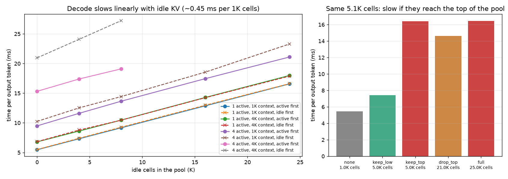

# Study C: does idle KV slow other requests' decoding?

## Why this was run

Across the three 50-task smoke runs, decode time per output token rose with mean KV occupancy: FIFO N4 baseline
50% → 16.3 ms, experiment 2 57% → 19.8 ms, experiment 3 (MLFQ) 80% → 23.0 ms. Experiment 3 kept every idle cache
and was 35% slower in throughput than the baseline. Three runs are only a correlation, and other things differed
between them (scheduler, chunking, prefill pattern). If idle cells really slow other requests, a scheduler must treat
"stay" as costing speed, not only memory. This microbenchmark isolates that effect.

## Method ([`run.py`](run.py))

- **Server:** Phase 1 settings (Qwen3-0.6B Q8_0, f16 KV, `-c 32768 -kvu`, `--cache-ram 0`, no mmap) with `-np 16`,
  as in experiments 1–3. Instrumented b11780 runtime; `kv_used_cells` recorded before each measurement.
- **One measurement:** erase all slots → write X idle cells (slots 4–15, up to 4,096 random-token prompts each,
  `n_predict 1`, then left idle) → B active requests (slots 0..B−1) with P-token random prompts decode 256 tokens
  concurrently (greedy, `ignore_eos`). Recorded: client-side time per output token (stream inter-token), the
  server's own per-token time (identical to within 0.01 ms), first-token time, aggregate tokens/s.
- **Two orders:** `idle_first` writes idle cells before the active prompts (active cells sit after them);
  `active_first` prefills the active prompts first (`n_predict 1`), then writes the idle cells, then decodes (the
  prompt is reused from cache), so idle cells sit after the active ones.
- **Grid:** order × B ∈ {1, 4} × P ∈ {1,024, 4,096} × X ∈ {0, 4K, 8K, 16K, 24K}, skipping combinations above
  31,744 cells (32K minus a 1K margin): 36 configurations × 3 repetitions = 108 measurements, seeded random order,
  one unrecorded warm-up. 0 errors. Run time ~30 min.

### Follow-up: count or range? ([`run_range.py`](run_range.py))

The main grid cannot separate "how many cells are occupied" from "how far into the pool they reach", because cells
are written contiguously. The follow-up writes one active 1,024-token prompt at the start of the pool and six idle
4,096-token slots after it (~25.6K cells), then erases different idle slots before the active request decodes 256
tokens: none, all, all but the highest, only the highest, all but the lowest. 5 cases × 3 repetitions, seeded order.
It assumes slots are placed in the pool in write order (consistent with the recorded cell counts).

## Results



### 1. Decode time grows linearly with idle cells

Median of 3 repetitions (standard deviation ≤ 0.25 ms everywhere):

| Active requests, context | Order | 0 idle | 4K | 8K | 16K | 24K | Slope (ms per 1K idle) | R² |
|---|---|---:|---:|---:|---:|---:|---:|---:|
| 1 × 1K | active first | 5.46 | 7.33 | 9.17 | 12.88 | 16.58 | 0.451 | 1.000 |
| 1 × 1K | idle first | 5.51 | 7.41 | 9.27 | 12.98 | 16.61 | 0.449 | 1.000 |
| 1 × 4K | active first | 6.80 | 8.63 | 10.47 | 14.29 | 17.99 | 0.455 | 1.000 |
| 1 × 4K | idle first | 6.83 | 8.79 | 10.46 | 14.25 | 17.88 | 0.447 | 1.000 |
| 4 × 1K | active first | 9.49 | 11.61 | 13.65 | 17.46 | 21.11 | 0.468 | 0.999 |
| 4 × 1K | idle first* | 10.25 | 12.53 | 14.43 | 18.56 | 23.30 | 0.526 | 0.999 |
| 4 × 4K | active first | 15.32 | 17.40 | 19.11 | – | – | 0.470 | 0.990 |
| 4 × 4K | idle first* | 20.96 | 24.09 | 27.24 | – | – | 0.765 | 0.996 |

\* see the confound below.

- **Each 1K occupied cells adds ~0.45 ms to every decode step**, whoever owns them. For one request, time per token
  is `5.03 + 0.450 ms × (occupied range in K cells)` across both orders and both context sizes (R² 1.000); for four
  requests (active first) `7.74 + 0.468 ms × K cells` (R² 0.998). Idle cells cost exactly as much as the
  request's own context.
- **24K idle cells make a single request 3.0× slower** (5.5 → 16.6 ms) and four 1K-context requests 2.2× slower.
  Aggregate decode throughput for 4 × 1K falls from 377 to 162 tokens/s (−57%).
- **Order does not matter for one request:** idle cells before or after the active ones cost the same.

### 2. What matters is the occupied range, not the count

| Case | Occupied cells | Highest occupied cell (approx.) | Time per token (ms) |
|---|---:|---:|---:|
| none (all idle erased) | 1,024 | 1K | 5.45 |
| keep_low (keep the lowest idle slot) | 5,120 | 5K | 7.41 |
| **keep_top (keep only the highest idle slot)** | **5,120** | **25.6K** | **16.42** |
| drop_top (erase only the highest idle slot) | 21,504 | 21.5K | 14.61 |
| full (nothing erased) | 25,600 | 25.6K | 16.45 |

The same 5,120 occupied cells cost 7.4 ms per token when they sit low in the pool and 16.4 ms (as slow as a full pool)
when one idle cache sits at the top. Every value matches `5.03 + 0.45 × highest occupied cell in K`
(keep_low: 7.3 predicted; keep_top and full: 16.5; drop_top: 14.7). **The attention cost follows the highest occupied
cell; holes below it are not skipped.** This is consistent with llama.cpp's unified cache attending over every cell
up to the highest used one and masking out other sequences' cells, so masked cells still cost compute. *Verified
afterwards in the b11780 source:* `llama_kv_cache::get_n_kv` sets the attention length to
`pad(cells.used_max_p1())`, every cell up to the highest occupied one (lab log section 11).

### Methodological confound (4 active requests, idle first)

With four active requests in `idle_first`, the prompts are prefilled inside the timed window, so requests that start
decoding early share steps with the others' prefill chunks. At X = 0 this alone raises time per token from 15.3 to
21.0 ms for 4 × 4K contexts (and 9.5 → 10.3 ms for 4 × 1K). The `active_first` rows, where prompts are prefilled
before timing, are the clean decode measurements. The difference is itself a measurement of prefill interference:
four concurrent 4K prefills add about 5.6 ms to each other's per-token time.

## What this means

1. **Idle KV is not free, even when memory is plentiful.** In the unified pool, any cache that extends the occupied
   range slows every running request by ~0.45 ms per 1K cells on every decode step. This explains experiment 3's
   slowdown (mean occupancy 80% → 23.0 ms per token) and part of the baseline's (50% → 16.3 ms).
2. **Where the cache sits matters.** Evicting a cache from the middle of the pool frees memory but does not speed
   anything up; only shrinking the top of the occupied range does. An eviction policy should target the caches at
   the highest cells, or the runtime needs compaction.
3. **A cost for staying.** Keeping ΔR extra cells at the top of the range for an idle period E slows each of the B
   running requests by `0.45·ΔR/1000` ms per step. Relative to a step time of TPOT ms, the running requests lose about
   `B · E · 0.45·ΔR/1000 / TPOT` seconds of progress. Example: 8K cells, B = 4, TPOT 16 ms → about 0.9 s lost per
   second of idle. Recomputing 8K tokens under N4 costs ~3 s (study B), so staying pays off only for idle periods
   shorter than ~3–4 s. Median tool waits (0.2 s) are well below that; queue waits under FIFO (minutes) are far above
   it. This break-even is derived from the two fitted models, not measured end to end.
4. **The 30 s stay threshold in experiments 1–2 was far too permissive** in this light, and experiment 3's
   "always stay" was the worst case.

## Limits

- One model (Qwen3-0.6B), one GPU (T4), one runtime version (b11780), f16 KV, flash attention left at `auto`.
  Other attention kernels may skip masked blocks; the slope must be re-measured if any of these change.
- Idle cells were written as contiguous prompts; fragmented idle caches (scattered generated tokens) were not tested
  separately, but the range result suggests they cost the same as long as they reach the same highest cell.
- Decode of 256 tokens per measurement; prefill time vs idle cells was not measured.

## Files

| File | Contents |
|---|---|
| `run.py`, `run_range.py`, `plot.py` | Grid measurement, count-vs-range follow-up, figure |
| `data/measurements.csv` | 108 rows: order, B, P, X, occupied cells, client and server time per token, first-token time, aggregate tokens/s |
| `data/range_measurements.csv` | 15 rows: case, occupied cells, time per token |
| `data/meta.json`, `data/server*.log`, `run.log`, `run_range.log` | Environment, server arguments, logs |
| `idle_kv.png` | The figure above |

```bash
export MODEL=/path/to/Qwen3-0.6B-Q8_0.gguf LLAMA_SERVER=/path/to/instrumented/llama-server
uv run python -m experiments.idle_kv_microbench.run --reps 3     # ~30 min
uv run python -m experiments.idle_kv_microbench.run_range        # ~3 min
uv run python -m experiments.idle_kv_microbench.plot
```
