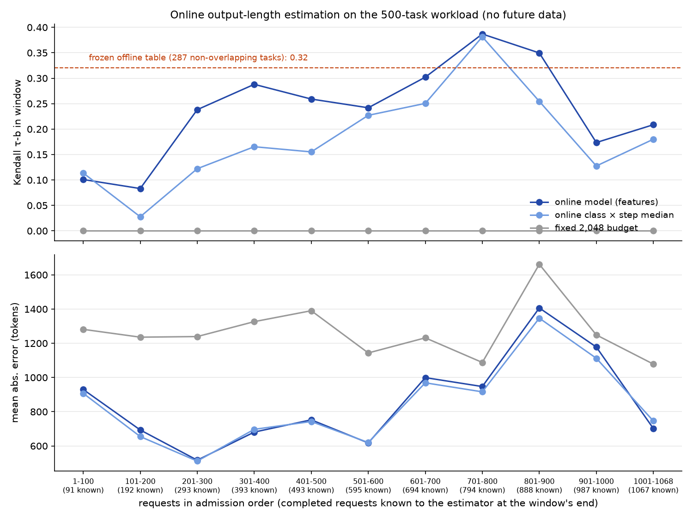
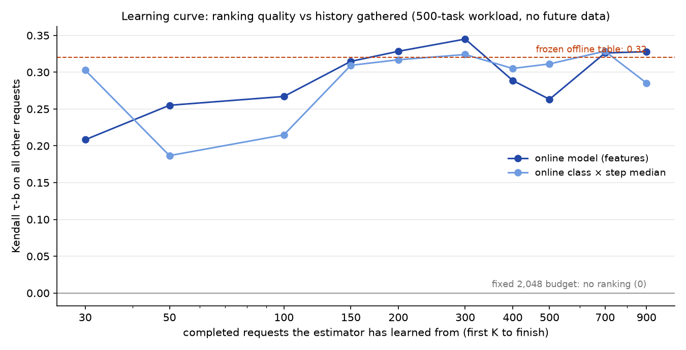

# Online output-length estimation: how much ranking quality does gathered history buy?

**Question (user, 2026-11-25):** start with the fixed output budget of the fixed-cap runs, keep every other condition,
and update the estimated output length of new requests as history accumulates, never using future data. How does
Kendall's τ improve over time?

This is an offline replay of *information*, not a serving run: it measures how good the estimates would be, not how
a scheduler using them would perform. Script: [`simulate.py`](simulate.py).

## Method

- **Workload and timeline:** the 1,068 requests (agent steps) of the 500-task set. Each request's admission time and
  completion time come from the 500-task E6 run (`results/mem_admission/full500_e6_cap2048_lookup`, fixed 2,048
  reservations). Real orderings driven by these estimates would change the times; the timeline is held fixed.
- **No future data:** at a request's admission the estimator may use only requests that had completed before it
  (their true lengths are then known to a server) and what the request shows at admission. No offline data, no
  lookup table, nothing from the trace's other tasks.
- **Start:** every request gets the fixed 2,048 budget (no ranking) until 30 requests have completed (2.1 min, 37
  requests admitted by then). After that the estimators are refitted after every 20 new completions.
- **Estimators:** (1) online median of completed requests per (class, step 0 / 1 / 2+); (2) online gradient-boosted
  trees on log length with features known at admission: class, step, this task's previous output lengths (last and
  mean), tool result error flag and length, history size, task text length, number of test cases.
- **Scores:** Kendall τ-b, mean absolute error, median % error, share underestimated.

## Results

### 1. As served, window by window



| Requests (admission order) | Completed requests known | τ online median | τ online model | MAE online model |
|---|---|---:|---:|---:|
| 1–100 | 0–91 | 0.11 | 0.10 | 930 |
| 101–200 | 92–192 | 0.03 | 0.08 | 693 |
| 201–300 | 194–293 | 0.12 | 0.24 | 517 |
| 301–400 | 294–393 | 0.17 | 0.29 | 681 |
| 401–500 | 394–493 | 0.16 | 0.26 | 753 |
| 501–600 | 494–595 | 0.23 | 0.24 | 617 |
| 601–700 | 596–694 | 0.25 | 0.30 | 999 |
| 701–800 | 695–794 | 0.38 | 0.39 | 947 |
| 801–900 | 795–888 | 0.25 | 0.35 | 1,406 |
| 901–1,000 | 889–987 | 0.13 | 0.17 | 1,178 |
| 1,001–1,068 | 991–1,067 | 0.18 | 0.21 | 702 |

Fixed 2,048 budget: τ 0 (all tied), MAE 1,272 over all requests. Whole run: online model τ 0.28 (0.30 after
warm-up), online median 0.24 (0.26); MAE 861 / 841 tokens; ~54% of requests underestimated by both.

**These windows are confounded by composition:** E6 admitted mbpp first steps late, so windows 601–1,000 are 51–57%
mbpp first steps and the last window has almost no first steps. τ inside a window of mostly one kind of request is low
for any estimator, so the late dip is not the estimator getting worse. Cumulative τ (all requests so far) rises
steadily: 0.10 (100) → 0.15 (300) → 0.20 (500) → 0.23 (700) → 0.27 (900) → 0.28 (1,068), but it averages in the
early, poorly informed predictions.

### 2. Learning curve on a fixed population (the cleaner answer)

Train on the first K requests to complete, score on all other requests.



| Completed requests known (K) | Reached at (E6 timeline) | τ online median | τ online model | MAE online model | Underestimated |
|---:|---:|---:|---:|---:|---:|
| 30 | 2.1 min | 0.30 | 0.21 | 914 | 48% |
| 50 | 3.8 min | 0.19 | 0.26 | 896 | 55% |
| 100 | 8.0 min | 0.21 | 0.27 | 903 | 54% |
| 150 | 11.4 min | 0.31 | 0.31 | 890 | 58% |
| 200 | 15.5 min | 0.32 | 0.33 | 894 | 58% |
| 300 | 21.6 min | 0.32 | 0.34 | 922 | 56% |
| 400 | – | 0.31 | 0.29 | 969 | 57% |
| 500 | – | 0.31 | 0.26 | 1,035 | 61% |
| 700 | – | 0.33 | 0.33 | 1,083 | 54% |
| 900 | – | 0.29 | 0.33 | 1,011 | 59% |

(The test population shrinks as K grows, from 1,038 to 168 requests, so later rows are noisier.)

## What it shows

1. **Learning is fast and then flat.** About 150–200 completed requests (11–16 minutes into this run) bring both
   estimators to τ ≈ 0.31–0.34, the same as the frozen offline table fitted on 287 other tasks (0.32). More history
   does not raise τ further.
2. **The online model beats the online median only early or slightly** (0.26–0.27 vs 0.19–0.21 at 50–100 completions;
   equal from ~150). The extra features (previous outputs, tool result, task text) add little beyond class × step on
   this workload.
3. **The ceiling is the information, not the amount of data.** With these features, τ tops out near 0.33. Higher needs
   new information, mainly about first steps (the task text itself, e.g. a small model on the served model's own
   representation).
4. **Budgets stay unusable.** MAE stays around 900 tokens and ~55% of requests are underestimated at every K, so the
   estimates are only good for ordering; reservations should stay on the fixed cap (with continuations).
5. **Leakage:** none by construction (only completed requests' lengths, only past). The only shared choice with earlier
   work is the feature list, picked from the earlier offline analysis.

## Files

`results/online_length/`: `predictions.csv` (per request: admission/completion time, features, true length, number of
completed requests known, the three estimates), `windows.csv`, `summary.json`, `tau_over_time.png`,
`learning_curve.csv`, `learning_curve.png`, `run.log`.

```bash
/opt/pytorch/bin/python3 -W ignore -m experiments.online_length.simulate
/opt/pytorch/bin/python3 -W ignore -c "from experiments.online_length.simulate import learning_curve; learning_curve()"
```
(`/opt/pytorch` for scikit-learn; the repo venv has none.)
