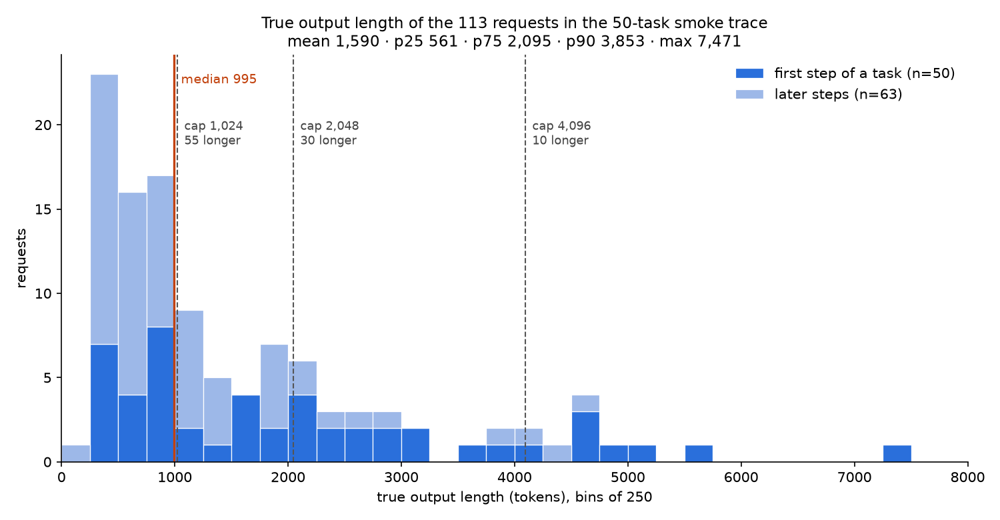
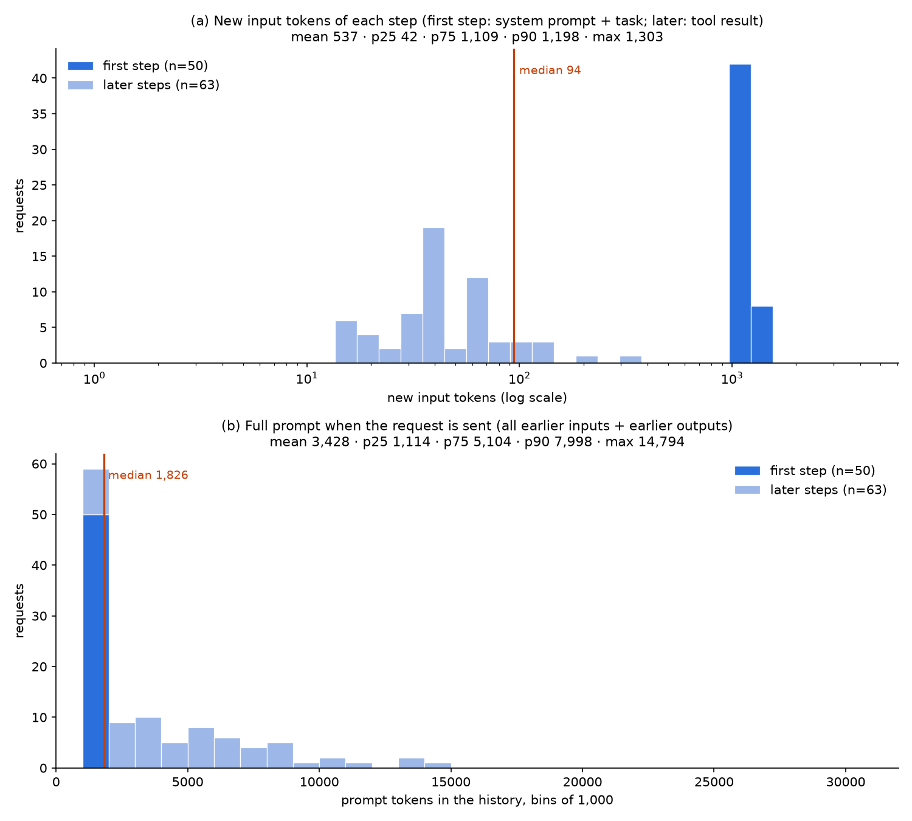

# Workload statistics: output and input length of the 50-task smoke trace

Script: [`output_length_hist.py`](output_length_hist.py) (reads `data/traces/agenttrace_50_seed2.jsonl`, writes
`output_length_hist.png`). Run: `.venv/bin/python experiments/workload_stats/output_length_hist.py`.

True (recorded) output length `n_gen` of the 113 model requests of the 50 tasks used in every smoke run. Bars are
stacked: first step of a task (dark, 50 requests) and later steps (light, 63). Bins of 250 tokens; the solid line is
the median, dashed lines are the fixed caps tried in Exp 4.

| | All 113 | First steps (50) | Later steps (63) |
|---|---:|---:|---:|
| Median | 995 | 1,698 | 873 |
| Mean | 1,590 | – | – |
| p25 / p75 | 561 / 2,095 | – | – |
| p90 / max | 3,853 / 7,471 | – | – |

Requests longer than each Exp 4 cap: 1,024 → 55; 2,048 → 30; 4,096 → 10; 8,192 → 0.

## What it shows

- **Right-skewed:** most requests are 250–1,250 tokens (largest bin 250–500, 23 requests), with a long tail to 7,471;
  mean 1,590 vs median 995.
- **Position in the task matters:** first steps are about twice as long as later steps (median 1,698 vs 873) and
  make up almost the whole tail above 3,000 tokens.
- **Consequences for the experiments:** cap 1,024 truncates about half the requests into continuations (Exp 4);
  few requests finish within MLFQ's 256-token first level (Exp 3); the wide spread is why a single length estimate
  or a single scaling factor is far off (LTR study), while a first-step / later-step lookup already carries signal.

## Input length ([`input_length_hist.py`](input_length_hist.py))

Two meanings of input length, one panel each (stacked by first step vs later steps):

- **(a) New input tokens of the step** (`input` in the trace): first step = shared smolagents system prompt + task,
  later step = the tool result appended to the history.
- **(b) Full prompt when the request is sent:** all earlier inputs plus all earlier outputs (recorded `n_gen`) of the
  task, i.e. the history the server prefills or finds cached and that occupies KV before the request generates.

| | All 113 | First steps (50) | Later steps (63) |
|---|---:|---:|---:|
| (a) new input, median (min–max) | 94 | 1,112 (1,080–1,303) | 42 (17–334) |
| (a) new input, mean / p90 | 537 / 1,198 | – | – |
| (b) full prompt, median (min–max) | 1,826 | 1,112 (1,080–1,303) | 4,360 (1,514–14,794) |
| (b) full prompt, mean / p75 / p90 | 3,428 / 5,104 / 7,998 | – | – |

Full prompts above 8K tokens: 11; above 16K: 0.

### What it shows

- **New input is bimodal:** every first step brings ~1.1K tokens (almost all of it the shared system prompt), while
  tool results are tiny (median 42 tokens, never above 334). The model's own outputs, not the tools, grow the context.
- **The history grows fast:** a later step's prompt has a median of 4,360 tokens and reaches 14.8K, because each
  earlier output (median ~1K, up to 7.5K) stays in the history.
- **Consequences:** discarding the cache at a tool call (Exp 4) means re-prefilling thousands of tokens to add a
  ~42-token tool result, which is why Exp 4's prefill was 2.5× the baseline's; keeping the cache is cheap in
  prefill but costs decode speed (Study C). Long histories are also why later-step prompts exceed OPT's 2,048-token
  window in the LTR study, and why four concurrent long tasks can overflow the 32K pool under FIFO N4.

Run: `.venv/bin/python experiments/workload_stats/input_length_hist.py`.
