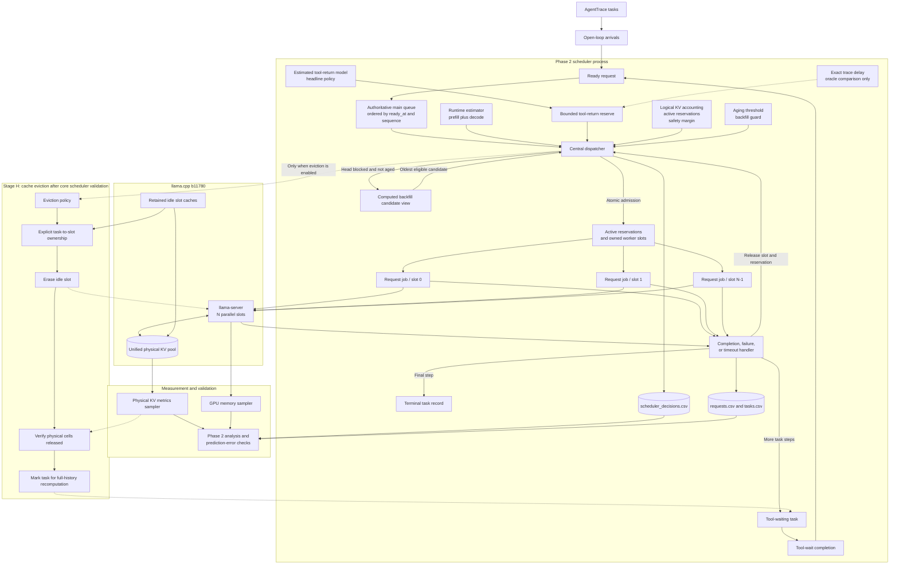

# Phase 2 Two-Queue Scheduler Implementation Plan

## Feature summary and business outcome

I want to build a new feature, a predictive memory-aware two-queue scheduler, that extends the request-level replay system to avoid preventable KV-context failures, backfill otherwise idle capacity without starving old requests, and improve the completed-task throughput/latency frontier relative to FIFO `N=4` and the zero-failure FIFO `N=1` reference.

This implementation is scoped to the scheduler, AgentTrace workloads, and the measurements needed to evaluate it. Exgentic ingestion is out of scope. The implementation will preserve a separate development/evaluation discipline within AgentTrace: calibrate and tune only on development data, freeze the estimator and policy parameters, and then run evaluation comparisons.

## Current state

`phase1/runner.py` currently has one condition-backed `RunnableFifo` and `N` workers. A worker removes the FIFO head, computes `len(history) + n_gen`, logs whether the request would fit beside active reservations, and dispatches it regardless. The fit check is observational; it neither waits nor backfills. Tool completion requeues the next request at the FIFO tail while preserving task history. Deadlines, result CSVs, physical KV sampling, and deterministic fake-completion tests already exist.

This worker-owned dequeue pattern is unsuitable for authoritative admission because concurrent workers could make decisions from stale/shared capacity. Phase 2 will use one central dispatcher to make atomic queue and reservation decisions, then launch non-preemptive request jobs up to the configured concurrency.

## Scope

### Included

- Memory-aware FIFO head admission.
- One authoritative age-ordered main queue.
- A transient backfill-candidate queue/view.
- Centralized worker-slot and KV-reservation accounting.
- Bounded backfill using predicted service time.
- Aging/starvation protection.
- A bounded reserve for agents waiting on tools.
- Infeasible-request classification.
- Additive decision/result instrumentation.
- Offline calibration of request-runtime estimates from Phase 1 data.
- Unit, regression, smoke, and analysis validation.
- Cache eviction as a separately validated implementation stage behind a policy flag, contingent on reliable slot ownership.

### Deferred unless requested

- Large held-out AWS experiment execution.
- llama.cpp changes beyond the existing metrics patch and supported slot-erase endpoint.
- Sophisticated learned memory prediction before the conservative reservation policy is validated.

## Scheduler architecture

### Authoritative main queue

Every ready request appears exactly once in `main_queue`, sorted by `(ready_at, enqueue_sequence)`. It retains the same `ready_at` while blocked or considered for backfill. A tool return creates a new ready request for the task with a new timestamp, matching Phase 1 semantics.

### Backfill candidate view

`backfill_candidates` is recomputed from younger entries whenever the head cannot be admitted. It does not own or duplicate requests. Candidates remain in `main_queue` until the dispatcher atomically selects and removes one.

Candidate eligibility requires:

1. a free inference slot;
2. predicted occupancy within the effective KV budget;
3. predicted service time no greater than the head's remaining backfill allowance;
4. no deadline violation;
5. the head has not crossed the aging threshold.

Eligible candidates are selected by oldest `ready_at` first. This is more fairness-preserving than smallest-request-first while still exploiting requests that fit.

### Central dispatcher

One async dispatcher owns main-queue mutations, active request reservations, free logical worker/slot IDs, tool-wait reserve accounting, decision logging, aging wakeups, and deadline expiry.

The dispatcher launches request jobs but never waits for an entire completion while holding the scheduler condition. Completion jobs update task history/state, release their reservation and slot, schedule tool waits, and notify the dispatcher.

The dispatcher wakes on arrival, tool return, request completion/failure, deadline, aging-threshold transition, or successful cache erasure.

### Architecture diagram



The solid path is the core scheduler. The dotted eviction path is enabled only after memory-aware FIFO, reserve accounting, backfill, aging, and explicit slot ownership have passed their independent validation stages.

## Proposed state model

Add scheduler-specific dataclasses in `phase2/scheduler.py`:

```python
@dataclass
class ReadyRequest:
    state: RequestTaskState
    ready_at: float
    enqueue_sequence: int
    prompt_tokens: int
    output_budget_tokens: int
    predicted_kv_cells: int
    predicted_runtime_s: float
    deadline_at: float

@dataclass
class ActiveReservation:
    worker: int
    task_index: int
    step_index: int
    reserved_kv_cells: int
    admitted_at: float

@dataclass
class WaitingCache:
    task_index: int
    slot_id: int
    resident_cells: int
    tool_started_at: float
    predicted_return_at: float
    evicted: bool = False
```

`RequestTaskState` will gain only fields required for cache/slot continuity, such as `slot_id` and `cache_resident`, or Phase 2 will wrap it to avoid changing Phase 1 state. `TaskRecord.status` needs an additive `infeasible` terminal value, with a distinct summary count.

## Admission and backfill algorithm

The first implementation uses conservative logical reservations rather than the one-second physical KV samples for real-time admission:

```text
capacity             = configured KV cells
active_reserved      = sum(active request reservations)
tool_return_reserve  = bounded reserve for waiting tasks
safety_margin        = calibrated fixed cells or fraction
effective_available  = capacity - active_reserved
                       - tool_return_reserve - safety_margin
```

This model intentionally does not subtract sampled physical occupancy in addition to reservations, because doing both can double-count active KV. Retained idle cache handling must be represented explicitly once slot ownership is available. Physical occupancy remains an outcome/validation metric.

Core decision pseudocode:

```python
while unfinished_tasks:
    expire_deadlines()
    head = main_queue[0] if main_queue else None

    if no_free_slot() or head is None:
        await wait_for_state_change()
        continue

    if infeasible_when_idle(head):
        finish_as_infeasible(head)
        continue

    if fits(head):
        dispatch(head, reason="fifo_head")
        continue

    head_age = now() - head.ready_at
    if head_age >= aging_threshold_s:
        if eviction_enabled and reclaim_for(head):
            continue
        await wait_for_capacity_or_deadline()
        continue

    allowance = aging_threshold_s - head_age - backfill_guard_s
    candidates = [
        request for request in main_queue[1:]
        if fits(request)
        and request.predicted_runtime_s <= allowance
        and predicted_finish_before_deadline(request)
    ]

    if candidates:
        dispatch(min(candidates, key=queue_order), reason="backfill")
    elif eviction_enabled and reclaim_for(head):
        continue
    else:
        await wait_for_state_change_or_aging()
```

After every dispatch, the loop recalculates capacity before selecting another request. Active generations are never preempted.

## Estimation strategy

### KV reservation

Start with:

```text
predicted_kv_cells = prompt_tokens + output_budget_tokens
```

plus a configurable safety margin. This matches the Phase 1 diagnostic and avoids introducing an unvalidated learned memory model. Log actual server outcome and physical occupancy so an incremental/cache-aware estimator can be added as a controlled second stage.

### Runtime prediction

Fit a simple, interpretable model from development Phase 1 request records:

```text
runtime = intercept
        + prefill_coefficient * predicted_uncached_prompt_tokens
        + decode_coefficient * output_budget_tokens
```

Use robust bucketed medians or non-negative linear coefficients, selected by held-out development error. Persist the fitted coefficients, source run list, checksum, and error quantiles. When required fields are unavailable, fall back to a conservative upper development quantile rather than zero. The chosen model and all scheduler parameters will be frozen before evaluation runs.

### Tool-return reserve

Begin with a bounded static policy so the effect can be isolated:

```text
reserve = min(max_reserve_cells,
              reserve_per_waiting_task * waiting_task_count)
```

Then evaluate a predicted-return horizon policy using only information available online. Headline results will use estimated return times. Exact scripted future delays will be supported only as an explicitly labeled oracle comparison.

## Aging and fairness

The main anti-starvation rule is a time threshold measured from the request's original `ready_at`. Once the head reaches `aging_threshold_s`, no younger request may be admitted until the head runs, expires, becomes infeasible, or necessary idle caches are evicted.

The backfill allowance is:

```text
aging_threshold_s - current_head_age - backfill_guard_s
```

The decision log will include head age, candidate age, predicted runtime, allowance, and number of prior bypasses. Metrics will include maximum ready wait, p95/p99 ready wait, oldest-head wait, and per-request bypass count.

## Cache eviction design

Eviction should not be part of the first correctness milestone. It will be enabled only after these invariants are verified:

- each retained task cache maps to a known llama.cpp `slot_id`;
- no active slot can be erased;
- `/slots/<id>?action=erase` lowers physical occupied cells;
- an evicted task can send its complete history and finish correctly;
- recomputation cost is recorded through `prompt_n`, `cache_n`, and `prompt_ms`.

The runner should request explicit `id_slot` values from `complete()` so the scheduler owns slot assignment. Before depending on this in experiments, a runtime smoke test must verify that a slot can safely be reused by another task and later reacquired/recomputed.

Initial eviction policies for ablation:

1. no eviction;
2. largest reclaimable idle cache first;
3. farthest predicted tool return first;
4. lowest estimated reuse benefit per cell.

Evict only tool-waiting, non-active caches. Re-sample physical occupancy synchronously after erase and fail the eviction-enabled run if the expected release cannot be verified.

## Configuration and interfaces

Create `Phase2Config` rather than expanding Phase 1's `RunConfig` with many policy-specific fields:

```python
@dataclass
class Phase2Config:
    run: RunConfig
    aging_threshold_s: float
    backfill_guard_s: float
    kv_safety_margin_cells: int
    reserve_per_waiting_task: int
    max_tool_reserve_cells: int
    runtime_model_path: str
    eviction_policy: str = "none"
```

The CLI should expose a small set of explicit arguments and record the complete configuration in `meta.json`. Invalid values—negative thresholds, reserve plus safety margin at or above capacity, missing estimator artifact, or eviction without required runtime support—must fail before server/workload execution.

## Result and metric changes

Write an additive `scheduler_decisions.csv` with one row per dispatcher decision. Proposed fields include:

- time, decision sequence, reason, selected task/step;
- queue length, free slots, active count;
- head task/step, head age, bypass count;
- predicted KV need/runtime;
- active reserved cells, tool reserve, safety margin, effective available cells;
- candidate count and candidate allowance;
- eviction target/reclaimed cells when applicable;
- scheduler decision duration;
- eventual request outcome and actual runtime.

Add summary metrics for backfills, blocked-head duration, maximum/p95/p99 ready wait, infeasible requests, prediction errors, scheduler overhead, reserve utilization, evictions, recomputed prompt tokens, and output-budget compliance. Preserve existing Phase 1 CSV columns and summaries so baseline analysis remains reproducible.

## Files to create or modify

- Create `phase2/__init__.py`.
- Create `phase2/scheduler.py` for queue state, decisions, reservations, and fairness.
- Create `phase2/estimator.py` for runtime-model fitting/loading/prediction.
- Create `phase2/runner.py` for Phase 2 execution, CLI, result persistence, and integration with the existing harness.
- Create `phase2/cache.py` only when eviction is enabled and slot ownership is validated.
- Modify `harness/client.py` only if explicit slot lifecycle support needs a small helper; retain `complete()` compatibility.
- Modify `analysis/metrics.py` additively and create `analysis/reproduce_phase2.py` for scheduler metrics and comparison checks.
- Add `tests/test_phase2_scheduler.py`, `tests/test_phase2_estimator.py`, and, if enabled, `tests/test_phase2_cache.py`.
- Update `README.md` with Phase 2 dry-run, calibration, smoke, and experiment commands.

Avoid changing `phase1/runner.py` unless a small shared helper can be extracted without changing Phase 1 behavior. Phase 2 will live in a sibling `phase2/` package and may initially duplicate a limited amount of orchestration code to protect baseline reproducibility; shared abstractions should be extracted only after both paths are tested.

## Error handling

- Expired queued requests retain the existing `timeout_queued` status.
- Requests that cannot fit under the idle-pool accounting model receive `infeasible`, not `failed` or timeout.
- Runtime prediction fallback is recorded in each decision.
- A request error releases its reservation/slot exactly once and terminates the task as in Phase 1.
- Tool jobs must notify the dispatcher on return or deadline.
- Dispatcher cancellation must cancel request/tool jobs and persist no successful-looking partial summary.
- Eviction failures abort eviction-enabled experimental runs rather than silently continuing with incorrect accounting.

## Validation strategy

### Unit tests

- Exact FIFO order when all heads fit.
- Atomic admission under simultaneous arrivals/completions.
- Head blocked while a younger request fits.
- Runtime allowance accepts/rejects candidates at boundary values.
- Backfilled request retains/removes the correct main-queue entry.
- Head aging disables younger admissions.
- Multiple backfills cannot reset head age.
- Tool reserve blocks admission and is released/recomputed on tool return.
- Deadline and infeasible handling cannot deadlock the queue.
- Request failure/timeout releases reservation and worker exactly once.
- Duplicate task IDs remain independent by task index.
- Runtime estimator serialization, fallback, and prediction error metrics.
- Slot mapping, active-cache protection, erase verification, and recomputation when eviction is enabled.

### Regression validation

```bash
uv run pytest -q
uv run python -m analysis.reproduce_phase1
```

There is no configured static typechecker in the repository. During implementation, run targeted tests continuously and the full suite at each completed phase. Adding a typechecker should be a separate explicit decision rather than silently expanding project tooling.

### Manual/runtime validation

1. Phase 2 dry-run validates configuration and workload without a GPU.
2. Fake-completion integration run confirms deterministic ordering and result files.
3. Instrumented one-task and synthetic contention smoke tests validate physical KV observations.
4. Memory-aware FIFO runs before backfill establish that admission removes context failures without queue-state regressions.
5. Backfill and aging ablations compare `none`, `fit-only`, and `bounded` policies.
6. Eviction smoke validates targeted erase and full-history recomputation before any large run.
7. Development runs freeze all policy settings and estimator artifacts before held-out evaluation.

## Risks and tradeoffs

- Conservative full-context reservation may make the scheduler safe but underutilized; this is acceptable for the first milestone and measurable through prediction error.
- A runtime model trained on one concurrency/load may be biased under another. Record the training runs and evaluate error by concurrency and context bucket.
- Backfill may improve mean latency while harming large requests; maximum wait and bypass counts are mandatory metrics.
- Tool reserve can trade throughput for reliability. It must be ablated rather than hidden inside the final policy.
- The one-second KV sampler cannot be treated as an atomic admission oracle.
- Explicit slot ownership may interact with llama-server's cache reuse semantics and must be validated before eviction.
- Exact trace delays or generation budgets can give oracle information unavailable online. The report must identify which features are known, estimated, or used only for controlled replay.

## Resolved design decisions

1. Cache eviction remains in Phase 2 but is staged after memory-aware FIFO and bounded backfill/aging are independently validated.
2. The second queue is a computed candidate view; the age-ordered main queue is the only authoritative owner of ready requests.
3. Admission uses logical reservations atomically. Physical KV measurements validate the model and confirm eviction effects; they are not queried as the primary decision oracle.
4. Headline results use estimated tool-return times. Exact scripted return times are permitted only in a clearly labeled oracle comparison.
5. Estimator and policy parameters are calibrated on development runs and frozen before evaluation.
6. Only AgentTrace is included; Exgentic is out of scope.
7. Phase 2 remains isolated in a sibling `phase2/` package to protect Phase 1 reproducibility.

## Implementation todos

### Phase A: Protect the baseline and establish fixtures

- [x] Run and record the existing `uv run pytest -q` baseline (`57 passed, 1 skipped`; after implementation: `81 passed, 1 skipped`).
- [ ] Run and record `uv run python -m analysis.reproduce_phase1`.
- [x] Identify a fixed AgentTrace development subset and a disjoint AgentTrace evaluation subset; write manifests/checksums without modifying the canonical trace schema.
- [x] Add deterministic synthetic scheduler fixtures for fit, blocked-head, backfill, aging, reserve, timeout, failure, and infeasible cases.

### Phase B: Runtime estimator and frozen configuration artifacts

- [x] Create `phase2/__init__.py` and `phase2/estimator.py`.
- [x] Extract development request features and targets from committed Phase 1 results.
- [x] Implement and test the interpretable prefill-plus-decode runtime estimator.
- [x] Implement a conservative fallback for missing prediction inputs.
- [x] Serialize coefficients, source run paths/checksums, fit metrics, and error quantiles.
- [x] Add estimated and exact/oracle tool-return prediction modes with explicit labels.
- [x] Add estimator unit tests for fitting, serialization, fallback, and deterministic predictions.

### Phase C: Central dispatcher with FIFO-equivalent behavior

- [x] Create `phase2/scheduler.py` with `ReadyRequest`, `ActiveReservation`, scheduler condition/state, and decision records.
- [x] Implement a single authoritative main queue ordered by `(ready_at, enqueue_sequence)`.
- [x] Implement atomic free-slot and active-reservation ownership in the dispatcher.
- [x] Create `phase2/runner.py` by integrating the dispatcher with the existing client, server, trace, deadline, timeline, and result conventions.
- [x] Preserve Phase 1 semantics for arrivals, tool waits, history growth, generation budgets, failures, and deadlines.
- [x] Prove FIFO-equivalent ordering when every head fits.
- [x] Test simultaneous state changes to ensure capacity cannot be admitted twice.
- [x] Run targeted tests continuously and rerun the full Phase 1 suite.

### Phase D: Memory-aware FIFO

- [x] Implement conservative KV need as `prompt_tokens + output_budget_tokens`.
- [x] Implement logical active reservations, safety margin, and effective-capacity calculation without double-counting physical occupancy; final margin calibration remains in Phase G.
- [x] Make FIFO head admission authoritative: dispatch if it fits and wait if it does not.
- [x] Implement idle-pool infeasible classification and distinct summary accounting.
- [x] Ensure deadlines can expire while a head is blocked without deadlocking the dispatcher.
- [x] Add `scheduler_decisions.csv` and additive summary fields for fit decisions, reservations, waiting, prediction mode, and outcomes.
- [x] Add unit tests for fit boundaries, blocked heads, infeasible requests, failures, timeouts, and reservation release.
- [ ] Run an instrumented memory-aware FIFO smoke test. Fake-completion integration is complete; GPU/runtime validation remains.

### Phase E: Tool-return reserve

- [x] Implement the bounded static reserve policy using waiting-task count.
- [x] Ensure reserve changes notify and wake the dispatcher.
- [x] Add estimated-return horizon support using only online-available inputs.
- [x] Add the exact scripted-delay oracle mode as a separate labeled configuration.
- [x] Log reserve size, prediction mode, and whether reserve blocked admission.
- [x] Test reserve acquisition/release, caps, horizon behavior, tool-return races, and deadline interactions.
- [ ] Run reserve ablations on the AgentTrace development subset.

### Phase F: Computed backfill view and aging

- [x] Compute eligible younger candidates from the authoritative main queue only when the head is blocked.
- [x] Require candidate fit, deadline feasibility, and predicted runtime within the head allowance.
- [x] Select the oldest eligible candidate and atomically remove only that main-queue entry.
- [x] Preserve the head's original timestamp and increment bypass accounting.
- [x] Implement aging cutoff and `backfill_guard_s` so younger work stops once the head is protected.
- [x] Recompute all capacity and candidate state after each dispatch.
- [x] Log candidate counts, selection reason, head age, allowance, predicted runtime, and bypass counts.
- [x] Test candidate boundary values, repeated backfills, no age reset, no starvation, and deterministic tie-breaking.
- [ ] Run `none`, fit-only, and bounded-backfill development ablations.

### Phase G: Calibration and policy freeze

- [x] Analyze development prediction errors by context, output budget, request step, and source run. All selected development sources use N4, so cross-concurrency calibration requires additional GPU development runs.
- [ ] Calibrate the KV safety margin, aging threshold, backfill guard, reserve parameters, and runtime fallback.
- [ ] Select settings using the declared completion/throughput/latency/fairness criteria rather than evaluation results.
- [ ] Write a frozen policy artifact containing all values, estimator checksum, development manifest checksum, and timestamp.
- [x] Make evaluation mode reject missing or modified frozen artifacts and reject policy/estimator mismatches.

### Phase H: Staged cache eviction

- [x] Create a disabled-by-default `phase2/cache.py` erase/verification primitive; enabling policy integration remains gated on Phases C--G runtime validation.
- [ ] Validate explicit `id_slot` ownership and slot reuse against the pinned llama.cpp runtime.
- [ ] Track retained caches only for tool-waiting, non-active tasks.
- [x] Implement a safe erase helper for `/slots/<id>?action=erase`.
- [ ] Verify physical KV occupancy decreases synchronously after each erase.
- [ ] Mark evicted tasks and force full-history recomputation on their next request.
- [ ] Record evictions, reclaimed cells, prompt recomputation tokens/time, and cache-hit loss.
- [ ] Implement no-eviction, largest-cache, farthest-return, and reuse-benefit-per-cell policies for ablation.
- [x] Test that active slots cannot be erased and that an erase without observed KV release fails.
- [ ] Run a targeted eviction/recomputation smoke test before any workload comparison.

### Phase I: AgentTrace evaluation and analysis

- [x] Create `analysis/reproduce_phase2.py` and additive Phase 2 metric readers.
- [ ] Validate identical AgentTrace tasks, arrival seeds, generation budgets, and output lengths across policies.
- [ ] Run the frozen scheduler and FIFO baselines on the disjoint AgentTrace evaluation subset/configurations.
- [ ] Run the oracle timing policy only as a separately labeled upper-bound comparison.
- [ ] Compare completed-task throughput, completion rate, p95 latency, KV failures, peak/mean KV occupancy, and maximum queue wait.
- [ ] Report scheduler overhead, prediction error, bypass distribution, reserve blocking, eviction, and recomputation costs.
- [x] Add consistency checks for terminal states and shortened output; cross-policy run-duration validation awaits evaluation runs.

### Phase J: Final verification and documentation

- [x] Run all targeted Phase 2 tests (`24 passed`).
- [x] Run `uv run pytest -q` (`81 passed, 1 skipped, 35 subtests passed`).
- [ ] Run `uv run python -m analysis.reproduce_phase1`.
- [ ] Run the Phase 2 reproduction/consistency command.
- [x] Update `README.md` with estimator, dry-run, smoke, frozen evaluation, and analysis commands.
- [x] Document the unrelated missing `report/fig_tradeoff.py` reproduction failure without changing it.
- [x] Mark every completed local task in this plan and summarize deviations from the approved design.

## Implementation status and deviations

The core local implementation is complete: AgentTrace splitting, development-only runtime fitting and diagnostics, central dispatcher, memory-aware FIFO, computed backfill view, aging, estimated/oracle tool-return modes, bounded reserve, infeasible handling, decision logging, dry-run validation, policy freezing/verification, result consistency checks, and the staged cache-erase safety primitive.

The implementation deliberately stops before enabling cache eviction in the runner. Explicit llama.cpp slot ownership, physical release, prompt recomputation, eviction-policy ablations, and all calibrated/frozen evaluation runs require the pinned instrumented T4 runtime. Starting paid cloud instances or changing a live llama.cpp runtime was not authorized by the implementation request. The provisional `policy_template.json` is therefore not a frozen evaluation policy.

## Adaptive-concurrency grace-period extension

I want to build a new feature `adaptive concurrency with short cache-preservation grace` that extends the system to reduce destructive slot reuse and KV recomputation while retaining the four-slot maximum concurrency and the existing memory-safety checks.

The slot-aware runner will record a per-task grace deadline when a request enters tool wait. For the selected 500 ms grace window, free slots that retain a waiting task's cache are excluded from scheduler worker selection. This makes effective concurrency adapt below four only while a cache has a high probability of near-term reuse. A returning task retains access to its own preferred slot. At grace expiration, the dispatcher wakes and the existing verified slot-erasure path may reclaim the slot. Terminal cleanup and hard memory-safety behavior remain unchanged.

The smoke-test policy will differ from the completed slot-aware run only by `cache_grace_s=0.5`; it will use the same 50-task AgentTrace burst, seed 2, four slots, 32K unified KV pool, frozen runtime estimator, model, and T4 runtime. Results will report grace holds, grace hits, expired grace evictions, effective running concurrency, evictions, recomputation, latency, throughput, failures, cache hit rate, and KV utilization.

Risks and tradeoffs: preserving a slot can temporarily idle compute while work is queued; inaccurate tool-return timing can add up to 500 ms per protected interval; simultaneous protected slots can reduce effective concurrency sharply; and llama.cpp cache erasure remains synchronous after grace expiration. The experiment must therefore compare both latency and throughput and must not claim improvement from eviction reduction alone.

### Adaptive-concurrency implementation todos

- [x] Add and validate `cache_grace_s`, preserving the old zero-grace behavior by default.
- [x] Allow scheduler selection from an explicit eligible-worker subset.
- [x] Track per-task grace deadlines and prevent reassignment of protected idle slots.
- [x] Wake the dispatcher at the earliest grace expiration.
- [x] Record grace holds, hits, expirations, and adaptive effective concurrency metadata.
- [x] Add focused scheduler, runner, configuration, and artifact tests.
- [x] Run the relevant test suite and repair regressions caused by this change (`92 passed, 1 skipped`).
- [x] Deploy the scoped files to the isolated T4 workspace.
- [x] Run the matched 50-task adaptive-concurrency smoke test.
- [x] Download artifacts and compare against FIFO and zero-grace slot-aware results.

`uv run python -m analysis.reproduce_phase1` recomputes the Phase 1 tables and inline values but exits when it tries to import the pre-existing missing `report/fig_tradeoff.py`. The Phase 1 numerical reproduction tests pass; this unrelated report-source gap was not modified.

Implementation was explicitly approved in the adaptive-concurrency request. The matched run completed 50/50 tasks with zero KV errors, 40 grace hits, 16 recomputed requests, and 3.359 tasks/min. The policy recovered throughput and KV reuse but worsened median completion and ready-queue latency because within-grace resumes bypass older queued work; bounded resume fairness is the next required refinement.

## Fair adaptive-resume extension

I want to build a new feature `fair adaptive resume` that extends the 500 ms slot-aware grace policy to retain most KV reuse while preventing repeated tool returns from indefinitely bypassing older FIFO work.

The implementation adds two disabled-by-default controls so the completed adaptive result remains reproducible: a maximum consecutive priority-resume count and a FIFO-head age cutoff. The matched smoke configuration permits one priority resume, then requires one normal FIFO admission before another priority resume; it also denies priority when the oldest queued request has waited at least 30 seconds. A return denied priority joins the normal FIFO queue. Its retained cache may still be reused if its slot remains available, or safely erased by the existing slot-aware path if older work needs the slot.

The runner will distinguish returning within grace from actually reusing the cache, record priority grants and denial reasons, and expose all controls in metadata and CLI configuration. The experiment changes only resume fairness relative to the previous 500 ms adaptive run.

### Fair adaptive-resume todos

- [x] Add disabled-by-default consecutive-resume and head-age controls with validation.
- [x] Mark priority-resume requests explicitly and update quota state only at admission.
- [x] Preserve FIFO ordering for denied returns and distinguish grace returns from actual cache hits.
- [x] Record priority grants, quota denials, age denials, cache reuse, and configuration.
- [x] Add focused quota, age-cutoff, compatibility, and artifact tests.
- [x] Run the complete local test suite (`95 passed, 1 skipped`).
- [x] Deploy only the scoped runtime files to the isolated T4 workspace.
- [x] Run the matched 50-task fair-adaptive smoke test.
- [x] Download raw artifacts and compare with FIFO, zero-grace, and unrestricted adaptive runs.

The user explicitly approved implementation and the matched smoke test on 2026-11-21.

The run completed 50/50 tasks with no KV errors. Fairness improved substantially versus unrestricted adaptive, but the 30-second old-head cutoff denied 32 returns while the one-for-one quota denied none. Cache hits fell from 40 to 8, throughput from 3.359 to 3.095 tasks/min, and recomputation rose from 36,719 to 224,734 tokens. The cutoff should be disabled or relaxed in the next development ablation so the quota can be evaluated independently.

## Previous-adaptive Poisson smoke design

I want to build a new experiment `matched Poisson-5s FIFO versus unrestricted adaptive` that extends the Phase 2 evaluation to the Phase 1 open-loop arrival regime and determines whether staggered arrivals create real backfill opportunities while preserving adaptive KV reuse.

The previous adaptive algorithm remains available as `phase2-adaptive`; no destructive source revert is needed. The experiment will explicitly set `cache_grace_s=0.5`, `max_consecutive_resume_priorities=0`, and `resume_priority_head_age_limit_s=0`. A new named Poisson smoke configuration will avoid overwriting any burst artifact.

Both arms will use 50 AgentTrace tasks, seed 2, N=4, a 32K unified KV pool, mean interarrival 5 seconds (`arrival_rate=0.2`), request-level scheduling, prompt reuse on, host cache off, identical tool delays, 14,400-second task deadlines, 900-second request timeouts, the frozen estimated-time model, and the pinned T4 llama.cpp runtime. Seeded sampling and exponential gaps must match across arms.

Primary metrics are completion count, KV failures, completed-task throughput, completion p50/p95, ready-queue p50/p95, and run span. Mechanism metrics are backfill opportunities/admissions, blocked-head decisions, grace returns/hits, evictions, recomputed requests/tokens, cache-hit ratio, mean/peak KV use, mean queue length, and mean concurrency.

The predeclared success target is 50/50 completion with zero KV failures, at least 95% of matched FIFO completed-task throughput, and no more than 10% worse p95 completion latency. Backfill is observational in this smoke: zero admissions does not fail the adaptive policy, but the run must report why candidate windows were absent. Expected paired wall time is 35--45 minutes.

### Poisson smoke todos

- [x] Add uniquely named FIFO and previous-adaptive Poisson-5s smoke configurations.
- [x] Assert identical seeded task order and arrival offsets across both arms.
- [x] Keep fairness controls explicitly disabled in metadata.
- [x] Add a dry-run/configuration test and run the local suite.
- [x] Present this design and receive approval before any AWS run.
- [x] Deploy scoped files and run both arms on the approved T4 instance.
- [x] Download artifacts and compare against each other and the historical Phase 1 Poisson-5s result.
- [x] Commit the complete Poisson experiment with an algorithm/configuration-specific message after validation.

Every subsequent experiment must receive its own scoped commit containing its implementation, tests, configuration, documentation, and result artifacts. Commit messages should identify the algorithm or experiment, for example `Add unrestricted adaptive Poisson-5s experiment`.

The valid adaptive arm completed 50/50 tasks with zero KV failures and exceeded FIFO completed-task throughput by 6.10%, but missed the predeclared p95 target by increasing completion p95 22.23%. Backfill candidate count remained zero. The final implementation also corrects unrestricted-limit semantics and enforces per-request slot compatibility under overlapping Poisson returns.

## One-resume/one-FIFO burst and Poisson experiment

I want to build a new experiment `one-resume/one-FIFO adaptive scheduling` that extends the 500 ms slot-aware grace policy to improve FIFO latency while retaining useful KV reuse. It tests only the admission quota: one priority resume must be followed by one ordinary FIFO admission when older work exists. Resume-priority age cutoff remains disabled.

Two adaptive-only arms will run with 50 AgentTrace tasks, seed 2, N=4, 32K unified KV, prompt reuse enabled, host cache disabled, estimated timing, `cache_grace_s=0.5`, `max_consecutive_resume_priorities=1`, and `resume_priority_head_age_limit_s=0`. One arm uses burst arrivals and the other Poisson rate 0.2 tasks/s. Existing matched FIFO artifacts are the baselines and must not be rerun.

Compare completion, failures, throughput, completion and queue p50/p95, grace returns/hits, priority grants/quota denials, recomputation, evictions, mean/peak KV, queue length, concurrency, and backfill. Store each raw run under a unique name and create one scoped commit named `Add one-resume one-FIFO adaptive experiments`.

### One-resume/one-FIFO todos

- [x] Add uniquely named quota-only burst and Poisson smoke configurations.
- [x] Add configuration tests proving quota 1 and resume-age cutoff 0.
- [x] Run the full local and remote focused test suites.
- [x] Run only the two adaptive arms on the approved T4 instance.
- [x] Download and validate full outputs, settings, and matching workload signatures.
- [x] Compare burst and Poisson results against existing FIFO artifacts.
- [x] Commit implementation, tests, documentation, provenance, and valid raw results together.

The user explicitly approved implementation, both adaptive runs, reuse of existing FIFO artifacts, and an experiment-specific commit on 2026-11-21.

Both arms completed 50/50 with zero KV failures. Burst quota materially improved fairness versus unrestricted adaptive but remained slower than FIFO; Poisson quota did not improve p95 versus unrestricted adaptive. This supports workload-aware quota activation rather than a universal one-for-one rule.

## Aging-360 and cost-aware dynamic-resume experiments

I want to build two matched Poisson-5s experiments that extend the Phase 2 scheduler to test whether a realistic backfill window and a cost-sensitive cache-resume decision improve the balance of throughput, success rate, and latency.

Experiment 1 keeps the current one-resume/one-FIFO implementation, 500 ms cache grace, slot-aware eviction, and all reservation settings, changing only `aging_threshold_s` from 30 to 360. Experiment 2 restores `aging_threshold_s=30`, disables the fixed resume quota and cutoff, and grants resume priority only when estimated recomputation time saved exceeds a queue-delay cost. Both use the existing 50-task AgentTrace Poisson-5s workload, seed 2, concurrency 4, 32K KV, and frozen estimated runtime model. Existing FIFO results will not be rerun.

The cost-aware score will be logged with its inputs. Validation requires focused configuration and scoring tests, the full local suite, remote artifact checks, and comparison of success, throughput, p50/p95, queue latency, cache reuse/recomputation, KV utilization, and backfill. Each experiment receives its own commit.

### Approved todos

- [x] Record the matched configurations and isolate the changed variables.
- [x] Add the uniquely named aging-360 Poisson smoke configuration and test.
- [x] Validate, run, download, analyze, and commit the aging-360 experiment.
- [x] Implement and test cost-aware dynamic resume priority with decision telemetry.
- [x] Run, download, analyze, and commit the cost-aware experiment.
- [x] Compare both experiments with each other and existing FIFO/quota baselines.

The user explicitly approved implementation and both AWS runs on 2026-11-22.

The aging-360 arm completed 50/50 tasks with zero KV errors and produced nine actual backfill admissions. Relative to aging-30 quota, p95 improved 0.6% and ready-queue p95 improved 2.7%, while throughput fell 2.7%, p50 increased 0.8%, and computed prefill increased 13.5%. The larger window enables backfill but does not by itself deliver a material end-to-end improvement.

The cost-aware aging-30 arm also completed 50/50 without KV errors. It improved throughput, p50, p95, cache-hit ratio, and prefill work versus both quota arms, but granted 39 of 40 within-grace returns. The result is promising but the low denial count means a weight sensitivity experiment is required to separate cost-gating benefit from run variance and near-unrestricted resume behavior.

## Full R4 cost-aware evaluation

I want to build a uniquely named full-run configuration that extends the validated cost-aware aging scheduler to the Phase 1 R4 workload and produces a direct 500-task comparison under sustained KV pressure.

The run uses AgentTrace seed 2, 500 tasks, N=4, Poisson arrival rate 0.5 tasks/s (mean 2 seconds), 32K unified KV, aging 30 seconds, backfill guard 8 seconds, 500 ms cache grace, slot-aware eviction, estimated timing, no fixed resume quota, and queue-cost weight 0.25. It will execute detached on the approved T4 and write raw artifacts plus a supervisor log to a unique output group.

### Approved todos

- [x] Add and test a uniquely named R4 cost-aware configuration.
- [x] Deploy the validated configuration and start it detached.
- [x] Preserve complete raw artifacts and logs on the instance.
- [x] Upload results to GitHub after retrieval through the authenticated local checkout.
- [x] Stop—not terminate—the instance after execution using a verified safe control path.
- [x] Compare against the Phase 1 R4 FIFO result after artifacts are available.

The user explicitly approved the full run, GitHub result publication, and stopping the instance after completion on 2026-11-22.

The run completed 500/500 tasks with no KV-context errors at 4.200 tasks/min. Relative to FIFO R4, it eliminated 28 failures, retained 98.6% of throughput, and improved p50 by 12.2%, but p95 increased by 16.2%. The detached archive-and-shutdown supervisor completed with status zero and successfully stopped the instance.

## Full R5 cost-aware aging comparison

I want to build two matched full R5 experiments that extend the cost-aware scheduler to N=16 and isolate whether increasing aging from 30 to 360 seconds creates useful backfill opportunities under extreme KV pressure.

Both runs use the 500-task AgentTrace seed-2 trace, N=16, Poisson arrival rate 0.5 tasks/s, 32K unified KV, 500 ms cache grace, slot-aware eviction, queue-cost weight 0.25, and the frozen estimated runtime model. The age-30 run executes on `34.213.238.178`; the age-360 run executes concurrently on `18.237.207.197`. Each has a unique output group, supervisor log, archive, and post-run shutdown.

### Approved todos

- [x] Verify both T4 hosts, instrumented runtimes, models, disk constraints, and idle state.
- [x] Add and test the uniquely named age-30 R5 configuration.
- [x] Commit and deploy age-30 as its own experiment.
- [x] Add and test age-360 as its own experiment.
- [x] Start both runs detached and verify independent server startup.
- [x] Archive complete logs/results and stop each instance after completion.
- [x] Retrieve, commit, push, and compare both against FIFO R5 after restart.

The user explicitly approved both parallel R5 runs, artifact handling, and post-run instance stopping on 2026-11-22.

Both runs completed 500/500 tasks without KV-context errors. Aging 360 admitted 135 backfills versus 38 at aging 30 and modestly improved throughput, p50, p95, queue length, and average running concurrency, while increasing cache recomputation. Complete raw artifacts, supervisor logs, and checksum-verified archives were retrieved for publication.
## Physical-KV-reconciled admission smoke

I want to build a physical-reconciled admission mode that extends cost-aware scheduling to admit against fresh measured KV occupancy plus conservative remaining growth, reducing false logical blocks without sacrificing the zero-failure property.

`ReadyRequest` will record a verified resident prefix and expose incremental growth as `prompt - resident + maximum output`. Active reservations retain both full-footprint accounting for legacy logical mode and incremental-growth accounting for physical mode. The dispatcher will obtain a fresh `/metrics` KV sample with a short maximum age; physical projection is `physical used + active remaining growth + candidate incremental growth + tool reserve + safety margin`. Sampling errors or stale data use the existing logical calculation. Decision logs identify accounting mode, physical baseline, resident prefix, incremental need, and fallback count.

The matched smoke uses the existing 50-task AgentTrace Poisson-5s workload, seed 2, N=4, 32K KV, aging 30, cost-aware resume, 500 ms grace, and queue-cost weight 0.25. It differs from `smoke_phase2_cost_aware_age30_n4_poisson5s_50` only in admission accounting. Compare success, KV errors, throughput, p50/p95, queue length, average/peak KV, active concurrency, cache reuse, recomputation, backfills, and physical-accounting fallbacks.

### Approved todos

- [x] Confirm the current retained-prefix subtraction and quantify false logical blocks.
- [x] Specify conservative physical projection and fallback semantics.
- [x] Add request/reservation incremental-growth fields and scheduler tests.
- [x] Add fresh physical-sample integration, telemetry, and fallback tests.
- [x] Add a uniquely named matched smoke configuration.
- [x] Run the complete local suite (`111 passed, 1 skipped`).
- [x] Deploy and run the matched T4 smoke test.
- [x] Retrieve and compare the valid corrected rerun.
- [x] Commit and push the result artifacts and negative finding.

The user explicitly approved implementation and the smoke test on 2026-11-22.

The valid run completed 50/50 with zero KV errors, physical sample errors, or logical fallbacks. It regressed throughput and latency because the conservative active-growth reserve double-counted growth already visible in physical occupancy. The mode remains opt-in; the default logical policy is unchanged. This result should be treated as a negative ablation, not promoted to the headline algorithm.
