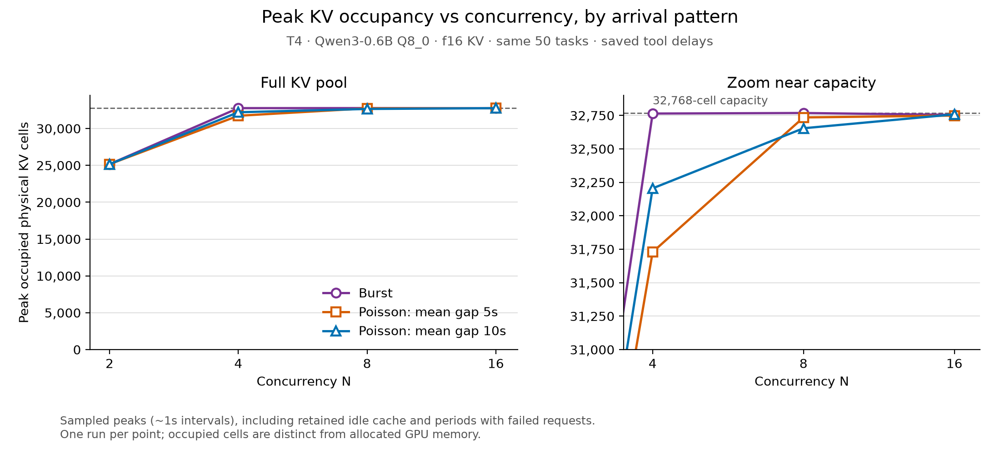

# Phase 1 results report: memory-constrained agent serving

Prepared **October 31, 2026**. This report covers the archived smoke tests, completed GPU sweeps, and available runtime microbenchmarks in this repository. All numbers describe these recorded experiments; they are not population estimates or claims about all agent workloads.

## 1. Main findings

1. **The constrained resource in the newest experiments is the configured shared KV pool, not all available T4 VRAM.** The 32,768-cell pool approaches full occupancy at N≥4, while device-wide GPU memory remains around 4,383 MiB out of 15,360 MiB.
2. **Fixed concurrency alone does not protect that pool.** In each new arrival pattern, N=2 completes 50/50 tasks. N=4 completes 46/50, N=8 completes 34/50, and N=16 completes only 18–32/50. All 138 failed tasks in the new grid have context errors; there are no recorded task timeouts.
3. **High concurrency can make successful-task latency look better by failing other tasks.** A low median among survivors is not a fair end-to-end improvement when more difficult work is removed.
4. **The earlier T4 Poisson-40s sweep was too lightly loaded to exercise N=8 or N=16 consistently.** Both reached only five active model calls at once. Faster arrivals and burst runs create materially stronger queue and KV pressure.
5. **Waiting dominates task completion under the new load.** For Poisson-10s at N=2, median task completion is 193.7s, median accumulated ready-queue waiting is 172.2s, and median summed model-request time per successful task is 19.2s. These separately computed medians need not add.
6. **Saved tool delays remain short relative to generation.** The selected workload's median tool wait per task is 0.142s, despite a 150× transformation and a 10s cap. Some waits are seconds long, but tools do not dominate the typical task.
7. **There are 32 measured size-only backfill candidate events in the new grid.** They motivate further work, but they do not establish that a predictive two-queue policy will improve performance. The current reservation estimator disagrees with observed request outcomes in both directions.
8. **The full T4 performed much better than the fractional L4 under the older matched workload configurations.** This is an operational result for these instance/runtime combinations, not an isolated GPU architecture comparison.

## 2. Evidence and scope

| Experiment family | Archived runs | Work per run | Physical KV occupancy available? |
|---|---:|---|---|
| Early Mac/L4/T4 smoke and stress checks | 10 | 6, 8, 20, or 50 tasks | No |
| Fractional-L4 Poisson sweep, v5 | 11 | Same fixed 50 tasks | No |
| T4 Poisson sweep, v5 | 11 | Same fixed 50 tasks | No |
| Two-instance T4 load sweep, v1 | 12 | Same fixed 50 tasks | Yes |
| Apple M5 runtime microbenchmarks | 5 files | 123 heterogeneous measurement rows | No new physical-cell gauges |
| Local telemetry validation | 1 | Synthetic two-step task | Yes; validation only |

The **44 agent-workload runs** contain **1,912 task executions: 1,588 completed, 324 failed, and zero recorded task timeouts**. These are repeated executions of overlapping tasks across configurations, not 1,912 independent task examples. Microbenchmark rows and the separate telemetry-validation task are excluded from these totals.

Primary evidence:

- [Early and older GPU results](../results/phase1/).
- [L4 v5 summary](../results/phase1/agenttrace_sweep_v5/summary.csv) and [T4 v5 summary](../results/phase1/t4_agenttrace_sweep_v5/summary.csv).
- [Instrumented T4 part A](../results/t4_load_v1_part_a/summary.csv) and [part B](../results/t4_load_v1_part_b/summary.csv).
- [All-run derived inventory](data/run_inventory.csv) and [instrumented T4 derived metrics](data/latest_t4_metrics.csv).
- [Runtime microbenchmark data](../results/micro/) and [KV telemetry implementation notes](../runtime/README.md).

The unsuccessful 3 GiB setup discussed during instance selection has no completed archived run in this evidence set. No quantitative performance claim is made about it. No completed 500-task or full-1,169-task serving evaluation is present.

## 3. Hardware, runtime, and the meaning of memory

### 3.1 Platforms

| Platform | Role | Important qualification |
|---|---|---|
| Apple M4 Pro, 24 GiB unified memory | Six-task Qwen smoke; local counter validation | The recorded Qwen smoke ran on **battery**, so it is not a controlled AC-powered hardware benchmark. Counter validation used a separate CPU build. |
| Apple M5, 24 GiB unified memory | Earlier runtime microbenchmarks | These use **Llama-3.2-1B Q8_0**, not the main Qwen model. |
| Fractional NVIDIA L4, 6 GiB slice | Early AWS stress tests and L4 v5 sweep | Identified during setup as a quarter-L4 allocation; recorded host RAM is about 30.2 GiB. Older per-run environment metadata does not itself record the GPU model. |
| Full NVIDIA T4, 15,360 MiB reported VRAM | T4 smokes and v5 sweep | Host RAM about 15.4 GiB; older runtime is the prebuilt b11780 deployment. |
| Two full T4 instances | New instrumented load grid | Part A runs N=2/8; part B runs N=4/16. Both use the same deployed runtime binary and library hashes. |

Main agent comparisons keep **Qwen3-0.6B Q8_0 weights** and **f16 KV** fixed. Source trace IDs containing “qwen3-1.7b” describe the model that originally produced that source trajectory; they do not mean a 1.7B model was served in these experiments.

The new runtime is source-built from upstream b11780, commit `1242be66f`, with the read-only occupancy patch and CUDA 12.8/T4 architecture target 75. Older GPU experiments used a prebuilt deployment of the same upstream release. **Do not attribute old-versus-new timing differences solely to the scheduler or arrival rate:** build/compiler/library differences are another variable. The occupancy patch does not change admission, but its collection overhead has not been measured in a dedicated A/B experiment.

### 3.2 Three quantities that must stay separate

1. **Allocated device memory:** model weights, the reserved KV buffer, compute buffers, CUDA/context overhead, and other device allocations. `gpu_memory.csv` measures device-wide allocated usage; it is not process-specific when other GPU programs exist.
2. **Physical occupied KV cells:** cells holding valid cache data inside that reserved buffer. The new `kv_memory.csv` counts shared physical cells once and includes retained idle contents.
3. **Scheduler reservations:** the diagnostic's estimated prompt-plus-maximum-output token budgets for active calls. These are neither actual occupied cells nor allocated GPU bytes.

For this Qwen f16 KV configuration, payload cost is **112 KiB/cell**:

| Configured KV capacity | Reserved KV payload |
|---:|---:|
| 16,384 cells | 1,792 MiB |
| 32,768 cells | 3,584 MiB |
| 65,536 cells | 7,168 MiB |

The T4's roughly 4.4 GiB device footprint stays nearly flat because much of the memory, especially KV, is allocated before replay. Filling an already allocated cell does not require another allocation. An idle retained cell may also be reusable or reclaimable; “occupied” does not mean “pinned by an active request.”

**These experiments impose a KV-capacity budget, not a hard cap on all GPU memory.** They do not demonstrate OS swapping, unified-memory paging, or a GPU-wide 4 GiB allocation limit. Context exhaustion with substantial free VRAM is expected when the runtime cannot grow its configured KV pool automatically.

### 3.3 Counter validation

The instrumentation was checked with the actual model on both T4 deployments before the new grid. The exporter observes zero cells initially, nonzero retained cells after a completed request with zero active generations, and zero after explicit slot erasure. A separate shared-reference probe observes **0 → 4 → 4 → 4 → 0** cells through decode, sequence copy, first-reference removal, and final-reference removal. This verifies that sharing does not double-count physical cells. The synthetic two-step runner validation records a 199-cell sampled peak in a 512-cell pool. These are measurement checks, not workload performance samples, and are excluded from the main comparison totals.

## 4. Workload and replay semantics

### 4.1 Dataset construction

The main saved file is [`agenttrace_50_seed2.jsonl`](../data/traces/agenttrace_50_seed2.jsonl), selected without replacement from the 1,169-task converted trace using seed 2. Its [manifest](../data/traces/agenttrace_50_seed2.jsonl.manifest.json) records the exact selection and hashes. It contains **35 MBPP and 15 NL2Bash tasks**, **113 planned model steps**, and **63 tool waits**.

| Steps per task | Tasks | Share |
|---:|---:|---:|
| 1 | 17 | 34% |
| 2 | 21 | 42% |
| 3 | 8 | 16% |
| 4 | 1 | 2% |
| 6 | 1 | 2% |
| 9 | 1 | 2% |
| 11 | 1 | 2% |

Thus 66% are multi-step, but only 8% have more than three steps. The sample is reproducible and random, not stratified. It does not provide broad tool diversity: the readable source uses `python_interpreter` and `bash`. The two source-model variants of an original problem are not independent task prompts; a later train/evaluation split should respect original task identity.

### 4.2 Context and response variation

| Token quantity, selected 50-task workload | Minimum | Median | p95 | Maximum |
|---|---:|---:|---:|---:|
| First-step input | 1,080 | 1,112.5 | 1,266.0 | 1,303 |
| Logical prompt across all planned steps | 1,080 | 1,826 | 9,605.8 | 14,794 |
| Requested output per step | 152 | 995 | 4,640.8 | 7,471 |

There is **little first-step prompt-length diversity**. Long contexts arise mainly from accumulated generated history and appended tool results. There is substantial output-length variation, and the complete workload requests **179,622 output tokens**. Calling the entire dataset “uniform context length” would be incorrect, but claiming a broad first-request short/long context mixture would also be incorrect.

Requests use token IDs, `temperature=0`, fixed recorded output budgets, and `ignore_eos=True`. Generated tokens are appended to later context; fixed recorded tool results are appended after the saved wait. Tools are not actually executed, and generated commands do not determine the next recorded result. This is **controlled agent-shaped replay**, not an end-to-end semantic agent benchmark. Fixed lengths prevent one policy from winning by shortening successful outputs, but they can force long generations after a natural stopping point.

Across the 44 agent runs, no request classified as successful has a recorded output count shorter than its requested budget. This is a length-consistency check, **not evidence of preserved answer quality**.

### 4.3 Controlled tool waits

The saved transformation is `min(original_delay_seconds × 150, 10 seconds)`; null delays remain null. This is a deterministic experimental transformation, not a claim that the transformed values are measured production latencies. [Transformation manifest](../data/traces/agenttrace_all_tool_delay_150x_max10s.jsonl.manifest.json).

| Delay statistic | Full 1,169-task trace | Selected 50 tasks |
|---|---:|---:|
| Median individual tool wait | 0.193s | 0.119s |
| Mean individual tool wait | 1.306s | 1.099s |
| p95 individual tool wait | 4.191s | 3.707s |
| Maximum individual tool wait | 10s | 10s |
| Median total tool wait per task | 0.122s | 0.142s |
| Mean total tool wait per task | 1.493s | 1.385s |

The full trace has 2,506 model steps and 1,337 tool waits; only 15 waits hit the cap. All new load-grid runs keep saved delays enabled at scale 1. Historical delay-zero runs are explicitly labeled ablations, not current workload settings. Actual executed wait totals can be lower when a task fails before reaching later tools.

## 5. Scheduling and metric definitions

The default **request FIFO** queues each ready model step. A worker executes one model request, releases its slot during tool sleep, and the continuation joins the FIFO tail after the tool returns. N is the maximum number of outstanding model calls, not a guarantee of N active calls. **The baseline does not reject or postpone a dispatch because its estimated KV need exceeds the remaining budget.** The diagnostic is observational.

The historical **task FIFO** instead holds a worker for the complete task, including tool sleeps. Its “running” timeline counts occupied task workers, so it should not be interpreted as the number of active model generations without additional instrumentation.

| Metric | Definition and interpretation |
|---|---|
| Task completion | Finish minus external task arrival; includes all model calls, ready-queue waits, and tools. Published p50/p95/p99 in metadata use **successful tasks only**. |
| Initial queue wait | First model admission minus task arrival (`queue_s`). |
| Accumulated ready-queue wait | Sum of waiting before every ready step (`ready_queue_s`); includes requeueing after tools. Metadata queue quantiles and successful-task breakdowns use different cohorts where stated. |
| Request latency | Client request send to request completion; distinct from complete-task latency. |
| TPOT | Main Qwen runs use client streaming time between first/last token-bearing events, normalized by event count. Stream chunks can differ from exact token boundaries; raw server timing is retained separately. |
| Throughput | Successfully completed tasks divided by elapsed workload span, in tasks/min. Failure-heavy short runs can still produce misleadingly high values if read without completion counts. |
| KV average | Time-weighted physical occupancy over the workload span, not an average of run peaks. |
| Queue/active averages | Duration-weighted piecewise-constant timeline counts over the complete run. Tool waits and not-yet-arrived tasks are not ready-queue entries. |
| GPU peak | Sampled allocated device memory, including startup; not occupied KV payload. Linux `peak_footprint_mib` is CPU RSS. |

Time-weighted occupancy is computed as:

```text
mean_used_cells = sum(used_cells[i] × duration_until_next_sample[i]) / workload_duration
mean_utilization = mean_used_cells / 32768
```

Intervals are clipped to workload start/end and held at the previous sample's value. Sampling targets approximately one second but HTTP requests wait for safe decode boundaries; observed gaps can exceed one second. Peaks may miss brief maxima. New runs report no sampler errors. A simultaneous sampled occupancy/processing count is not a decomposition of active versus idle-owned cells.

## 6. Early smoke and stress results

All rows below are burst arrivals. Full raw configuration and paths are in [the inventory](data/run_inventory.csv). Missing GPU peaks mean that device sampling was not recorded, not zero usage.

| Run | KV cells | Completed | p50 task s | p95 task s | TPOT ms | Run min | GPU peak MiB |
| --- | --- | --- | --- | --- | --- | --- | --- |
| L4: 50-task 16K N16 retry | 16,384 | 2/50 | 162.8 | 187.0 | 36.90 | 3.16 | — |
| L4: 50-task 16K N8 | 16,384 | 10/50 | 271.8 | 345.2 | 49.89 | 5.91 | — |
| L4: 50-task 32K N8 | 32,768 | 34/50 | 881.8 | 1610.4 | 82.15 | 34.69 | — |
| L4: six-task N4 | 16,384 | 6/6 | 77.8 | 151.7 | 37.58 | 2.55 | — |
| L4: six-task N8 | 16,384 | 6/6 | 96.4 | 144.6 | 49.45 | 2.43 | — |
| T4: eight-task 32K N4 | 32,768 | 8/8 | 81.6 | 187.6 | 13.32 | 4.01 | 4,383 |
| T4: 20-task 64K N16 | 65,536 | 20/20 | 77.9 | 224.5 | 35.87 | 6.08 | 7,999 |
| T4: eight-task 32K N8 | 32,768 | 8/8 | 65.5 | 215.7 | 21.32 | 4.59 | 4,377 |
| T4: eight-task 64K N8 | 65,536 | 8/8 | 54.2 | 214.6 | 19.28 | 4.66 | 7,993 |
| Mac trial | 16,384 | 6/6 | 19.0 | 37.1 | 9.45 | 0.64 | — |

### Interpretation

- The six-task L4 N4/N8 tests contain only six tasks, so N8 cannot exercise eight simultaneous tasks. Their 6/6 success is not evidence that 50-task N8 is safe.
- On L4, 16K KV with 50 tasks is severely underprovisioned: N8 completes 10/50 and N16 only 2/50. Increasing to 32K at N8 raises completion to 34/50, but does not eliminate errors. The latter run has 11 estimated size-only backfill events.
- The Mac Qwen trial's 19.0s median versus the L4 N4 smoke's 77.8s median is a recorded setup comparison, not a clean platform ranking: battery state, platform/runtime, and request timeout differ.
- The T4 eight-task N4/N8 32K tests all succeed. N8 has lower task p50 (65.6s versus 81.6s) but **longer total run duration** (275.1s versus 240.7s), worse p95 (215.7s versus 187.7s), and higher TPOT (21.3ms versus 13.3ms). A median alone would choose the wrong conclusion.
- At T4 N8, doubling KV from 32K to 64K does not establish a throughput improvement: both complete 8/8 and total durations are 275.1s/279.5s. GPU peak rises from 4,377 to 7,993 MiB, broadly consistent with allocating another 3,584 MiB of KV plus other buffers.
- The 20-task N16/64K smoke completes 20/20 with a 7,999 MiB GPU peak. It has a different selected task set from the eight-task runs, so it is a feasibility result, not a matched N8-versus-N16 experiment.

## 7. Older Poisson sweeps: L4 versus T4

These v5 runs use the same fixed 50 tasks and 32K KV. The primary comparison uses Poisson mean gap 40s; the realized arrival window is about 1,905s (31.75 minutes). Each GPU has 11 unique configurations after aliases are deduplicated.

### 7.1 Fixed-concurrency points

| GPU | N | Completed | p50 task s | p95 task s | Tasks/min | TPOT ms | Mean active |
| --- | --- | --- | --- | --- | --- | --- | --- |
| L4 slice | 1 | 50/50 | 1493.0 | 3713.1 | 0.577 | 24.99 | 1.00 |
| L4 slice | 2 | 50/50 | 767.4 | 2534.3 | 0.748 | 40.29 | 1.97 |
| L4 slice | 4 | 46/50 | 538.0 | 1413.8 | 0.901 | 66.83 | 3.85 |
| L4 slice | 8 | 34/50 | 105.3 | 338.8 | 0.936 | 58.70 | 3.74 |
| L4 slice | 16 | 31/50 | 68.6 | 269.0 | 0.856 | 52.37 | 3.08 |
| T4 | 1 | 50/50 | 38.6 | 169.1 | 1.551 | 6.31 | 0.66 |
| T4 | 2 | 50/50 | 23.3 | 143.9 | 1.562 | 9.81 | 0.95 |
| T4 | 4 | 50/50 | 32.8 | 150.0 | 1.541 | 13.63 | 1.25 |
| T4 | 8 | 50/50 | 32.6 | 148.8 | 1.522 | 13.63 | 1.27 |
| T4 | 16 | 50/50 | 32.7 | 148.5 | 1.531 | 13.62 | 1.26 |

Across all 11 points, L4 completes **468/550 task executions**; T4 completes **550/550**. At N2, which completes all tasks on both, task p50 is 767.4s on L4 versus 23.3s on T4. TPOT is 40.29ms versus 9.81ms. End-to-end differences combine service speed with accumulated queueing; the task latency ratio is not a raw token-speed ratio.

The L4 N4/N8/N16 low survivor medians are affected by failures. At T4 N8 and N16, mean active calls are only about 1.27 and 1.26, and observed maxima are five. Those points are not sustained eight- or sixteen-way inference tests. Similar throughput across T4 settings is largely constrained by the deliberately slow arrival schedule, so it does not locate maximum serving capacity.

### 7.2 Cache, scheduler, and tool-delay ablations at N4

| GPU | N4 variant | Completed | p50 task s | Reuse % | Prefill tokens | CPU RSS peak MiB |
| --- | --- | --- | --- | --- | --- | --- |
| L4 slice | Request FIFO, 8 GiB host cache | 46/50 | 621.9 | 84.7 | 48,491 | 8,816 |
| L4 slice | Request FIFO, tool delays off | 46/50 | 539.3 | 41.3 | 188,292 | 627 |
| L4 slice | Request FIFO, prompt reuse off | 46/50 | 502.8 | 0.0 | 295,558 | 634 |
| L4 slice | Task FIFO, host cache off | 50/50 | 654.2 | 93.7 | 24,540 | 627 |
| L4 slice | Request FIFO, host cache off | 46/50 | 538.0 | 37.5 | 181,703 | 625 |
| T4 | Request FIFO, 8 GiB host cache | 50/50 | 22.0 | 93.3 | 26,018 | 8,902 |
| T4 | Request FIFO, tool delays off | 50/50 | 31.8 | 94.5 | 21,164 | 727 |
| T4 | Request FIFO, prompt reuse off | 50/50 | 34.3 | 0.0 | 387,246 | 732 |
| T4 | Task FIFO, host cache off | 50/50 | 32.1 | 91.7 | 32,044 | 724 |
| T4 | Request FIFO, host cache off | 50/50 | 32.8 | 89.4 | 41,176 | 724 |

The T4 host-cache comparison is the cleaner recorded cache-only test: enabling 8 GiB host cache reduces computed prefill from 41,176 to 26,018 tokens and p50 from 32.8s to 22.0s. CPU RSS peak rises from about 724 MiB to 8,902 MiB, while GPU usage remains about 4.4 GiB. This supports a host-memory/prefill tradeoff on this run, not a statistically established latency gain.

Disabling reuse on T4 increases prefill to 387,246 tokens while all tasks still complete. p50 changes only from 32.8s to 34.3s because much of this workload is generation rather than prefill. The large shared system prefix is materially reusable, but it does not remove the cost of generating new tokens or maintaining separate growing contexts.

On L4, the task-FIFO run completes 50/50 versus request FIFO's 46/50 and computes only 24,540 prefill tokens with 93.7% reported reuse. **That is not a cache-only comparison:** holding workers changes interleaving, context retention, and concurrent pressure. Its success makes task FIFO a meaningful simple baseline for Phase 2, rather than something to dismiss because tools can block workers.

The L4 no-reuse run has a lower survivor median despite more prefill. That result is not evidence that recomputation is inherently faster: task failures, survivor composition, interference, and unreplicated execution all affect the aggregate.

Removing delays has little effect on T4 p50 (32.8s to 31.8s). On L4, p50 is also similar (538.0s to 539.3s). With these short waits, this ablation does not provide strong support for a complex tool-finish-time prediction policy.

### 7.3 Narrow arrival-rate sweep

| GPU | Mean gap s | Completed | p50 task s | Tasks/min | Mean active |
| --- | --- | --- | --- | --- | --- |
| L4 slice | 38 | 34/50 | 177.3 | 0.988 | 4.90 |
| L4 slice | 40 | 34/50 | 105.3 | 0.936 | 3.74 |
| L4 slice | 42 | 35/50 | 102.5 | 0.924 | 3.49 |
| T4 | 38 | 50/50 | 32.7 | 1.604 | 1.33 |
| T4 | 40 | 50/50 | 32.6 | 1.522 | 1.27 |
| T4 | 42 | 50/50 | 32.6 | 1.464 | 1.21 |

Changing the mean gap from 42s to 38s remains a lightly loaded regime on T4. It mostly changes elapsed arrival span and therefore measured task throughput. It does not demonstrate that the configured N8 is saturated. On L4, the workload already accumulates more queueing and failures; its higher rate sensitivity reflects a different service/load balance.

## 8. New instrumented T4 load sweep

The 12 runs vary only the intended load/concurrency factors within the deployed setup: **N=2,4,8,16 × burst, Poisson-5s, Poisson-10s**. Model, precision, 50-task file, seed, saved waits, prompt reuse, 32K unified pool, and host cache off remain fixed. Task deadline is 14,400s; request timeout is 900s. There are no observed timeouts.

Burst releases all 50 tasks together. Poisson-10s realizes about 476.25s between first and last arrival; Poisson-5s realizes about 238.12s. These are task arrivals; additional model requests become ready as agents complete tools. Both halves use identical binaries, but **N2/N8 run on one instance and N4/N16 on another**, which is a hardware-host confound that should be addressed with cross-host repeats.

### 8.1 Completion, latency, throughput, and token speed

| Arrival pattern | N | Completed | Failed | p50 task s | p95 task s | Tasks/min | TPOT ms | Run min |
| --- | --- | --- | --- | --- | --- | --- | --- | --- |
| Burst | 2 | 50/50 | 0 | 550.3 | 895.1 | 2.951 | 9.90 | 16.94 |
| Burst | 4 | 46/50 | 4 | 389.3 | 689.3 | 3.375 | 15.98 | 13.63 |
| Burst | 8 | 34/50 | 16 | 305.5 | 429.2 | 4.000 | 24.43 | 8.50 |
| Burst | 16 | 18/50 | 32 | 104.0 | 215.9 | 4.803 | 31.20 | 3.75 |
| Poisson 10s | 2 | 50/50 | 0 | 193.7 | 645.3 | 2.980 | 9.84 | 16.78 |
| Poisson 10s | 4 | 46/50 | 4 | 138.2 | 348.0 | 3.414 | 16.76 | 13.47 |
| Poisson 10s | 8 | 34/50 | 16 | 47.0 | 118.4 | 3.414 | 17.43 | 9.96 |
| Poisson 10s | 16 | 32/50 | 18 | 23.0 | 65.2 | 3.554 | 14.94 | 9.00 |
| Poisson 5s | 2 | 50/50 | 0 | 353.9 | 771.3 | 2.953 | 9.73 | 16.93 |
| Poisson 5s | 4 | 46/50 | 4 | 222.4 | 527.5 | 3.256 | 15.91 | 14.13 |
| Poisson 5s | 8 | 34/50 | 16 | 83.4 | 219.5 | 4.140 | 23.96 | 8.21 |
| Poisson 5s | 16 | 22/50 | 28 | 25.5 | 53.9 | 4.110 | 15.43 | 5.35 |

All three N2 configurations complete all 50 tasks and generate the full planned 179,622 output tokens. N4 loses four tasks under every arrival pattern; N8 loses sixteen under every pattern. N16 loses 18, 28, or 32 tasks as arrivals become more concentrated. Overall, the grid completes **462/600 task executions** and records **138 context-error failures**, across 1,153 issued model requests.

For N2, total durations remain close to 1,007–1,017s across arrival patterns: the GPU has a sustained backlog for much of the run, and the same work must eventually finish. Bringing arrivals closer raises median waiting even though total completion time changes little: p50 rises from 193.7s (10s gaps) to 353.9s (5s gaps) to 550.3s (burst).

The burst N16 row illustrates survivor bias: 103.96s p50 and 4.80 tasks/min coexist with only **18/50 completed tasks**. It should not be called the best policy. Error-free completion, tail latency, completed work under a common horizon, and a common successful-task cohort must accompany aggregate speed comparisons.

Increasing concurrency raises per-request token latency in the sustained burst regime: median TPOT is 9.90, 15.98, 24.43, and 31.20ms at N2/4/8/16. Requests share a GPU, and larger decoding batches perform more work per step. These measurements do **not** isolate whether arithmetic, memory bandwidth, kernel selection, CPU dispatch, or runtime overhead is the binding resource. Available VRAM and a high utilization snapshot cannot answer that question.

Supplementary task-tail and request timing measurements:

| Arrival pattern | N | Task p99 s | Request p50 s | TTFT p50 s | TTFT p95 s | Generated tokens/s |
| --- | --- | --- | --- | --- | --- | --- |
| Burst | 2 | 987.0 | 12.57 | 0.095 | 2.089 | 176.7 |
| Burst | 4 | 770.4 | 20.62 | 0.109 | 2.922 | 199.7 |
| Burst | 8 | 485.8 | 24.53 | 0.108 | 2.589 | 227.9 |
| Burst | 16 | 223.1 | 21.74 | 1.290 | 5.395 | 149.6 |
| Poisson 10s | 2 | 798.2 | 11.83 | 0.094 | 2.691 | 178.4 |
| Poisson 10s | 4 | 480.0 | 18.41 | 0.149 | 2.414 | 199.5 |
| Poisson 10s | 8 | 208.6 | 19.59 | 0.103 | 1.653 | 185.1 |
| Poisson 10s | 16 | 102.1 | 14.40 | 0.059 | 0.512 | 175.6 |
| Poisson 5s | 2 | 905.5 | 12.55 | 0.078 | 2.287 | 176.8 |
| Poisson 5s | 4 | 712.7 | 17.61 | 0.125 | 2.599 | 198.8 |
| Poisson 5s | 8 | 288.6 | 21.68 | 0.196 | 2.303 | 190.2 |
| Poisson 5s | 16 | 80.5 | 12.38 | 0.106 | 0.623 | 143.4 |

Task p99 is also conditional on success; with only 18–50 survivors it is especially unstable. Request timing columns use successful requests, including successful earlier steps of a task that may later fail. Generated tokens/s is successful-request output divided by complete-run elapsed time, so it includes output from those partial tasks and is not a completed-task-quality metric. A low TTFT relative to request duration is consistent with generation dominating model service in this replay.

### 8.2 Physical KV occupancy

| Arrival pattern | N | Peak cells | Peak % | Mean cells | Mean % |
| --- | --- | --- | --- | --- | --- |
| Burst | 2 | 25,160 | 76.78 | 10,875 | 33.19 |
| Burst | 4 | 32,764 | 99.99 | 18,682 | 57.01 |
| Burst | 8 | 32,768 | 100.00 | 24,501 | 74.77 |
| Burst | 16 | 32,754 | 99.96 | 27,904 | 85.16 |
| Poisson 10s | 2 | 25,160 | 76.78 | 10,590 | 32.32 |
| Poisson 10s | 4 | 32,205 | 98.28 | 16,453 | 50.21 |
| Poisson 10s | 8 | 32,654 | 99.65 | 17,415 | 53.15 |
| Poisson 10s | 16 | 32,758 | 99.97 | 15,222 | 46.45 |
| Poisson 5s | 2 | 25,160 | 76.78 | 10,731 | 32.75 |
| Poisson 5s | 4 | 31,729 | 96.83 | 17,377 | 53.03 |
| Poisson 5s | 8 | 32,735 | 99.90 | 22,875 | 69.81 |
| Poisson 5s | 16 | 32,749 | 99.94 | 16,074 | 49.05 |



The 32K pool reaches at least 99.65% sampled occupancy for every N8/N16 point. All N2 peaks are exactly 25,160 cells (76.78%) for this fixed workload. Larger concurrency provides enough overlapping growing contexts to approach the configured capacity, even though total VRAM still has substantial free space.

Time averages answer a different question. Burst N8 averages 74.77% occupancy, whereas Poisson-10s N8 averages 53.15%; both approach full at some point. Poisson N16 averages fall below N8 despite near-full peaks because the issued work differs after early failures and the workload contains periods with few ready calls. They are not evidence of better memory efficiency.

GPU sampled peak is 4,383 MiB in eleven points and 4,381 MiB in burst N16. That flat allocation is compatible with large changes in occupied cells. CPU RSS peaks range separately around 702–751 MiB; adding them to device-wide VRAM is not a precise total resident-memory accounting model.

N4/Poisson-5s fails despite a sampled peak of 96.83%. This is not contradictory: snapshots can miss the immediate failure state, and the runtime must fit upcoming allocations/decoding work, not merely the current sampled occupancy. It is not proof that a request could safely be admitted whenever sampled usage is below 100%.

### 8.3 Queue and active-request utilization

| Arrival pattern | N | Mean active | Max active | Mean ready queue | Max ready queue | Time at N active % | Spare workers + empty queue % |
| --- | --- | --- | --- | --- | --- | --- | --- |
| Burst | 2 | 1.93 | 2 | 23.83 | 48 | 93.50 | 6.50 |
| Burst | 4 | 3.53 | 4 | 21.65 | 46 | 80.94 | 19.06 |
| Burst | 8 | 6.58 | 8 | 23.15 | 42 | 75.03 | 24.97 |
| Burst | 16 | 8.93 | 16 | 8.79 | 34 | 36.79 | 63.21 |
| Poisson 10s | 2 | 1.97 | 2 | 10.40 | 23 | 96.53 | 3.47 |
| Poisson 10s | 4 | 3.59 | 4 | 7.52 | 19 | 80.43 | 19.57 |
| Poisson 10s | 8 | 4.57 | 8 | 1.35 | 9 | 34.38 | 65.62 |
| Poisson 10s | 16 | 3.63 | 11 | 0.00 | 1 | 0.00 | 100.00 |
| Poisson 5s | 2 | 1.94 | 2 | 16.35 | 36 | 93.93 | 6.07 |
| Poisson 5s | 4 | 3.60 | 4 | 13.13 | 32 | 83.23 | 16.77 |
| Poisson 5s | 8 | 6.13 | 8 | 5.26 | 16 | 65.85 | 34.15 |
| Poisson 5s | 16 | 4.27 | 14 | 0.00 | 1 | 0.00 | 100.00 |

The timeline records almost no time with **both spare workers and a nonempty ready queue**: each new point is below 0.003%. The FIFO is work-conserving with respect to its concurrency ceiling. Low average active count is therefore not evidence that it voluntarily waits for memory to become free.

For N8, burst holds eight active calls for **75.03%** of the run, versus **34.38%** under Poisson-10s. Mean active count rises from 4.57 to 6.58, and mean waiting queue rises from 1.35 to 23.15. Remaining quieter periods reflect exhausted ready work, draining/completing tasks, tools, and failures.

Poisson N16 never reaches sixteen active calls: maxima are 11 (10s gaps) and 14 (5s gaps), with effectively no waiting queue. Burst does reach sixteen, but only for 36.79% of its shortened, failure-heavy run. Configured concurrency must therefore be reported alongside realized activity.

### 8.4 Why task medians are high

In Poisson-10s N2, one task near the median takes **197.23s = 181.63s accumulated ready-queue waiting + 12.60s model requests + 3.00s tools** (plus approximately 0.002s overhead). For Poisson-10s N4, another near-median task takes about **135.08s = 87.80s waiting + 46.89s model requests + 0.39s tools**.

These task examples are additive decompositions. The separately reported population medians are not. In particular, `service_s` in the existing runner is finish minus first admission and includes later queueing/tool waits; it should not be renamed “pure inference time.”

The configured Poisson-10s arrival rate is about six new tasks/minute, while observed completed-task throughput is roughly three to four/minute. This finite workload therefore builds a backlog at low N. Observed throughput under failures is not a clean estimate of error-free system capacity.

## 9. Backfill opportunities and estimator reliability

The diagnostic computes:

```text
need(request) = full logical prompt tokens + requested maximum output tokens
remaining_estimate = configured KV cells - sum(need(active requests))
candidate event = oldest need > remaining_estimate
                  AND at least one later queued ready request individually fits
```

It is a conservative reservation heuristic in some cases and an incomplete cache model in others. It ignores exact physical sharing and retained-idle cache state. It does not simulate scheduling the candidate or enforce a waiting-time allowance.

| Arrival pattern | N | Dispatches | Estimated head exceed | Size-only candidates | Estimated fit → error | Estimated exceed → success |
| --- | --- | --- | --- | --- | --- | --- |
| Burst | 2 | 113 | 0 | 0 | 0 | 0 |
| Burst | 4 | 106 | 6 | 2 | 2 | 4 |
| Burst | 8 | 91 | 50 | 8 | 3 | 37 |
| Burst | 16 | 68 | 51 | 0 | 4 | 23 |
| Poisson 10s | 2 | 113 | 0 | 0 | 0 | 0 |
| Poisson 10s | 4 | 108 | 4 | 2 | 1 | 1 |
| Poisson 10s | 8 | 90 | 36 | 3 | 1 | 21 |
| Poisson 10s | 16 | 83 | 18 | 0 | 5 | 5 |
| Poisson 5s | 2 | 113 | 0 | 0 | 0 | 0 |
| Poisson 5s | 4 | 112 | 8 | 7 | 2 | 6 |
| Poisson 5s | 8 | 88 | 39 | 10 | 5 | 28 |
| Poisson 5s | 16 | 68 | 19 | 0 | 11 | 2 |

There are **231 estimated-head-exceed dispatch events** and **32 size-only candidate events** in the new grid. Thirty-two events are not thirty-two proven task completions gained; events can concern overlapping queue situations, and the counter is collected under FIFO's trajectory rather than a counterfactual memory-aware execution.

For example, in N4/Poisson-10s at about 682.55s, the estimate has 10,251 cells remaining. The oldest request needs 10,414 tokens. Five later requests fit individually; the smallest needs 2,598. This is an understandable candidate for bypassing the oldest request if runtime and fairness constraints also permit it.

The estimate is not reliable enough to use blindly. Across the new grid:

- **34 requests estimated to fit still return errors.**
- **127 requests estimated to exceed the budget nevertheless succeed.**

These are disagreements with eventual request outcomes, not a calibrated classifier confusion matrix for true instantaneous physical fit. Errors can be caused by later context growth and interference; successful requests can reuse prefixes or finish after other requests release cells. They still demonstrate why the estimator needs calibration before becoming an admission rule.

N16 has zero recorded size-only candidates despite many errors. Under Poisson it has essentially no queued alternatives; under burst its full-output reservations can leave no smaller request that fits the estimated remainder. More KV pressure does not automatically create useful backfill work. A memory-aware FIFO would also change the ready queue and could create candidate states that this unconstrained FIFO never visits.

## 10. Supporting microbenchmark evidence

These five files are useful runtime characterization, but their Apple M5/Llama-3.2-1B configuration differs from the Qwen GPU experiments. They must not be pooled into Qwen throughput averages.

### 10.1 M1: static allocation and memory measurement

Ten configurations complete without recorded request errors. Reported KV allocation is 64/128/256/512/1024/2048 MiB for 2K/4K/8K/16K/32K/64K cells: **32 KiB/cell for this Llama model**. Changing slots from 1 to 32 with a unified 16K pool leaves KV allocation at 512 MiB. Model/OS mapping behavior affects footprint: the 8K no-mmap case has about 2,179 MiB idle footprint versus about 372 MiB with mmap. Neither value should be interpreted as all GPU allocation.

The static-allocation finding supports distinguishing occupied cells from reservation. The 32 KiB constant does not apply to Qwen; Qwen's corresponding cost is 112 KiB/cell.

### 10.2 M2: prefill results are incomplete

Only **one of three** recorded requests succeeds. The 1,024-token point has TTFT 1.464s (about 700 token/s from the client metric). The 128- and 8,192-token points report `ServerDisconnectedError`. A prefill scaling curve or robust estimator cannot be fitted to this file. These failed points should be repaired/repeated before use.

### 10.3 M3: batching tradeoff and a timing anomaly

All 42 recorded request rows succeed, covering six context/concurrency combinations. Batch wall-time throughput is:

| Prompt tokens | Batch 1 tok/s | Batch 4 tok/s | Batch 16 tok/s |
|---:|---:|---:|---:|
| 128 | 34.46 | 164.00 | 159.57 |
| 2,048 | 19.46 | 34.74 | 51.02 |

These are individual recorded batches, not replicated confidence intervals. Raw `tpot_ms` is internally inconsistent for some rows: e.g. the 128-token/B4 case records roughly 4,443ms/token while the whole request lasts about 3.12s. For interpretation, reconstruct approximate client TPOT from `(t_end - t_first)/(predicted_n - 1)` instead of trusting those fields:

| Prompt tokens | Batch 1 ms/token | Batch 4 ms/token | Batch 16 ms/token |
|---:|---:|---:|---:|
| 128 | 27.82 | 22.10 | 96.71 |
| 2,048 | 38.20 | 71.27 | 210.18 |

The reconstructed values include final-message overhead and are not identical to the newer client's first-to-last-token metric. This artifact limits use of older server-reported timings to train an estimator. The newer Qwen main runs use separate client timing fields.

### 10.4 M4: prefix reuse helps TTFT

Four requests succeed. Reuse reduces next-step TTFT from 0.314s to 0.077s at context 256 (4.09×), and from 4.508s to 0.347s at context 4,096 (12.98×). These are single observed pairs. They establish that reusable context can matter for prefill, not a universal end-to-end agent speedup.

### 10.5 M5: idle time versus interleaving

All 64 recorded rows succeed. At one/four/eight interleaved sessions, the `unified+ram` setup retains about 96.97% prompt reuse at later steps. With host cache off, one/four sessions retain similar reuse, but eight sessions fall to zero and next-step median TTFT rises to 2.385s. The recorded 0s/10s idle-gap cases with host cache enabled both retain about 97.03% reuse.

This supports the distinction between **elapsed idle time** and **other sessions displacing a context**. The metadata lists additional configurations that have no recorded rows; the file does not substantiate results for all those configurations. No archived M6 capacity dataset is available in this report's evidence set.

## 11. What the results support for Phase 2

### 11.1 Start with memory-aware admission, then test backfill

The strongest demonstrated problem is unsafe admission under a fixed KV budget. The first useful comparison is therefore **memory-aware FIFO versus the tuned safe fixed-concurrency FIFO**, followed by the two-queue extension. Keep the same model, precision, requests, budgets, waits, and capacity. A correct policy should avoid context failures without silently rejecting, truncating, or abandoning difficult tasks.

For the new 32K/50-task load grid, **N2 is the only tested fixed concurrency that completes every task across all arrival patterns**. It is a defensible provisional safe baseline for this workload, not proof that N2 is universally optimal. A policy should also compare against all tested fixed-N points with failures visible, and against task FIFO where it preserves reusable context effectively.

### 11.2 Calibrate what “fits” means

Use prompt length, requested output budget, current active reservations, physical occupancy, and observed cache reuse. Establish a policy for idle/reclaimable contents; total occupancy alone is not a non-evictable-memory budget. Include a safety margin and test the estimator against full task completion, not just admission-time snapshots. Validate on more than this one 50-task sample before declaring a general estimator.

The source runtime has a preallocated KV buffer, so a token-budget admission policy can be a valid memory-aware mechanism. Do not describe it as dynamically growing GPU memory or managing OS swap. A separate GPU-wide memory-cap experiment would require a different mechanism and validation.

### 11.3 Treat the two-queue policy as a hypothesis

The proposed rule—try the oldest ready request, consider smaller fitting requests when it cannot fit, and require predicted runtime to fit within its remaining wait allowance—is plausible. The workload has output/context variation and some observed candidate events. What remains unproven is whether bypassing improves completed work or tail latency beyond safe FIFO admission, and whether long tasks suffer.

Measure candidate count, accepted bypass count, candidate runtime prediction error, actual oldest-request delay, maximum wait, completion by step-count/output-length bucket, failure count, and scheduling overhead. Set a finite aging/wait bound and never interrupt an active generation. Run a no-benefit workload too: the lightly loaded T4 Poisson-40s regime is an example where few or no candidates should be available.

### 11.4 Keep tool prediction separate from the current proposal

Saved waits create ready/unready transitions and change which contexts can be reused; that is already useful to admission experiments. The present proposal does **not** contain a validated tool-completion estimator. Its wait allowance is not automatically an estimate of when a tool returns.

Since typical tool waits are much shorter than model service in this sample, a complex “wait for the tool instead of admitting work” mechanism is not yet motivated by measured gains. If tool-return prediction becomes part of the policy, evaluate an explicitly labeled delay sensitivity study with reproducible, tool-conditioned patterns while preserving the original saved dataset. Do not retroactively call longer synthetic waits realistic without supporting measurements.

## 12. Limitations and remaining evaluation work

- **Sample size:** 50 distinct selected trajectories, reused across many runs; no 500-task/full-dataset main evaluation yet. Long multi-step tasks are sparse.
- **No repeated trials:** single runs per configuration cannot separate timing variation from stable effects. No confidence intervals are claimed.
- **Host assignment:** new N2/N8 versus N4/N16 is confounded with two physical EC2 hosts. Rotate/repeat matched settings across hosts before strong causal claims.
- **Build change:** old prebuilt and new source-built runtime results are separate experimental generations. There is no isolated measurement of patch/scraping overhead.
- **No hard total-GPU cap:** constrained KV is measured; paging/swapping/global-memory exhaustion is not.
- **Cache occupancy versus pinning:** gauges include idle retention and do not expose active ownership, exact reclaimable cells, or eviction counts. Do not infer these from total occupancy or slot lengths.
- **Failure-dependent work:** failed tasks issue fewer later steps, alter cache contents and queue pressure, and can make both mean occupancy and latency look better. Evaluate matched cohorts and a common task set, but retain failures in the main success denominator.
- **Replay quality:** tools/results are fixed, generated text is not scored, and ignore-EOS outputs can be unnaturally long. Output-budget agreement is necessary but insufficient for task-quality equivalence.
- **Metric gaps:** physical occupancy exists only for the new grid and validation. M2 is incomplete, older M3 server TPOT is unreliable, and early GPU-memory peaks are missing. Older logs cannot retroactively provide physical KV occupancy.
- **Coverage gaps:** tool types and first-step context lengths are narrow. There is no calibrated runtime/tool estimator, implemented predictive scheduler, policy-overhead measurement, or starvation/fairness evaluation yet.

These experiments provide a reproducible FIFO baseline, useful runtime/cache characterization, and a measured KV-admission problem. They do not yet establish a completed Phase 2 improvement or a full-scale Phase 1 generalization result.

## 13. Reproduction and artifact index

Recompute all report-derived averages and tables without running inference:

```bash
python -m analysis.build_results_report
```

Recreate the exported KV figure and its peak CSV:

```bash
python -m analysis.plot_t4_kv
```

Key files:

| Artifact | Purpose |
|---|---|
| [All-run inventory](data/run_inventory.csv) | 44 agent runs, original summary metrics, source paths, derived timeline statistics |
| [Latest T4 metrics](data/latest_t4_metrics.csv) | All 12 instrumented points with time-weighted KV/queue/active averages and diagnostic outcomes |
| [Peak KV figure PDF](../results/analysis/t4_load_v1/peak_kv_by_arrival.pdf) | Standalone plot for export |
| [Peak KV figure CSV](../results/analysis/t4_load_v1/peak_kv_by_arrival.csv) | Exact peak cells and percentages used in the plot |
| [Split sweep definition](../docs/t4_split_sweeps.md) | Run assignment, controlled factors, result-commit/stop behavior |
| [Runner](../phase1/runner.py) and [sweep](../phase1/sweep.py) | FIFO semantics, summary definitions, exact grids |
| [Occupancy patch and validation](../runtime/) | Physical-cell instrumentation, supported cache implementation, reproducible checks |

For each agent run, `tasks.csv` and `requests.csv` supply outcomes and latency; `timeline.csv` supplies event-driven queue counts; `memory.csv` is process memory; `gpu_memory.csv` is device allocation where available; `admission_checks.csv` records reservation estimates. The new runs additionally contain `kv_memory.csv`. Per-run `meta.json` and group `provenance.txt` document configuration and hashes.

Main artifact hashes:

```text
Qwen3-0.6B-Q8_0.gguf
9465e63a22add5354d9bb4b99e90117043c7124007664907259bd16d043bb031

agenttrace_50_seed2.jsonl
84a8ff891dce683ace8682787957dc888b2198aed36412554f355cdd1d2f15a1

instrumented llama-server executable, identical on both new T4 hosts
286ddc0b5becb98eb1cb4503ebeeac78860c1a698dad2bad5ae9d2a2d414db7c
```

The executable hash alone does not identify shared libraries; both parts' provenance files also record library hashes. Original AWS result commits are `aa1776d` (A) and `baf7c98` (B); integration/plot artifacts were pushed through `5ab9e9d`. This report and its generated metrics are separate later artifacts.
