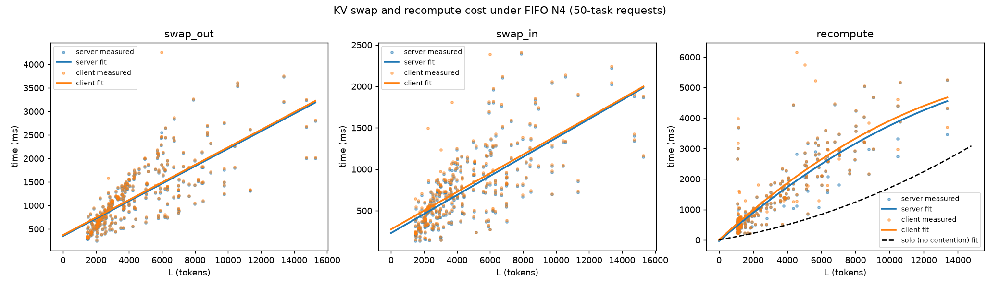

# Swap vs stay vs recompute: KV cost models under FIFO N4

Cost models for a scheduler that decides, per waiting task, whether to keep its KV cache on the GPU (stay),
move it to host memory (swap) or drop it and recompute later (recompute):

| Model | Form | L |
|---|---|---|
| Swap out, GPU → CPU | `T_out(L) = a_out·L + b_out` | tokens in the slot (prompt + generated so far) |
| Swap in, CPU → GPU | `T_in(L) = a_in·L + b_in` | tokens restored |
| Recompute (prefill) | `T_rc(L) = c + d·L + e·L²` | prompt tokens prefilled from an empty cache |

Times are in ms. Stay costs no time but keeps `L × 112 KiB` of the 32K-cell pool occupied.

## Fitted parameters (FIFO N4, 50-task requests)

From [`params.json`](params.json) (server-side timings; the `client` variants in that file add ~16–17 ms of
queueing and HTTP and are otherwise the same):

| Model | Parameters | R² | MAPE | 5-fold CV R² |
|---|---|---:|---:|---:|
| Swap out | `a_out = 0.1856 ms/token`, `b_out = 351.6 ms` | 0.60 | 33% | 0.60 |
| Swap in | `a_in = 0.1146 ms/token`, `b_in = 230.5 ms` | 0.53 | 41% | 0.53 |
| Recompute | `c = −34.5 ms`, `d = 0.4840 ms/token`, `e = −1.054e−5 ms/token²` | 0.80 | 29% | 0.80 |
| Recompute, `e` fixed at 0 | `c = 118.3 ms`, `d = 0.3779 ms/token` | 0.79 | 31% | 0.79 |
| Recompute, solo reference | `c = 10.1 ms`, `d = 0.0906 ms/token`, `e = 7.94e−6 ms/token²` | 0.9999 | 1% | – |

Fit range: swap L = 1,462–15,293 tokens; recompute L = 1,080–13,383 tokens. Do not extrapolate.



## What the numbers say

- **Recompute under N4 is about 4–5× slower per token than alone.** Median 0.41 ms/token under N4 vs
  0.09 ms/token solo: a prefill shares every server step with the other three requests' decoding.
- **Under N4 the recompute curve is concave (`e < 0`).** Contention, not attention, dominates the cost here.
  The free fit peaks near L ≈ 23K tokens and must not be used beyond the fitted range; the `e = 0` fit is
  almost as good (R² 0.79 vs 0.80) and safer to extrapolate a little. Solo, the expected small positive `e`
  appears.
- **Swap through llama.cpp is slow and noisy.** Effective bandwidth is about 0.62 GB/s out and 1.0 GB/s in,
  far below the T4's PCIe Gen3 ×8 link (~7.9 GB/s). The slot save/restore path copies tensor by tensor and
  writes a file (here on RAM-backed `/dev/shm`). The fixed costs are large too: about 350 ms out and 230 ms in.
- **All three models are noisy under N4.** The same request varies by a median of 16% (swap out), 25% (swap in)
  and 23% (recompute) between repetitions, depending on what the other three workers are doing. Treat the fits
  as expected values; R² 0.5–0.8 is the ceiling with L alone. Adding a contention feature (e.g. number of
  requests decoding) is the obvious next term.
- **Rough break-even at N4:** a round trip `T_out + T_in ≈ 0.300·L + 582 ms`, recompute `≈ 0.378·L + 118 ms`
  (e = 0 fit). Swap starts to beat recompute only above roughly L ≈ 6K tokens, and at most lengths the
  difference between them is smaller than the scatter. The swap-out time is paid when the task leaves; recompute is paid when it returns.

## Richer models used by the KV policy

The L-only fits leave 30–40% mean error. Two measurable factors explain much of it, and the KV policy in
[`experiments/kv_policy/`](../experiments/kv_policy/README.md) uses these models (`params.json` → `policy_models`):

| Model | Form | Parameters (ms) | R² | MAPE | CV MAPE |
|---|---|---|---:|---:|---:|
| Swap out, split length | `b + a_p·P + a_g·G` | b 150.2, a_p 0.1417, a_g 0.4185 | 0.83 | 19% | 19% |
| Swap in, split length | `b + a_p·P + a_g·G` | b 140.6, a_p 0.0950, a_g 0.2185 | 0.63 | 35% | 36% |
| Recompute, contention | `c + d·L + f_dec·L·n_dec + f_pre·L·n_pre + g·dec_ctx` | c −126.2, d 0.5466, f_dec −0.0534, f_pre −0.0876, g 0.0228 | 0.83 | 26% | 27% |

- **P** = tokens that were prefilled (stored contiguously), **G** = tokens that were generated one at a time.
  With four requests decoding together in the unified pool, generated tokens land in cells scattered between
  other requests' cells, and llama.cpp copies one contiguous range at a time: a generated token costs about
  3× more to swap out than a prompt token.
- **n_dec / n_pre** = how many other requests were decoding / prefilling during this prefill (overlap-weighted),
  **dec_ctx** = the context those decoders attend over. Reconstructed from each request's recorded timings.
  At decision time the policy uses the current number of running requests and their contexts.
- Contention adds nothing for swap. The likely reason (not verified in the llama.cpp source) is that the
  server's main loop runs a save or restore on its own, so other requests pause during the copy instead of
  slowing it.
- Swap in improves least; its remaining error probably depends on how fragmented the free cells are when the
  restore runs, which was not recorded.

## Assumptions

- Requests are independent: tool waits and task structure are ignored; each request keeps the prompt length and
  output budget it has in the 50-task trace.
- Prompt content does not affect timing, so prompts are random ordinary-vocabulary tokens; this also guarantees
  that no request reuses another's cache, so every prefill is a full recompute.
- Swap means llama.cpp's slot save/restore to a RAM-backed tmpfs (`/dev/shm`): the only GPU↔host path this
  runtime exposes. Save and restore block the server loop while they run.
- The FIFO N4 contention in the measurement is representative of the runs the models are used in (same server
  configuration, 4 concurrent requests, no tool waits so the GPU is never idle).
- Requests that fail with "Context size has been exceeded" are excluded (36 of 339).

## How it was measured

[`measure.py`](measure.py) treats every model request of `data/traces/agenttrace_50_seed2.jsonl` (113
requests) as an independent job and ignores tool waits and task structure. Each request keeps its prompt
length and output budget; prompts are random tokens, so no request reuses another's cache.

- Server: the Phase 1 N4 configuration (Qwen3-0.6B Q8_0, f16 KV, `-c 32768 -np 4 -kvu --cache-ram 0`,
  no mmap, instrumented b11780 runtime), plus `--slot-save-path` on `/dev/shm`.
- Scheduler: one FIFO queue, 4 workers, all requests queued at t = 0, shuffled per repetition (seed 2 + rep).
  Worker *w* uses slot *w*.
- Per request: erase slot → generate the full output (recompute time = server `prompt_ms`) → save slot
  (swap out = `save_ms`) → erase → restore (swap in = `restore_ms`) → resend prompt + output with
  `n_predict 1` to check the restore is reused → erase. Save and restore happen while the other three workers
  keep decoding.
- 3 repetitions, 339 requests. 36 (11%) failed with "Context size has been exceeded", the same pool overflow
  as the Phase 1 N4 runs, and are excluded; they cover 26 distinct requests with prompts of 1.1K–14.8K tokens.
  303 measurements remain for every model.
- Checks: every prefill started from an empty cache (0 tokens reused); 112 KiB moved per token, matching the
  model's KV cost; 301 of 303 restores were fully reused by the next request. The other 2 (the same request in
  two repetitions) were only partly reused: the restore worked but the resent tokens diverged after about
  1.5K tokens.

[`fit.py`](fit.py) fits ordinary least squares on all measurements, with 5-fold cross-validation grouped by
request so repetitions of one request never span train and test. It also fits the no-contention reference
from `results/solo_SLO/smoke50_v1/evict/requests.csv` when that file exists.

## Files

| File | Contents |
|---|---|
| `measure.py` | Runs the server and the measurement |
| `fit.py` | Fits the models; writes `params.json`, `fit_report.md`, `fit.png` |
| `data/measurements.csv` | One row per request and repetition: lengths, prefill, save and restore timings (server and client), bytes, verification |
| `data/trace_requests.csv` | The 113 requests: task, step, prompt length, output budget |
| `data/meta.json`, `data/server.log`, `measure.log` | Environment, server arguments, run logs |
| `params.json` | All fitted parameters and fit metrics, including `policy_models` and the solo reference |
| `fit_report.md`, `fit.png` | Fit summary and the L-only fits plotted against the measurements |

## Reproduce

```bash
export MODEL=/path/to/Qwen3-0.6B-Q8_0.gguf LLAMA_SERVER=/path/to/instrumented/llama-server
uv run python -m swap_vs_stay_vs_recompute.measure --reps 3   # ~60 min on the T4
uv run python -m swap_vs_stay_vs_recompute.fit
```

## Limits

- Swap is measured through llama.cpp's slot save/restore, the only path this runtime offers. A custom
  pinned-memory copy could be several times faster, so these are upper bounds for swap on this hardware.
- The models use L only. Under N4 the cost also depends on what else is running.
- 50-task requests only: lengths above ~15K tokens are not covered, and the longest requests are the ones
  most likely to fail on context size and drop out.
